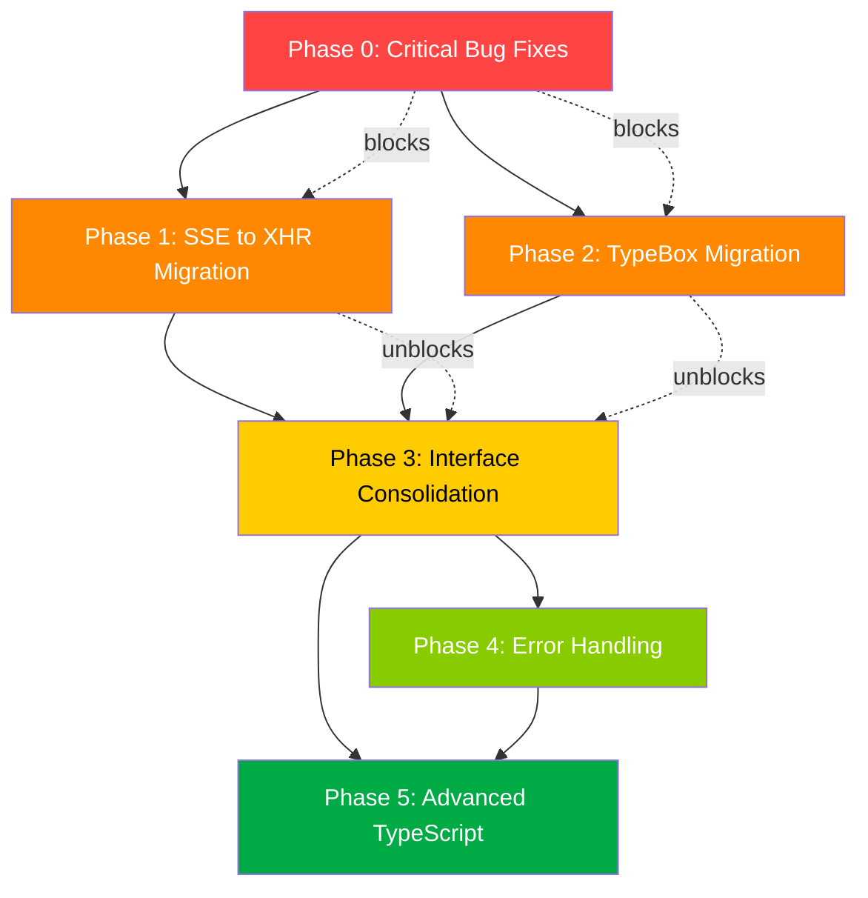

# Buddy Wallet — Implementation Plan V2

**Date:** May 2026  
**Status:** 🔴 READY FOR EXECUTION  
**Scope:** Critical bug fixes, SSE→XHR migration, TypeBox migration, interface consolidation, error handling, advanced TypeScript  
**Sources:** 3 audit files + deep codebase scan

---

## Table of Contents

1. [Executive Summary](#executive-summary)
2. [Dependency Graph](#dependency-graph)
3. [Phase 0: Critical Bug Fixes](#phase-0-critical-bug-fixes-immediate--blocks-everything)
4. [Phase 1: SSE to XHR Migration](#phase-1-sse-to-xhr-migration)
5. [Phase 2: TypeBox Migration & Schema Consolidation](#phase-2-typebox-migration--schema-consolidation)
6. [Phase 3: Interface Consolidation (Generics)](#phase-3-interface-consolidation-generics)
7. [Phase 4: Error Handling & Code Quality](#phase-4-error-handling--code-quality)
8. [Phase 5: Advanced TypeScript Patterns](#phase-5-advanced-typescript-patterns)
9. [Summary Table](#summary-table)
10. [Rollback Strategies](#rollback-strategies)
11. [Testing Checklists](#testing-checklists)

---

## Executive Summary

| Phase | Priority | Risk | Files Changed | Status |
|-------|----------|------|---------------|--------|
| Phase 0: Critical Bug Fixes | 🔴 P0 — IMMEDIATE | High | 5 | Pending |
| Phase 1: SSE → XHR Migration | 🔴 P0 | Medium | 5 | Pending |
| Phase 2: TypeBox Migration | 🔴 P0 | High | 15+ | Pending |
| Phase 3: Interface Consolidation | 🟡 P1 | Medium | 20+ | Pending |
| Phase 4: Error Handling | 🟡 P1 | Low | 10+ | Pending |
| Phase 5: Advanced TypeScript | 🟢 P2 | Low | 5+ | Pending |

**Critical Findings NOT in audits (discovered via deep scan):**

| Finding | Severity | Impact |
|---------|----------|--------|
| Redis queue name mismatch: API→`bw:queue:imports`, Worker→`import_jobs` | 🔴 CRITICAL | Jobs enqueued by API are NEVER consumed by worker |
| Redis progress key mismatch: API reads `bw:job:{jobId}`, Worker writes `bw:import:{logId}` | 🔴 CRITICAL | SSE/XHR progress will NEVER show real-time updates |
| DebtStatus missing `disputed` in handler types | 🔴 CRITICAL | Handler rejects valid status transitions |
| DebtDirection uses `'owed'/'owing'` in handler but `'LEND'/'BORROW'` in types | 🔴 CRITICAL | Direction values never match between layers |
| Magic number contradictions: `MAX_PENDING_DEBTS` is 10 in handler, 200 in config | 🔴 CRITICAL | Production limit is 10x stricter than intended |
| Frontend polling calls non-existent `progress-batch` endpoint | 🟡 HIGH | SSE fallback is completely broken |
| `JSON.parse(log.errors)` without try-catch | 🟡 HIGH | Malformed JSON crashes the endpoint |
| `apiSuccess`/`apiError` return `Record<string, unknown>` | 🟡 MEDIUM | Type information lost at every handler boundary |
| S3 `delete()` silently swallows errors | 🟡 MEDIUM | Callers never know deletion failed |
| Worker uses `any` types for `autoMapping` and `newDebts` | 🟡 MEDIUM | No compile-time safety in import processing |

---

## Dependency Graph



**Phase ordering rationale:**
- Phase 0 MUST come first — the Redis queue mismatch means NO imports work at all
- Phase 1 and Phase 2 can run in parallel after Phase 0
- Phase 3 depends on both Phase 1 (XHR types) and Phase 2 (TypeBox schemas)
- Phase 4 depends on Phase 3 (needs consolidated error types)
- Phase 5 depends on Phase 4 (builds on error hierarchy and type patterns)

---

## Phase 0: Critical Bug Fixes (IMMEDIATE — blocks everything)

### Task 0.1: Fix Redis Queue Name Mismatch

**Severity:** 🔴 CRITICAL  
**Risk:** High  
**Effort:** Small  
**Dependencies:** None

**Problem:** API enqueues jobs to `bw:queue:imports` but Worker pops from `import_jobs`. Jobs are NEVER consumed.

**Files to modify:**

#### 0.1a: Worker — Change `blpop` key to match API

**File:** [`apps/worker/src/index.ts`](apps/worker/src/index.ts:99)  
**Line:** 99

**Current code:**
```typescript
const importResult = await redis.blpop('import_jobs', 5);
```

**Target code:**
```typescript
const importResult = await redis.blpop('bw:queue:imports', 5);
```

#### 0.1b: Worker — Change push notification queue key similarly

**File:** [`apps/worker/src/index.ts`](apps/worker/src/index.ts:131)  
**Line:** 131

**Current code:**
```typescript
const pushResult = await redis.blpop('push_notifications', 5);
```

**Target code:**
```typescript
const pushResult = await redis.blpop('bw:queue:push-notifications', 5);
```

> **Note:** Verify the API enqueue key for push notifications matches. If the API uses `enqueueJob('push-notifications', job)`, the worker must pop from `bw:queue:push-notifications`.

---

### Task 0.2: Fix Redis Progress Key Mismatch

**Severity:** 🔴 CRITICAL  
**Risk:** High  
**Effort:** Small  
**Dependencies:** None

**Problem:** API reads progress from `bw:job:{jobId}` hash (via [`getJobStatus()`](apps/api/src/providers/redis/queue.ts:99)), but Worker writes progress to `bw:import:{logId}` as a SETEX string (via [`setProgress()`](apps/worker/src/redis.ts:111)). The SSE handler reads from `bw:job:{jobId}` and will never find worker progress.

**Files to modify:**

#### 0.2a: Worker — Use `updateJobProgress` from shared queue provider instead of custom `setProgress`

**File:** [`apps/worker/src/redis.ts`](apps/worker/src/redis.ts:111)  
**Lines:** 111-132

**Current code:**
```typescript
export function setProgress(logId: string, progress: ImportProgress): void {
  if (!isRedisHealthy()) return;
  const now = Date.now();
  const last = lastProgressUpdate.get(logId) || 0;
  const isStatusChange = progress.status !== 'processing';
  if (!isStatusChange && now - last < PROGRESS_THROTTLE_MS) {
    return;
  }
  lastProgressUpdate.set(logId, now);
  try {
    const redis = getRedis();
    redis
      .send('SETEX', [`bw:import:${logId}`, '3600', JSON.stringify(progress)])
      .then(() => onRedisSuccess())
      .catch((err) => onRedisFailure(err));
  } catch {
    // Redis unavailable
  }
}
```

**Target code:**
```typescript
export function setProgress(logId: string, progress: ImportProgress): void {
  if (!isRedisHealthy()) return;
  const now = Date.now();
  const last = lastProgressUpdate.get(logId) || 0;
  const isStatusChange = progress.status !== 'processing';
  if (!isStatusChange && now - last < PROGRESS_THROTTLE_MS) {
    return;
  }
  lastProgressUpdate.set(logId, now);
  try {
    const redis = getRedis();
    // Write to bw:job:{logId} hash — matches API's getJobStatus() key pattern
    redis
      .send('HSET', [
        `bw:job:${logId}`,
        'progress', JSON.stringify(progress),
        'status', String(progress.status || 'processing')
      ])
      .then(() => {
        // Refresh TTL
        redis.send('EXPIRE', [`bw:job:${logId}`, '3600']).catch(() => {});
        onRedisSuccess();
      })
      .catch((err) => onRedisFailure(err));
  } catch {
    // Redis unavailable
  }
}
```

#### 0.2b: Worker — Fix cancellation check key pattern

**File:** [`apps/worker/src/jobs/import.job.ts`](apps/worker/src/jobs/import.job.ts:199)  
**Line:** 199

**Current code:**
```typescript
const status = await redis.send('HGET', [`job:${jobId}`, 'status']);
```

**Target code:**
```typescript
const status = await redis.send('HGET', [`bw:job:${jobId}`, 'status']);
```

---

### Task 0.3: Fix DebtStatus/DebtDirection Mismatches

**Severity:** 🔴 CRITICAL  
**Risk:** Medium  
**Effort:** Small  
**Dependencies:** None

**Problem:** Handler [`DebtStatus`](apps/api/src/modules/debts/types/handler.types.d.ts:3) has 4 values (missing `disputed`). Handler [`DebtDirection`](apps/api/src/modules/debts/types/handler.types.d.ts:4) uses `'owed' | 'owing'` but types use `'LEND' | 'BORROW'`.

**Files to modify:**

#### 0.3a: Align handler DebtStatus with types

**File:** [`apps/api/src/modules/debts/types/handler.types.d.ts`](apps/api/src/modules/debts/types/handler.types.d.ts:3)  
**Line:** 3

**Current code:**
```typescript
export type DebtStatus = 'pending' | 'confirmed' | 'cancelled' | 'paid';
```

**Target code:**
```typescript
export type DebtStatus = 'pending' | 'confirmed' | 'paid' | 'disputed' | 'cancelled';
```

#### 0.3b: Align handler DebtDirection with types

**File:** [`apps/api/src/modules/debts/types/handler.types.d.ts`](apps/api/src/modules/debts/types/handler.types.d.ts:4)  
**Line:** 4

**Current code:**
```typescript
export type DebtDirection = 'owed' | 'owing';
```

**Target code:**
```typescript
export type DebtDirection = 'LEND' | 'BORROW';
```

#### 0.3c: Audit all handler code using old direction values

**Files to search:** All files in `apps/api/src/modules/debts/`  
**Action:** Find all references to `'owed'` and `'owing'` and replace with `'LEND'` and `'BORROW'` respectively.

---

### Task 0.4: Fix Magic Number Contradictions

**Severity:** 🔴 CRITICAL  
**Risk:** Medium  
**Effort:** Small  
**Dependencies:** None

**Problem:** [`create.handler.ts:10`](apps/api/src/modules/debts/handlers/create.handler.ts:10) defines `MAX_PENDING_DEBTS = 10` but [`packages/config/src/shared/index.ts:48`](packages/config/src/shared/index.ts:48) defines `MAX_PENDING_DEBTS: 200`. Similarly, `DUPLICATE_DAYS_BACK = 30` in handler vs `DUPLICATE_CHECK_DAYS: 7` in config.

**Files to modify:**

#### 0.4a: Remove local constants, use centralized config

**File:** [`apps/api/src/modules/debts/handlers/create.handler.ts`](apps/api/src/modules/debts/handlers/create.handler.ts:10)  
**Lines:** 10-12

**Current code:**
```typescript
const MAX_PENDING_DEBTS = 10;
const DUPLICATE_AMOUNT_TOLERANCE = 0.1; // ±10%
const DUPLICATE_DAYS_BACK = 30;
```

**Target code:**
```typescript
import { SHARED_CONSTANTS } from '@repo/config';

const MAX_PENDING_DEBTS = SHARED_CONSTANTS.USER.MAX_PENDING_DEBTS; // 200
const DUPLICATE_AMOUNT_TOLERANCE = SHARED_CONSTANTS.DEBT.DUPLICATE_TOLERANCE; // 0.1
const DUPLICATE_DAYS_BACK = SHARED_CONSTANTS.DEBT.DUPLICATE_CHECK_DAYS; // 7
```

#### 0.4b: Verify all other magic number usages

**Files to audit:**
- [`apps/api/src/modules/data/handlers/import.handler.ts:40`](apps/api/src/modules/data/handlers/import.handler.ts:40) — `10_000` should use `SHARED_CONSTANTS.IMPORT.MAX_ROWS`
- [`apps/api/src/modules/data/handlers/preview.handler.ts:102`](apps/api/src/modules/data/handlers/preview.handler.ts:102) — `generatePreviewRows(parsed.rows, 10)` should use `SHARED_CONSTANTS.IMPORT.PREVIEW_ROWS`

---

## Phase 1: SSE to XHR Migration

### Task 1.1: Create XHR Progress-Poll Endpoint

**Severity:** 🔴 P0  
**Risk:** Medium  
**Effort:** Medium  
**Dependencies:** Phase 0 (Redis key alignment must be fixed first)

#### 1.1a: Create new handler file

**File:** [`apps/api/src/modules/data/handlers/progress-poll.handler.ts`](apps/api/src/modules/data/handlers/progress-poll.handler.ts) — **CREATE**

**Target code:**
```typescript
/**
 * XHR Progress Poll Handler
 * @logicType http
 *
 * POST /data/import/progress-poll
 * Body: { logIds: string[] }
 * Response: { data: { [logId]: ImportProgress }, meta: { hasActiveJobs: boolean } }
 */
import { getJobStatus } from '@/providers/redis/queue';
import { ImportRepository } from '@/repositories/data/import.repo';
import { db } from '@/providers/database';
import { apiSuccess, apiError } from '@/commons/http/response';
import { GEN_ERRORS } from '@repo/errors';
import type { AuthenticatedHandlerContext } from '@/types/handler-context';

const importRepo = new ImportRepository(db);

interface ProgressPollBody {
  logIds: string[];
}

type ProgressPollContext = AuthenticatedHandlerContext<ProgressPollBody>;

export const progressPoll = {
  poll: async ({ body, user, set }: ProgressPollContext) => {
    const { logIds } = body;

    if (!Array.isArray(logIds) || logIds.length === 0) {
      set.status = 400;
      return apiError(GEN_ERRORS.INVALID_INPUT, 'logIds array is required');
    }

    if (logIds.length > 20) {
      set.status = 400;
      return apiError(GEN_ERRORS.INVALID_INPUT, 'Maximum 20 logIds allowed');
    }

    const results: Record<string, unknown> = {};
    let hasActiveJobs = false;

    for (const logId of logIds) {
      // 1. Try Redis first (real-time worker progress)
      const redisStatus = await getJobStatus(logId);
      if (redisStatus?.progress) {
        const progress = redisStatus.progress as Record<string, unknown>;
        results[logId] = progress;
        if (progress.status !== 'success' && progress.status !== 'failed' && progress.status !== 'cancelled') {
          hasActiveJobs = true;
        }
        continue;
      }

      // 2. Fallback to DB
      const log = await importRepo.getLogById(logId, user.id);
      if (log) {
        results[logId] = {
          status: log.status,
          current: log.importedCount || 0,
          total: log.totalRows || 0,
          percentage: log.status === 'success' ? 100 : 0,
          errors: log.errors ? JSON.parse(log.errors as string) : undefined,
          completedAt: log.completedAt
        };
        if (log.status !== 'success' && log.status !== 'failed' && log.status !== 'cancelled') {
          hasActiveJobs = true;
        }
      }
    }

    set.status = 200;
    return apiSuccess(results, undefined, {
      hasActiveJobs,
      serverTime: new Date().toISOString()
    });
  }
};
```

#### 1.1b: Register the new route

**File:** [`apps/api/src/modules/data/routes.ts`](apps/api/src/modules/data/routes.ts:1)  
**Lines:** 13, 46-49

**Current code (line 13):**
```typescript
import { sseProgress } from './handlers/sse.handler';
```

**Target code:**
```typescript
import { progressPoll } from './handlers/progress-poll.handler';
```

**Current code (lines 46-49):**
```typescript
  .get('/import/progress-sse', requireUser(sseProgress.progressSSE), {
    query: t.Object({ logIds: t.String() }),
    detail: { tags: ['data'], description: 'SSE stream for import progress' }
  })
```

**Target code:**
```typescript
  .post('/import/progress-poll', requireUser(progressPoll.poll), {
    body: t.Object({ logIds: t.Array(t.String(), { maxItems: 20 }) }),
    detail: { tags: ['data'], description: 'XHR poll for import progress' }
  })
```

---

### Task 1.2: Delete SSE Handler

**Severity:** 🔴 P0  
**Risk:** Low  
**Effort:** Small  
**Dependencies:** Task 1.1 (new endpoint must exist first)

**File:** [`apps/api/src/modules/data/handlers/sse.handler.ts`](apps/api/src/modules/data/handlers/sse.handler.ts) — **DELETE** (200 lines)

---

### Task 1.3: Fix Individual Progress Endpoint to Read Redis

**Severity:** 🟡 HIGH  
**Risk:** Low  
**Effort:** Small  
**Dependencies:** Phase 0 (Redis key alignment)

**File:** [`apps/api/src/modules/data/handlers/import.handler.ts`](apps/api/src/modules/data/handlers/import.handler.ts:102)  
**Lines:** 102-118

**Current code:**
```typescript
getProgress: async ({ params, user, set }: ImportProgressContext) => {
  const log = await importRepo.getLogById(params.id, user.id);
  if (!log) {
    set.status = 404;
    return apiError(GEN_ERRORS.NOT_FOUND);
  }
  set.status = 200;
  return apiSuccess({
    id: log.id,
    status: log.status,
    totalRows: log.totalRows,
    importedCount: log.importedCount,
    errorCount: log.errorCount,
    errors: log.errors ? JSON.parse(log.errors as string) : undefined,
    completedAt: log.completedAt
  });
},
```

**Target code:**
```typescript
getProgress: async ({ params, user, set }: ImportProgressContext) => {
  // 1. Try Redis first (real-time worker progress)
  const redisStatus = await getJobStatus(params.id);
  if (redisStatus?.progress) {
    set.status = 200;
    return apiSuccess({
      id: params.id,
      ...(redisStatus.progress as Record<string, unknown>)
    });
  }

  // 2. Fallback to DB
  const log = await importRepo.getLogById(params.id, user.id);
  if (!log) {
    set.status = 404;
    return apiError(GEN_ERRORS.NOT_FOUND);
  }

  let errors: string[] | undefined;
  if (log.errors) {
    try {
      errors = JSON.parse(log.errors as string);
    } catch {
      errors = [String(log.errors)];
    }
  }

  set.status = 200;
  return apiSuccess({
    id: log.id,
    status: log.status,
    totalRows: log.totalRows,
    importedCount: log.importedCount,
    errorCount: log.errorCount,
    errors,
    completedAt: log.completedAt
  });
},
```

**Additional import needed at top of file:**
```typescript
import { getJobStatus } from '@/providers/redis/queue';
```

---

### Task 1.4: Rewrite Frontend Import-Progress Store

**Severity:** 🔴 P0  
**Risk:** Medium  
**Effort:** Large  
**Dependencies:** Task 1.1 (XHR endpoint must exist)

**File:** [`apps/web/src/lib/stores/import-progress.svelte.ts`](apps/web/src/lib/stores/import-progress.svelte.ts) — **REWRITE**

**Current code:** 244 lines with SSE primary + broken XHR fallback  
**Target:** Pure XHR polling with exponential backoff

**Key changes:**
1. Remove all `EventSource` / SSE code (lines 24, 56-112, 175-181)
2. Replace `api.v1.import['progress-batch'].post()` (line 133) with `api.v1.import['progress-poll'].post()`
3. Implement exponential backoff retry (1s → 2s → 4s → 8s → max 30s)
4. Add `AbortController` for clean cancellation
5. Preserve FSM transitions from [`import-workflow.machine.ts`](apps/web/src/lib/state-machines/import-workflow.machine.ts)

**Target structure:**
```typescript
import { SvelteMap } from 'svelte/reactivity';
import { api } from '$lib/services/api';
import type { ImportProgress } from '@repo/types/core/import';
import type { ImportJob } from '@repo/types/infrastructure/jobs';
import {
  normalizeImportWorkflowState,
  isImportWorkflowTerminal,
  transitionImportWorkflow
} from '$lib/state-machines/import-workflow.machine';

class ImportProgressStore {
  activeJobs = new SvelteMap<string, ImportJob>();
  fileCache = new Map<string, File>();
  private pollingTimer: ReturnType<typeof setTimeout> | undefined;
  private abortController: AbortController | null = null;
  private retryDelay = 1000;
  private maxRetryDelay = 30000;
  private basePollingInterval = 1000;

  addJob(jobId: string, type: 'preview' | 'import', fileName: string, userId: string, file?: File) {
    // ... same as current implementation (lines 26-53)
    this.startPolling();
  }

  private getPendingJobIds(): string[] {
    // ... same as current implementation (lines 159-168)
  }

  private async startPolling() {
    const pendingIds = this.getPendingJobIds();
    if (pendingIds.length === 0) {
      this.stopPolling();
      return;
    }

    this.abortController = new AbortController();

    try {
      const { data, error } = await api.v1.import['progress-poll'].post({
        logIds: pendingIds
      });

      if (!error && data) {
        const result = (data as any)?.data || data;
        const meta = (data as any)?.meta;

        const progressMap: Record<string, ImportProgress> = {};
        for (const [id, item] of Object.entries(result)) {
          if (item && typeof item === 'object' && 'status' in item) {
            progressMap[id] = item as ImportProgress;
          }
        }
        this.applyProgressUpdates(progressMap);
        this.retryDelay = 1000; // Reset on success

        // Stop if all jobs terminal
        if (meta && !meta.hasActiveJobs) {
          this.stopPolling();
          return;
        }
      }

      // Schedule next poll
      this.pollingTimer = setTimeout(() => this.startPolling(), this.basePollingInterval);
    } catch (err) {
      if ((err as Error)?.name === 'AbortError') return;
      console.warn(`[Import] Poll failed, retrying in ${this.retryDelay}ms`);
      this.pollingTimer = setTimeout(() => this.startPolling(), this.retryDelay);
      this.retryDelay = Math.min(this.retryDelay * 2, this.maxRetryDelay);
    }
  }

  private stopPolling() {
    this.abortController?.abort();
    this.abortController = null;
    if (this.pollingTimer) {
      clearTimeout(this.pollingTimer);
      this.pollingTimer = undefined;
    }
  }

  private applyProgressUpdates(data: Record<string, ImportProgress>) {
    // ... same as current implementation (lines 192-228)
  }

  destroy() {
    this.stopPolling();
  }

  removeJob(jobId: string) {
    this.activeJobs.delete(jobId);
  }

  getJob(jobId: string) {
    return this.activeJobs.get(jobId);
  }
}

export const importProgress = new ImportProgressStore();
```

---

## Phase 2: TypeBox Migration & Schema Consolidation

### Task 2.1: Remove drizzle-valibot from packages/db

**Severity:** 🔴 P0  
**Risk:** High  
**Effort:** Medium  
**Dependencies:** Phase 0

**Files to modify:**

#### 2.1a: Remove valibot imports from all schema files

**Files:**
- `packages/db/src/schema/user.schema.ts` — Remove `createInsertSchema` and `valibot` imports
- `packages/db/src/schema/debt.schema.ts` — Remove `createInsertSchema` and `valibot` imports
- `packages/db/src/schema/session.schema.ts` — Remove valibot imports
- `packages/db/src/schema/import-log.schema.ts` — Remove valibot imports
- `packages/db/src/schema/bank-account.schema.ts` — Remove valibot imports
- All other `*.schema.ts` files in `packages/db/src/schema/`

**Pattern for each file:**
```typescript
// BEFORE
import { createInsertSchema } from 'drizzle-valibot';
import * as v from 'valibot';
export const insertUserSchema = v.omit(createInsertSchema(users, {...}), [...]);

// AFTER — Remove valibot imports, keep only Drizzle types
export type User = typeof users.$inferSelect;
export type NewUser = typeof users.$inferInsert;
// NO validation schema here — pure data layer
```

#### 2.1b: Remove drizzle-valibot from package.json

**File:** `packages/db/package.json`  
**Action:** Remove `drizzle-valibot` from dependencies

---

### Task 2.2: Migrate packages/schema to TypeBox

**Severity:** 🔴 P0  
**Risk:** High  
**Effort:** Large  
**Dependencies:** Task 2.1

**Files to modify/create:**

#### 2.2a: Rewrite common schema in TypeBox

**File:** `packages/schema/src/shared/common.schema.ts` — **REWRITE**

**Current:** Uses Valibot  
**Target:** TypeBox

```typescript
import { t, Static } from '@sinclair/typebox';
import { TypeCompiler } from '@sinclair/typebox/compiler';

export const PaginationSchema = t.Object({
  page: t.Optional(t.Number({ minimum: 1, default: 1 })),
  limit: t.Optional(t.Number({ minimum: 1, maximum: 100, default: 20 }))
});

export type PaginationInput = Static<typeof PaginationSchema>;
export const PaginationValidator = TypeCompiler.Compile(PaginationSchema);
```

#### 2.2b: Create TypeBox DTOs for each domain

**Files to create:**
- `packages/schema/src/shared/auth/login.schema.ts`
- `packages/schema/src/shared/auth/register.schema.ts`
- `packages/schema/src/shared/debt/create-debt.schema.ts`
- `packages/schema/src/shared/debt/update-debt.schema.ts`
- `packages/schema/src/shared/import/import-data.schema.ts`
- `packages/schema/src/shared/import/preview.schema.ts`

**Example (create-debt.schema.ts):**
```typescript
import { t, Static } from '@sinclair/typebox';
import { TypeCompiler } from '@sinclair/typebox/compiler';

export const CreateDebtSchema = t.Object({
  counterpartyPhone: t.String({ minLength: 1 }),
  amount: t.Number({ minimum: 1 }),
  description: t.Optional(t.String()),
  counterpartyName: t.Optional(t.String()),
  dueDate: t.Optional(t.Union([t.Date(), t.String()])),
  status: t.Optional(t.Union([
    t.Literal('pending'), t.Literal('confirmed'),
    t.Literal('paid'), t.Literal('disputed'), t.Literal('cancelled')
  ])),
  direction: t.Union([t.Literal('LEND'), t.Literal('BORROW')])
});

export type CreateDebtInput = Static<typeof CreateDebtSchema>;
export const CreateDebtValidator = TypeCompiler.Compile(CreateDebtSchema);
```

#### 2.2c: Update package.json exports

**File:** `packages/schema/package.json`

```json
{
  "exports": {
    "./shared": "./src/shared/index.ts",
    "./shared/auth": "./src/shared/auth/index.ts",
    "./shared/debt": "./src/shared/debt/index.ts",
    "./shared/import": "./src/shared/import/index.ts",
    "./dto": "./src/dto/index.ts"
  }
}
```

---

### Task 2.3: Delete packages/validation

**Severity:** 🔴 P0  
**Risk:** Medium  
**Effort:** Small  
**Dependencies:** Task 2.2 (TypeBox schemas must exist first)

**Action:** Delete entire `packages/validation/` directory

**Files to delete:**
- `packages/validation/src/auth.ts`
- `packages/validation/src/bank.ts`
- `packages/validation/src/debt.ts`
- `packages/validation/src/helpers.ts`
- `packages/validation/src/import.ts`
- `packages/validation/src/profile.ts`
- `packages/validation/src/shared.ts`
- `packages/validation/index.ts`
- `packages/validation/client.ts`
- `packages/validation/package.json`
- `packages/validation/eslint.config.js`

---

### Task 2.4: Update All Imports

**Severity:** 🔴 P0  
**Risk:** Medium  
**Effort:** Medium  
**Dependencies:** Tasks 2.2, 2.3

**Files to modify:** All files importing from `@repo/validation`

**Pattern:**
```typescript
// BEFORE
import { loginSchema } from '@repo/validation';

// AFTER
import { LoginSchema } from '@repo/schema/shared/auth';
```

**Search command:** `grep -r "@repo/validation" apps/ packages/`

---

## Phase 3: Interface Consolidation (Generics)

### Task 3.1: Result Type Consolidation (P0)

**Severity:** 🔴 P0  
**Risk:** Medium  
**Effort:** Medium  
**Dependencies:** Phase 1, Phase 2

**Problem:** 10+ result types with identical structure don't use the existing [`Result<T>`](packages/types/src/api/base.d.ts:9) generic.

**Files to modify:**

#### 3.1a: Delete duplicate result types

**File:** `packages/types/src/core/import.d.ts`

**Types to delete and replace:**
| Current Type | Replace With |
|-------------|-------------|
| `PreviewResult` | `Result<PreviewResultData>` |
| `ImportResult` | `Result<ImportResultData>` |
| `ProgressResult` | `Result<ImportProgress>` |

**File:** `packages/types/src/core/debt.d.ts`

| Current Type | Replace With |
|-------------|-------------|
| `DebtResult` (lines 59-61) | `Result<DebtResultData>` |
| `StatusUpdateResult` (lines 92-94) | `Result<StatusUpdateResultData>` |

#### 3.1b: Update all consumers

**Files to update:** All files importing the deleted types. Search for `PreviewResult`, `ImportResult`, `ProgressResult`, `DebtResult`, `StatusUpdateResult`.

---

### Task 3.2: Status Type Consolidation (P0)

**Severity:** 🔴 P0  
**Risk:** Medium  
**Effort:** Medium  
**Dependencies:** Phase 1, Phase 2

**Problem:** 4 overlapping status definitions with identical base values.

**Files to modify:**

#### 3.2a: Create generic workflow state type

**File:** `packages/types/src/infrastructure/workflow.d.ts` — **CREATE**

```typescript
/** Base workflow states shared across all job types */
export type BaseWorkflowState =
  | 'pending'
  | 'queued'
  | 'processing'
  | 'success'
  | 'failed'
  | 'cancelled';

/** Generic workflow state with type-specific extensions */
export type WorkflowState<TExtension extends string = never> =
  | BaseWorkflowState
  | TExtension;

/** Import-specific states */
export type ImportState = WorkflowState<'preview'>;

/** Job-specific states */
export type JobState = WorkflowState<'preview' | 'completed'>;
```

#### 3.2b: Replace duplicate status types

| Current Type | File | Replace With |
|-------------|------|-------------|
| `ImportLogStatus` | `packages/types/src/core/import.d.ts:19-26` | `ImportState` |
| `ImportWorkflowState` | `packages/types/src/infrastructure/import-workflow.d.ts:1-7` | `ImportState` |
| `JobStatus` | `packages/types/src/infrastructure/jobs.d.ts:1` | `JobState` |

---

### Task 3.3: User Type Consolidation (P1)

**Severity:** 🟡 P1  
**Risk:** Medium  
**Effort:** Large  
**Dependencies:** Task 3.1

**Problem:** 5+ user types with overlapping fields.

**File:** `packages/types/src/core/user.d.ts`

**Target:** Generic `User<TInclude, TExclude>` with pre-configured variants.

```typescript
export interface UserFields {
  id: string;
  name: string;
  phoneNumber: string;
  email: string | null;
  password: string;
  role: string;
  permissions: string[];
  isActive: boolean;
  isLocked: boolean;
  lockoutUntil: Date | null;
  failedLoginAttempts: number;
  lastFailedLoginAt: Date | null;
  emailVerified: boolean;
  phoneVerified: boolean;
  sessionVersion: number;
  lastPasswordChangeAt: Date | null;
  emailNotificationsEnabled: boolean;
  pushNotificationsEnabled: boolean;
  temporaryPassword: string | null;
  temporaryPasswordExpires: Date | null;
  mustChangePassword: boolean;
  temporaryPasswordUsed: boolean;
  createdAt: Date;
  updatedAt: Date;
}

export type SensitiveFields =
  | 'password'
  | 'temporaryPassword'
  | 'temporaryPasswordExpires'
  | 'temporaryPasswordUsed';

export type InternalFields =
  | 'isLocked'
  | 'lockoutUntil'
  | 'failedLoginAttempts'
  | 'lastFailedLoginAt'
  | 'phoneVerified'
  | 'sessionVersion'
  | 'lastPasswordChangeAt';

export type User<
  TInclude extends keyof UserFields = keyof UserFields,
  TExclude extends keyof UserFields = never
> = Pick<UserFields, Exclude<TInclude, TExclude>>;

export type UserEntity = User<keyof UserFields>;
export type SafeUser = User<keyof UserFields, SensitiveFields | InternalFields> & {
  createdAt: Date | string;
  updatedAt: Date | string;
};
export type CurrentUser = User<'id' | 'role' | 'phoneNumber' | 'email' | 'permissions'>;
```

---

### Task 3.4: Bank Type Consolidation (P1)

**Severity:** 🟡 P1  
**Risk:** Low  
**Effort:** Small  
**Dependencies:** Task 3.1

**File:** `packages/types/src/core/bank.d.ts`

**Target:** Generic `Bank<TIdType, TOptional>`.

```typescript
export interface BankBase {
  name: string;
  code: string;
  bin: string;
  shortName: string;
  logo: string;
  swift_code?: string;
}

export type Bank<
  TIdType extends string | number = string,
  TOptional extends keyof BankBase = never
> = { id: TIdType }
  & Required<Pick<BankBase, Exclude<keyof BankBase, TOptional>>>
  & Partial<Pick<BankBase, TOptional>>;

export type BankInfo = Bank<string> & {
  transferSupported: number;
  lookupSupported: number;
  support: number;
  isTransfer: number;
};

export type VietQRBank = Bank<number, 'transferSupported' | 'lookupSupported'>;
```

---

### Task 3.5: Handler Body/Params/Query Generics (P2)

**Severity:** 🟢 P2  
**Risk:** Low  
**Effort:** Medium  
**Dependencies:** Task 3.1

**Files to create:**

#### 3.5a: Common params

**File:** `apps/api/src/types/common-params.d.ts` — **CREATE**

```typescript
export type IdParams<TKey extends string = 'id'> = {
  [K in TKey]: string;
};

export type EntityIdParams = IdParams<'id'>;
export type ResourceIdParams = IdParams<'key'>;
```

#### 3.5b: Common bodies

**File:** `apps/api/src/types/common-bodies.d.ts` — **CREATE**

```typescript
export type CreateBody<T> = T;
export type UpdateBody<T> = T & { id: string };
export type PatchBody<T> = Partial<T> & { id: string };
```

#### 3.5c: Common queries

**File:** `apps/api/src/types/common-queries.d.ts` — **CREATE**

```typescript
export interface PaginationQuery {
  page?: number;
  limit?: number;
  cursor?: string;
}

export type ListQuery<
  TFilters extends Record<string, unknown> = Record<string, never>,
  TSort extends string = never
> = PaginationQuery & {
  filters?: TFilters;
  sortBy?: TSort;
  sortOrder?: 'asc' | 'desc';
  search?: string;
};
```

#### 3.5d: Update module handler types to use generics

**Files:**
- [`apps/api/src/modules/debts/types/handler.types.d.ts`](apps/api/src/modules/debts/types/handler.types.d.ts) — Replace `DebtIdParams` with `EntityIdParams`, `ListDebtsQuery` with `ListQuery<...>`
- `apps/api/src/modules/data/types/handler.types.d.ts` — Same pattern
- `apps/api/src/modules/user/types/handler.types.d.ts` — Same pattern
- `apps/api/src/modules/bank/types/handler.types.d.ts` — Same pattern
- `apps/api/src/modules/storage/types/handler.types.d.ts` — Same pattern
- `apps/api/src/modules/notification/types/handler.types.d.ts` — Same pattern

---

### Task 3.6: SafeUser → UserResponse Rename

**Severity:** 🟢 P2  
**Risk:** Low  
**Effort:** Medium  
**Dependencies:** Task 3.3

**Migration pattern:**
```typescript
// Step 1: Add alias for backward compatibility
type SafeUser = UserResponse; // @deprecated Use UserResponse

// Step 2: Update all imports across codebase
import type { UserResponse } from '@repo/types/core/user';

// Step 3: Remove alias after full migration
```

**Files to update:** All files importing `SafeUser` — search with `grep -r "SafeUser" apps/ packages/`

---

## Phase 4: Error Handling & Code Quality

### Task 4.1: Fix try-catch Violations

**Severity:** 🟡 P1  
**Risk:** Low  
**Effort:** Medium  
**Dependencies:** Phase 3

#### 4.1a: Fix JSON.parse without try-catch

**File:** [`apps/api/src/modules/data/handlers/import.handler.ts`](apps/api/src/modules/data/handlers/import.handler.ts:116)  
**Line:** 116

**Current code:**
```typescript
errors: log.errors ? JSON.parse(log.errors as string) : undefined,
```

**Target code:**
```typescript
errors: log.errors ? (() => {
  try { return JSON.parse(log.errors as string); }
  catch { return [String(log.errors)]; }
})() : undefined,
```

#### 4.1b: Fix preview handler try-catch for validation

**File:** [`apps/api/src/modules/data/handlers/preview.handler.ts`](apps/api/src/modules/data/handlers/preview.handler.ts:52)  
**Lines:** 52-57

**Current code:**
```typescript
let parsed;
try {
  parsed = await parseSpreadsheetFile(buffer, file.name);
} catch (err) {
  set.status = 400;
  return apiError(BE_ERRORS.IMPORT_PARSE_ERROR, `Failed to parse file: ${err instanceof Error ? err.message : String(err)}`);
}
```

**Target code:** (after `parseSpreadsheetFile` returns `Result<T>`)
```typescript
const result = await parseSpreadsheetFile(buffer, file.name);
if ('code' in result) {
  set.status = 400;
  return apiError(BE_ERRORS.IMPORT_PARSE_ERROR, result.error);
}
const parsed = result.data;
```

---

### Task 4.2: Add Exception Hierarchy

**Severity:** 🟡 P1  
**Risk:** Low  
**Effort:** Medium  
**Dependencies:** Phase 3

**File:** `packages/errors/src/hierarchy.ts` — **CREATE**

```typescript
export abstract class AppError extends Error {
  constructor(
    message: string,
    public readonly code: string,
    public readonly statusCode: number,
    cause?: unknown
  ) {
    super(message, { cause });
    this.name = this.constructor.name;
  }
}

export class ValidationError extends AppError {
  constructor(message: string, field?: string) {
    super(message, 'VALIDATION_ERROR', 400);
  }
}

export class StorageError extends AppError {
  constructor(message: string, meta?: Record<string, unknown>) {
    super(message, 'STORAGE_ERROR', 500);
    Object.assign(this, meta);
  }
}

export class BusinessError extends AppError {
  constructor(
    code: string,
    message: string,
    statusCode: number = 400,
    meta?: Record<string, unknown>
  ) {
    super(message, code, statusCode);
    Object.assign(this, meta);
  }
}

export class NotFoundError extends AppError {
  constructor(resource: string, id: string) {
    super(`${resource} not found: ${id}`, 'NOT_FOUND', 404);
  }
}
```

---

### Task 4.3: Fix Magic Numbers (Remaining)

**Severity:** 🟡 P2  
**Risk:** Low  
**Effort:** Small  
**Dependencies:** Task 0.4

**Files to audit and fix:**

| File | Line | Magic Number | Should Use |
|------|------|-------------|------------|
| `preview.handler.ts` | 102 | `generatePreviewRows(parsed.rows, 10)` | `SHARED_CONSTANTS.IMPORT.PREVIEW_ROWS` |
| `import.handler.ts` | 40 | `10_000` | `SHARED_CONSTANTS.IMPORT.MAX_ROWS` |
| `login.handler.ts` | 26 | `90 * 24 * 60 * 60` | `SHARED_CONSTANTS.AUTH.REFRESH_TOKEN_MAX_AGE_DAYS * 86400` |
| `login.handler.ts` | 71 | `900` (TTL) | `SHARED_CONSTANTS.AUTH.OTP_EXPIRY_MINUTES * 60` |
| `login.handler.ts` | 75 | `15 * 60 * 1000` | `SHARED_CONSTANTS.AUTH.SESSION_MAX_AGE_SECONDS * 1000` |

---

### Task 4.4: Add JSON Storage Size Limits

**Severity:** 🟡 P1  
**Risk:** Low  
**Effort:** Small  
**Dependencies:** Phase 0

**File:** [`apps/api/src/modules/data/handlers/preview.handler.ts`](apps/api/src/modules/data/handlers/preview.handler.ts:68)  
**Lines:** 68-76

**Current code:**
```typescript
try {
  await importStorage.save(s3Key, Buffer.from(JSON.stringify({
    headers: parsed.headers,
    rows: parsed.rows,
    totalRows: parsed.totalRows,
    fileName: file.name,
    fileSize: file.size,
    parsedAt: new Date().toISOString()
  })));
```

**Target code:**
```typescript
try {
  const MAX_PREVIEW_JSON_SIZE = 10 * 1024 * 1024; // 10MB
  const jsonBuffer = Buffer.from(JSON.stringify({
    headers: parsed.headers,
    rows: parsed.rows,
    totalRows: parsed.totalRows,
    fileName: file.name,
    fileSize: file.size,
    parsedAt: new Date().toISOString()
  }));

  if (jsonBuffer.length > MAX_PREVIEW_JSON_SIZE) {
    set.status = 413;
    return apiError(BE_ERRORS.IMPORT_FILE_TOO_LARGE,
      `Parsed data too large (${(jsonBuffer.length / 1024 / 1024).toFixed(1)}MB). Max: 10MB.`
    );
  }

  await importStorage.save(s3Key, jsonBuffer);
```

---

### Task 4.5: Fix apiSuccess/apiError Typing

**Severity:** 🟡 MEDIUM  
**Risk:** Low  
**Effort:** Small  
**Dependencies:** Phase 3

**File:** [`apps/api/src/commons/http/response.ts`](apps/api/src/commons/http/response.ts:31)  
**Lines:** 31-36

**Current code:**
```typescript
export function apiSuccess<T>(data: T, message?: string, meta?: Record<string, unknown> | null) {
  const result: Record<string, unknown> = { data };
  if (message) result.message = message;
  if (meta) result.meta = meta;
  return result;
}
```

**Target code:**
```typescript
interface ApiSuccessResponse<T> {
  data: T;
  message?: string;
  meta?: Record<string, unknown>;
}

export function apiSuccess<T>(data: T, message?: string, meta?: Record<string, unknown> | null): ApiSuccessResponse<T> {
  const result: ApiSuccessResponse<T> = { data };
  if (message) result.message = message;
  if (meta) result.meta = meta;
  return result;
}
```

---

### Task 4.6: Fix S3 Silent Error Swallowing

**Severity:** 🟡 MEDIUM  
**Risk:** Low  
**Effort:** Small  
**Dependencies:** Task 4.2 (exception hierarchy)

**File:** [`apps/api/src/modules/storage/services/s3.service.ts`](apps/api/src/modules/storage/services/s3.service.ts:64)  
**Lines:** 64-74

**Current code:**
```typescript
async delete(relativePath: string): Promise<void> {
  const key = toKey(relativePath);
  try {
    await s3Client.delete(key);
  } catch (error) {
    logger.warn(`Failed to delete file s3://${bucket}/${key}`, {
      key,
      error: String(error)
    });
  }
},
```

**Target code:**
```typescript
async delete(relativePath: string): Promise<{ success: boolean; error?: string }> {
  const key = toKey(relativePath);
  try {
    await s3Client.delete(key);
    return { success: true };
  } catch (error) {
    logger.error(`Failed to delete file s3://${bucket}/${key}`, {
      key,
      error: String(error)
    });
    return { success: false, error: String(error) };
  }
},
```

---

### Task 4.7: Fix Worker `any` Types

**Severity:** 🟡 MEDIUM  
**Risk:** Low  
**Effort:** Small  
**Dependencies:** None

**File:** [`apps/worker/src/jobs/import.job.ts`](apps/worker/src/jobs/import.job.ts:82)  
**Line:** 82

**Current code:**
```typescript
const autoMapping: any = { name: '', amount: '', phone: '', email: '', description: '', dueDate: '' };
```

**Target code:**
```typescript
interface AutoColumnMapping {
  name: string;
  amount: string;
  phone: string;
  email: string;
  description: string;
  dueDate: string;
}
const autoMapping: AutoColumnMapping = { name: '', amount: '', phone: '', email: '', description: '', dueDate: '' };
```

**File:** [`apps/worker/src/jobs/import.job.ts`](apps/worker/src/jobs/import.job.ts:182)  
**Line:** 182

**Current code:**
```typescript
const newDebts: any[] = [];
```

**Target code:**
```typescript
import type { NewDebt } from '@repo/db';

const newDebts: NewDebt[] = [];
```

---

## Phase 5: Advanced TypeScript Patterns

### Task 5.1: Template Literal Types for Redis Keys

**Severity:** 🟢 P2  
**Risk:** Low  
**Effort:** Small  
**Dependencies:** Phase 0

**File:** `packages/types/src/infrastructure/redis.d.ts` — **CREATE**

```typescript
/** Redis key patterns — enforced at type level */
export type RedisKeyPattern =
  | `bw:queue:${string}`
  | `bw:job:${string}`
  | `bw:progress:${string}`
  | `bw:session:${string}`
  | `preview_data:${string}`
  | `login:attempts:${string}`;

/** Queue name literals */
export type QueueName = 'imports' | 'push-notifications';

/** Build queue key from queue name */
export type QueueKey = `bw:queue:${QueueName}`;

/** Build job key from job ID */
export type JobKey = `bw:job:${string}`;
```

---

### Task 5.2: satisfies Operator for Configs

**Severity:** 🟢 P2  
**Risk:** Low  
**Effort:** Small  
**Dependencies:** None

**File:** [`packages/config/src/shared/index.ts`](packages/config/src/shared/index.ts:11)

**Current code:**
```typescript
export const SHARED_CONSTANTS = {
  IMPORT: { ... },
  DEBT: { ... },
  // ...
} as const;
```

**Target code:**
```typescript
interface SharedConstantsShape {
  IMPORT: {
    MAX_ROWS: number;
    MAX_FILE_SIZE: number;
    MAX_SYNC_PROCESS_SIZE: number;
    MAX_EMPTY_ROWS: number;
    CHUNK_SIZE: number;
    PREVIEW_ROWS: number;
    STALE_LOG_LIFETIME: number;
    ACCEPTED_EXTENSIONS: readonly string[];
    ACCEPTED_MIME_TYPES: readonly string[];
  };
  PAGINATION: { DEFAULT_SIZE: number; MAX_SIZE: number };
  DEBT: {
    MIN_AMOUNT: number;
    MAX_AMOUNT: number;
    MAX_BATCH_DELETE: number;
    DUPLICATE_CHECK_DAYS: number;
    DUPLICATE_TOLERANCE: number;
  };
  USER: {
    MAX_DAILY_IMPORT_ROWS: number;
    MAX_PENDING_DEBTS: number;
    PASSWORD_MIN_LENGTH: number;
  };
  AUTH: {
    OTP_EXPIRY_MINUTES: number;
    OTP_RESEND_COOLDOWN_SECONDS: number;
    OTP_MAX_RESENDS_PER_HOUR: number;
    OTP_MAX_ATTEMPTS: number;
    TEMP_PASSWORD_EXPIRY_HOURS: number;
    SESSION_MAX_AGE_SECONDS: number;
    REFRESH_TOKEN_MAX_AGE_DAYS: number;
  };
  SECURITY: {
    COMMON_PASSWORDS: readonly string[];
  };
}

export const SHARED_CONSTANTS = {
  // ... same values as current
} as const satisfies SharedConstantsShape;
```

---

### Task 5.3: Discriminated Unions for Result Types

**Severity:** 🟢 P2  
**Risk:** Low  
**Effort:** Medium  
**Dependencies:** Task 3.1

**File:** `packages/types/src/api/base.d.ts`

**Current code:**
```typescript
export type Result<T> =
  | { data: T }
  | { code: string; error?: string };
```

**Target code (enhanced with `kind` discriminator):**
```typescript
export type Result<T, E = string> =
  | { kind: 'success'; data: T; code?: never; error?: never }
  | { kind: 'error'; code: E; message: string; data?: never; cause?: unknown }
  | { kind: 'validation'; field: string; issues: string[]; data?: never };

/** Exhaustive switch helper */
export function assertNever(x: never): never {
  throw new Error(`Unexpected case: ${JSON.stringify(x)}`);
}

/** Handle result with exhaustive checking */
export function handleResult<T>(result: Result<T>): T {
  switch (result.kind) {
    case 'success': return result.data;
    case 'error': throw new Error(`${result.code}: ${result.message}`);
    case 'validation': throw new Error(`Validation failed on ${result.field}: ${result.issues.join(', ')}`);
    default: return assertNever(result);
  }
}
```

> **Note:** This is a breaking change. Consider adding a backward-compatible alias:
> ```typescript
> /** @deprecated Use Result<T> with kind discriminator */
> export type LegacyResult<T> = { data: T } | { code: string; error?: string };
> ```

---

### Task 5.4: Factory Closures for Services

**Severity:** 🟢 P2  
**Risk:** Low  
**Effort:** Medium  
**Dependencies:** Task 4.2

**Pattern to apply to existing class-based services:**

```typescript
// BEFORE — class with DI
class DebtService {
  constructor(
    private debtRepo: DebtRepository,
    private userRepo: UserRepository
  ) {}
  async create(data: CreateDebtInput) { ... }
}

// AFTER — factory closure
export function createDebtService(
  debtRepo: DebtRepository,
  userRepo: UserRepository
) {
  return {
    async create(data: CreateDebtInput): Promise<Result<Debt>> {
      const user = await userRepo.findById(data.counterpartyPhone);
      if (!user) return { kind: 'error', code: 'USER_NOT_FOUND', message: '...' };
      return debtRepo.create(data);
    }
  };
}
```

**Files to migrate (optional, lower priority):**
- `apps/api/src/modules/debts/services/debt.service.ts`
- `apps/api/src/modules/bank/services/bank.service.ts`
- `apps/api/src/modules/user/services/user.service.ts`

---

## Summary Table

| Phase | Task | Files Changed | Risk | Effort |
|-------|------|---------------|------|--------|
| **Phase 0** | 0.1 Redis queue name fix | 1 | High | Small |
| | 0.2 Redis progress key fix | 2 | High | Small |
| | 0.3 DebtStatus/Direction fix | 1 | Medium | Small |
| | 0.4 Magic number fix | 1 | Medium | Small |
| **Phase 1** | 1.1 Create XHR endpoint | 2 (create + modify) | Medium | Medium |
| | 1.2 Delete SSE handler | 1 (delete) | Low | Small |
| | 1.3 Fix individual progress | 1 | Low | Small |
| | 1.4 Rewrite frontend store | 1 | Medium | Large |
| **Phase 2** | 2.1 Remove drizzle-valibot | 6+ | High | Medium |
| | 2.2 Migrate to TypeBox | 10+ (create + modify) | High | Large |
| | 2.3 Delete packages/validation | 11 (delete) | Medium | Small |
| | 2.4 Update imports | 10+ | Medium | Medium |
| **Phase 3** | 3.1 Result consolidation | 10+ | Medium | Medium |
| | 3.2 Status consolidation | 5+ | Medium | Medium |
| | 3.3 User consolidation | 10+ | Medium | Large |
| | 3.4 Bank consolidation | 3 | Low | Small |
| | 3.5 Handler generics | 8+ (create + modify) | Low | Medium |
| | 3.6 SafeUser rename | 15+ | Low | Medium |
| **Phase 4** | 4.1 Fix try-catch | 3 | Low | Medium |
| | 4.2 Exception hierarchy | 1 (create) | Low | Medium |
| | 4.3 Fix magic numbers | 3 | Low | Small |
| | 4.4 JSON size limits | 1 | Low | Small |
| | 4.5 Fix apiSuccess typing | 1 | Low | Small |
| | 4.6 Fix S3 error handling | 1 | Low | Small |
| | 4.7 Fix worker any types | 1 | Low | Small |
| **Phase 5** | 5.1 Redis key types | 1 (create) | Low | Small |
| | 5.2 satisfies operator | 1 | Low | Small |
| | 5.3 Discriminated unions | 1 | Low | Medium |
| | 5.4 Factory closures | 3+ | Low | Medium |

**Total estimated file changes:**
- Files to **create**: ~15
- Files to **modify**: ~50+
- Files to **delete**: ~13
- **Grand total**: ~78 files affected

---

## Rollback Strategies

### Phase 0 Rollback
- **Redis queue name:** Revert `blpop` key in `apps/worker/src/index.ts` to `'import_jobs'`
- **Redis progress key:** Revert `setProgress` in `apps/worker/src/redis.ts` to use `SETEX` with `bw:import:${logId}`
- **DebtStatus/Direction:** Revert handler types to original values
- **Magic numbers:** Revert to local constants in `create.handler.ts`
- **Risk:** Low — each fix is a single-line change

### Phase 1 Rollback
- **XHR endpoint:** Delete `progress-poll.handler.ts`, restore SSE route in `routes.ts`
- **Frontend store:** Restore original `import-progress.svelte.ts` from git
- **Risk:** Medium — frontend store is a full rewrite

### Phase 2 Rollback
- **drizzle-valibot:** Re-add `drizzle-valibot` dependency, restore `createInsertSchema` calls
- **packages/validation:** Restore from git
- **Risk:** High — many files affected, use feature branch

### Phase 3 Rollback
- **Result types:** Restore original type definitions from git
- **Status types:** Restore original status unions
- **Risk:** Medium — type changes propagate widely

### Phase 4 Rollback
- **Exception hierarchy:** Delete `hierarchy.ts`, revert to original error handling
- **Risk:** Low — additive changes, easy to revert

### Phase 5 Rollback
- **All Phase 5 tasks:** Delete new type files, revert config changes
- **Risk:** Low — additive patterns, no breaking changes

---

## Testing Checklists

### Phase 0 Testing
- [ ] API enqueues job → Worker picks it up (verify Redis key match)
- [ ] Worker writes progress → SSE/XHR reads real-time progress (verify key match)
- [ ] Debt creation with `disputed` status succeeds
- [ ] Debt creation with `LEND`/`BORROW` direction succeeds
- [ ] `MAX_PENDING_DEBTS` enforced at 200 (not 10)
- [ ] `DUPLICATE_CHECK_DAYS` enforced at 7 (not 30)

### Phase 1 Testing
- [ ] `POST /data/import/progress-poll` returns progress for active jobs
- [ ] `hasActiveJobs: false` when all jobs terminal
- [ ] Frontend polling stops when `hasActiveJobs` is false
- [ ] Frontend retries with exponential backoff on network error
- [ ] Individual `GET /data/import/:id/progress` reads from Redis
- [ ] SSE endpoint returns 404 after deletion

### Phase 2 Testing
- [ ] `packages/db` builds without `drizzle-valibot`
- [ ] `packages/schema` TypeBox schemas validate correctly
- [ ] `packages/validation` is fully removed
- [ ] All imports resolve to `@repo/schema/*`
- [ ] API endpoints still validate input correctly

### Phase 3 Testing
- [ ] All `Result<T>` usages compile without errors
- [ ] `ImportState` / `JobState` used consistently
- [ ] `User<T>` generic produces correct field sets
- [ ] `Bank<TIdType>` generic produces correct types
- [ ] Handler types use `EntityIdParams`, `ListQuery`, etc.
- [ ] `UserResponse` alias works during migration

### Phase 4 Testing
- [ ] `JSON.parse` on malformed errors returns fallback string
- [ ] `parseSpreadsheetFile` returns `Result<T>` instead of throwing
- [ ] Exception hierarchy classes have correct `statusCode` and `code`
- [ ] JSON preview storage rejects payloads > 10MB
- [ ] `apiSuccess` return type is `ApiSuccessResponse<T>` not `Record<string, unknown>`
- [ ] S3 `delete()` returns `{ success: boolean }` to caller
- [ ] Worker `autoMapping` and `newDebts` have proper types

### Phase 5 Testing
- [ ] Redis key types enforce valid patterns at compile time
- [ ] `satisfies` catches invalid config keys at compile time
- [ ] Discriminated union `Result<T>` works with exhaustive switch
- [ ] Factory closure services are testable with mock dependencies

---

**End of Implementation Plan V2**
