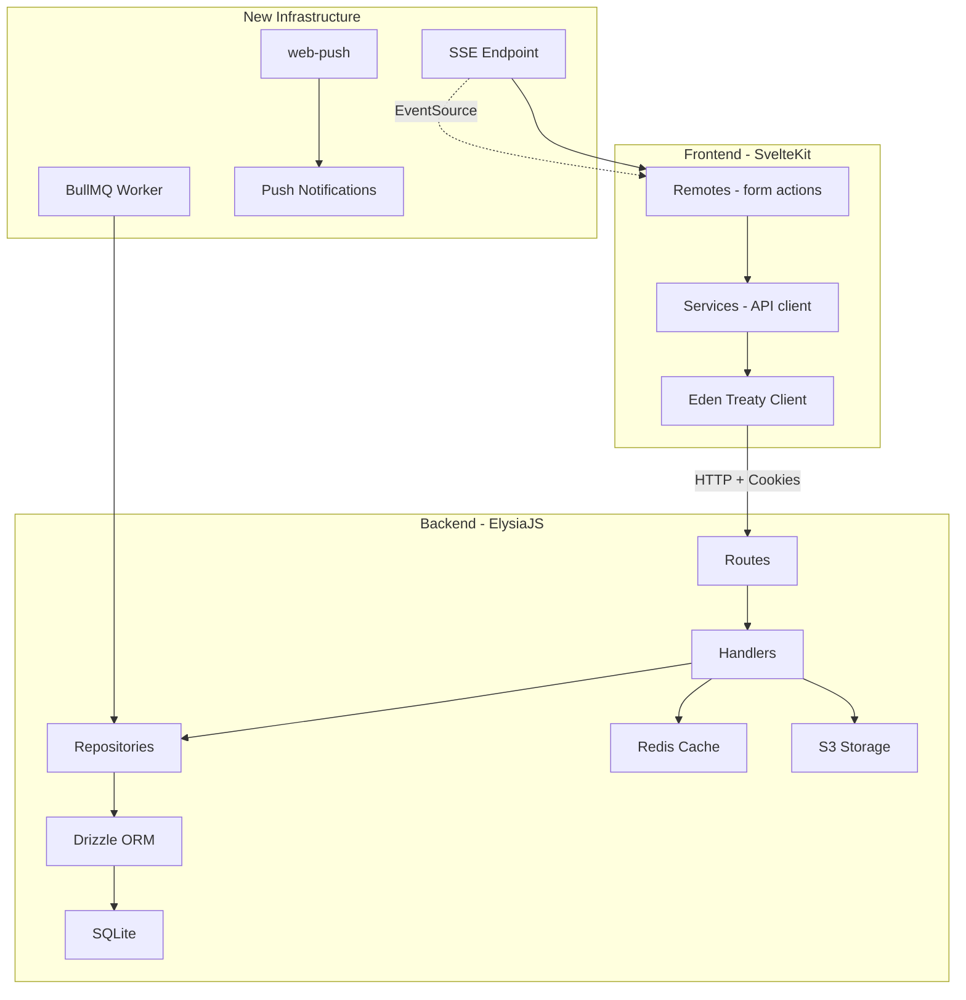

# Buddy Wallet — Audit Implementation Plan

**Based on:** Refined Comprehensive Audit (May 2, 2026)  
**Current Grade:** B+ (8.0/10)  
**Target Grade:** A (9.0/10)  
**Total Remaining Gaps:** 20 items across 5 sprints

---

## Architecture Overview



---

## Sprint 2: Import Preview & Storage

**Goal:** Enable users to upload Excel/CSV files, preview data, map columns, and store raw JSON for re-mapping.

**Audit Gaps Addressed:** #1, #2, #3

### Task 2.1: Add `exceljs` dependency to backend

- **File:** `apps/api/package.json`
- **Action:** Run `bun add exceljs` in the API workspace
- **Why:** Server-side Excel/CSV parsing is required for the preview endpoint

### Task 2.2: Create import preview service

- **File:** `apps/api/src/modules/data/services/import-preview.service.ts` (new)
- **Action:** Create a service with these functions:
  - `parseExcelFile(buffer: Buffer): { headers: string[], rows: Record<string, unknown>[] }` — Uses `exceljs` to parse uploaded Excel/CSV
  - `suggestColumnMapping(headers: string[]): Record<string, string>` — Maps common header names to debt fields (e.g., "Số điện thoại" → `debtorPhone`, "Số tiền" → `amount`)
  - `validateParsedData(rows: Record<string, unknown>[]): { valid: boolean, errors: string[] }` — Validates parsed rows against debt schema
- **Pattern:** Follow existing service pattern in [`data.service.ts`](../api/src/modules/data/services/data.service.ts) — pure functions, no side effects

### Task 2.3: Create S3 import storage provider

- **File:** `apps/api/src/providers/storage/storage.ts`
- **Action:** Add a new storage instance for import JSON files:
  ```typescript
  export const importStorage = createStorageService(
    globalS3Client,
    'imports/json',
    STORAGE_CONFIG.BUCKET!,
    toOptional(STORAGE_CONFIG.PUBLIC_BASE_URL)
  );
  ```
- **Why:** Store pre-parsed JSON in S3 for fast re-mapping without re-processing binary files

### Task 2.4: Create import preview handler

- **File:** `apps/api/src/modules/data/handlers/preview.handler.ts` (new)
- **Action:** Implement `POST /data/import/preview` handler:
  1. Accept `multipart/form-data` with Excel/CSV file
  2. Parse file using `parseExcelFile()`
  3. Generate column mapping suggestions using `suggestColumnMapping()`
  4. Store parsed JSON to S3 via `importStorage` with key `imports/json/{previewId}.json`
  5. Create import log with `status: 'preview'`
  6. Return `{ previewId, headers, previewRows: rows.slice(0, 10), suggestedMapping, totalRows }`
- **Validation:** Use existing [`import.ts`](../api/src/commons/validation/import.ts:40) file type validation
- **Permission:** `requirePermission('admin:import', ...)`

### Task 2.5: Add preview route

- **File:** `apps/api/src/modules/data/routes.ts`
- **Action:** Add route:
  ```typescript
  .post('/import/preview', requirePermission('admin:import', preview.preview), {
    detail: { tags: ['data'], description: 'Upload and preview Excel/CSV for import' }
  })
  ```

### Task 2.6: Update import handler to use S3 JSON

- **File:** `apps/api/src/modules/data/handlers/import.handler.ts`
- **Action:** Modify `importData` to:
  1. Accept optional `previewId` in body
  2. If `previewId` provided, fetch parsed JSON from S3 instead of requiring client-sent data
  3. Apply column mapping from the preview
  4. Process batches from S3 JSON
- **Why:** Eliminates need for client to re-send large JSON payloads

### Task 2.7: Complete remap handler

- **File:** `apps/api/src/modules/data/handlers/import.handler.ts`
- **Action:** Replace placeholder `remap` handler with real implementation:
  1. Fetch raw JSON from S3 using `importStorage.get(imports/json/{id}.json)`
  2. Apply new column mapping
  3. Re-validate mapped data
  4. Create new import log with `previewLogId` reference
  5. Return new preview with remapped data

### Task 2.8: Update frontend import upload zone

- **File:** `apps/web/src/lib/components/import/ImportUploadZone.svelte`
- **Action:** Update to:
  1. Send file as `multipart/form-data` to `/data/import/preview`
  2. Receive preview data and pass to `ImportPreviewMapping`
  3. Show loading state during upload/parse

### Task 2.9: Update frontend import preview mapping

- **File:** `apps/web/src/lib/components/import/ImportPreviewMapping.svelte`
- **Action:** Ensure it:
  1. Displays headers from preview response
  2. Shows suggested mapping with override capability
  3. Previews first 10 rows
  4. Submits final mapping to trigger import

### Task 2.10: Add frontend import remote

- **File:** `apps/web/src/lib/remotes/import.remote.ts` (new or update existing)
- **Action:** Add form actions for:
  - `previewImport(file: File)` — multipart upload
  - `startImport(previewId: string, mapping: Record<string, string>)` — trigger import
  - `remapImport(importId: string, mapping: Record<string, string>)` — re-map from history

### Task 2.11: Update import history re-map flow

- **File:** `apps/web/src/lib/components/import/ImportActionsDialog.svelte`
- **Action:** Enable "Re-map" button for preview imports:
  1. Call remap endpoint
  2. Show mapping dialog with previous mapping pre-filled
  3. Allow user to adjust and re-import

---

## Sprint 3: Background Processing & SSE

**Goal:** Move import processing to background workers with real-time SSE progress updates.

**Audit Gaps Addressed:** #4, #5

### Task 3.1: Add BullMQ dependency

- **File:** `apps/api/package.json`
- **Action:** Run `bun add bullmq ioredis`
- **Why:** BullMQ requires ioredis for Redis connection

### Task 3.2: Create job queue provider

- **File:** `apps/api/src/providers/queue/index.ts` (new)
- **Action:** Create BullMQ queue instances:
  ```typescript
  import { Queue } from 'bullmq';
  import { redisConnection } from '@/providers/redis/connection';
  
  export const importQueue = new Queue('import-processing', {
    connection: redisConnection,
    defaultJobOptions: {
      attempts: 3,
      backoff: { type: 'exponential', delay: 1000 },
      removeOnComplete: { count: 100 },
      removeOnFail: { count: 50 }
    }
  });
  ```

### Task 3.3: Create import worker

- **File:** `apps/api/src/workers/import.worker.ts` (new)
- **Action:** Create BullMQ worker that:
  1. Receives job with `{ importLogId, userId, s3Key, columnMapping }`
  2. Fetches parsed JSON from S3
  3. Processes in batches (reuse existing `processBatch` logic)
  4. Updates import log progress after each batch
  5. Publishes progress to Redis pub/sub channel `import:progress:{logId}`
  6. Handles errors with retry logic

### Task 3.4: Create SSE progress endpoint

- **File:** `apps/api/src/modules/data/handlers/sse.handler.ts` (new)
- **Action:** Implement `GET /data/import/progress-sse`:
  1. Accept `logIds` query parameter (comma-separated)
  2. Set response headers: `Content-Type: text/event-stream`, `Cache-Control: no-cache`, `Connection: keep-alive`
  3. Subscribe to Redis pub/sub channels for each logId
  4. Stream progress updates as SSE events
  5. Clean up subscriptions on client disconnect
- **Frontend Compatibility:** Must match the format expected by [`import-progress.svelte.ts`](../apps/web/src/lib/stores/import-progress.svelte.ts:84): `{ logId: { data: ImportProgress } }`

### Task 3.5: Add SSE route

- **File:** `apps/api/src/modules/data/routes.ts`
- **Action:** Add route:
  ```typescript
  .get('/import/progress-sse', requireUser(sse.progressSSE), {
    query: t.Object({ logIds: t.String() }),
    detail: { tags: ['data'], description: 'SSE stream for import progress' }
  })
  ```

### Task 3.6: Update import handler to use queue

- **File:** `apps/api/src/modules/data/handlers/import.handler.ts`
- **Action:** Replace synchronous batch processing with:
  ```typescript
  // Instead of blocking:
  await importQueue.add('process-import', {
    importLogId: logId,
    userId: user.id,
    s3Key: `imports/json/${previewId}.json`,
    columnMapping: mapping
  });
  
  // Return immediately
  return apiSuccess({ importId: logId, status: 'queued' }, 'Import queued for processing');
  ```

### Task 3.7: Create worker entry point

- **File:** `apps/api/src/workers/index.ts` (new)
- **Action:** Create worker entry point that can be run separately:
  ```typescript
  // bun run src/workers/index.ts
  import './import.worker';
  ```
- **Deployment:** Run as separate process: `bun run src/workers/index.ts`

### Task 3.8: Update frontend polling to use SSE

- **File:** `apps/web/src/lib/stores/import-progress.svelte.ts`
- **Action:** Verify SSE client works with new backend endpoint. The existing implementation at line 76 already uses `EventSource` — just ensure the URL matches the new route.

---

## Sprint 4: Notifications & Polish

**Goal:** Implement push notifications, fix date safety, fix race conditions, add repository validation.

**Audit Gaps Addressed:** #6, #7, #10, #11

### Task 4.1: Add web-push dependency

- **File:** `apps/api/package.json`
- **Action:** Run `bun add web-push` and `bun add -d @types/web-push`
- **Note:** Check if already in dependencies first

### Task 4.2: Create push notification service

- **File:** `apps/api/src/modules/notification/services/push.service.ts` (new)
- **Action:** Implement:
  ```typescript
  import webPush from 'web-push';
  import { configs } from '@/config';
  
  webPush.setVapidDetails(
    'mailto:admin@buddywallet.com',
    configs.VAPID_PUBLIC_KEY,
    configs.VAPID_PRIVATE_KEY
  );
  
  export async function sendPush(
    subscription: PushSubscription,
    payload: { title: string; body: string; url?: string }
  ): Promise<boolean> {
    try {
      await webPush.sendNotification(subscription, JSON.stringify(payload));
      return true;
    } catch (error) {
      logger.notification('Push send failed', { error });
      return false;
    }
  }
  
  export async function sendPushToUser(
    userId: string,
    payload: { title: string; body: string; url?: string }
  ): Promise<void> {
    const subscriptions = await notificationRepo.getSubscriptions(userId);
    await Promise.allSettled(
      subscriptions.map(sub => sendPush(sub, payload))
    );
  }
  ```

### Task 4.3: Add push notification types

- **File:** `apps/api/src/modules/notification/types/push.ts`
- **Action:** Verify/update push subscription types to match Web Push API

### Task 4.4: Create notification triggers

- **File:** `apps/api/src/modules/notification/services/notification-triggers.service.ts` (new)
- **Action:** Create event-triggered notification functions:
  - `onDebtCreated(debt, creator)` — Notify counterparty
  - `onDebtConfirmed(debt, confirmer)` — Notify other party
  - `onSuggestionReceived(debt, suggester)` — Notify creator
  - `onSuggestionResponded(debt, responder, accepted)` — Notify suggester
  - `onProofUploaded(debt, uploader)` — Notify counterparty
  - `onDebtPaid(debt, payer)` — Notify creditor
- **Each function:** Creates in-app notification + sends push

### Task 4.5: Integrate triggers into handlers

- **Files:**
  - `apps/api/src/modules/debts/handlers/create.handler.ts` — Add `onDebtCreated`
  - `apps/api/src/modules/debts/handlers/confirm.handler.ts` — Add `onDebtConfirmed`
  - `apps/api/src/modules/debts/handlers/suggest.handler.ts` — Add `onSuggestionReceived`
  - `apps/api/src/modules/debts/handlers/respond-suggestion.handler.ts` — Add `onSuggestionResponded`
  - `apps/api/src/modules/storage/handlers/proof.handler.ts` — Add `onProofUploaded`
  - `apps/api/src/modules/debts/handlers/complete.handler.ts` — Add `onDebtPaid`
- **Pattern:** Fire-and-forget with `Promise.resolve().then(...)` or queue

### Task 4.6: Add Valibot validation to repositories

- **Files:**
  - `apps/api/src/repositories/debt/debt.repo.ts`
  - `apps/api/src/repositories/user/user.repo.ts`
  - `apps/api/src/repositories/bank/bank-account.repo.ts`
  - `apps/api/src/repositories/auth/session.repo.ts`
  - `apps/api/src/repositories/data/import.repo.ts`
  - `apps/api/src/repositories/storage/file.repo.ts`
- **Action:** For each repository, wrap `insert()` and `update()` calls with Valibot validation:
  ```typescript
  import * as v from 'valibot';
  import { insertDebtSchema } from '@repo/db';
  
  async create(data: InsertDebt): Promise<Debt> {
    const validated = v.parse(insertDebtSchema, data);
    const [result] = await this.database.insert(debts).values(validated).returning();
    return result as Debt;
  }
  ```
- **Note:** Valibot schemas already exist in `packages/db` — just need to import and use them

### Task 4.7: Fix date serialization in Svelte components

- **Files to update (8+ components):**
  - `apps/web/src/lib/components/dashboard/DebtsTable.svelte:400` — Replace `new Date(debt.createdAt).toLocaleDateString()` with `formatDate(debt.createdAt)`
  - `apps/web/src/routes/(admin)/settings/security/+page.svelte:266,279` — Same replacement
  - `apps/web/src/routes/(admin)/dashboard/+page.svelte:216` — Same replacement
  - `apps/web/src/routes/(admin)/settings/activity/+page.svelte:13` — Use `formatDate` from `@repo/utils/format`
  - `apps/web/src/routes/(admin)/debts/create/+page.svelte:117` — Same replacement
  - `apps/web/src/lib/components/dashboard/QuickActions.svelte:34` — Same replacement
  - `apps/web/src/lib/components/import/ImportActionsDialog.svelte:67` — Same replacement
  - `apps/web/src/lib/components/import/ImportResultsDialog.svelte:40` — Same replacement
  - `apps/web/src/routes/(auth)/account-locked/+page.svelte:16` — Same replacement
- **Import:** `import { formatDate } from '@repo/utils/format';`

### Task 4.8: Fix frontend race conditions

- **Files:**
  - `apps/web/src/lib/components/dashboard/DebtsTable.svelte` — Add pending state for confirm/delete buttons
  - `apps/web/src/routes/(admin)/debts/[id]/+page.svelte` — Add pending state for all action buttons
  - `apps/web/src/lib/components/import/ImportUploadZone.svelte` — Disable during upload
- **Pattern:** Use Svelte 5 `$state` runes:
  ```svelte
  <script>
    let isSubmitting = $state(false);
    
    async function handleConfirm() {
      if (isSubmitting) return;
      isSubmitting = true;
      try {
        // ... submit
      } finally {
        isSubmitting = false;
      }
    }
  </script>
  
  <button disabled={isSubmitting} onclick={handleConfirm}>
    {isSubmitting ? 'Confirming...' : 'Confirm'}
  </button>
  ```

---

## Sprint 5: Quality & Scale

**Goal:** Test coverage, N+1 prevention, zombie data fix, JWT separation, optimistic locking.

**Audit Gaps Addressed:** #8, #9, #12, #13, #15

### Task 5.1: Set up test infrastructure

- **File:** `apps/api/package.json`
- **Action:** Add test dependencies:
  ```bash
  bun add -d @elysiajs/testing
  ```
- **File:** `apps/api/tests/helpers/setup.ts` (new)
- **Action:** Create test helpers:
  - `createTestApp()` — Boot Elysia app for testing
  - `createTestUser()` — Insert test user into DB
  - `createTestDebt()` — Insert test debt
  - `getAuthToken()` — Get JWT for authenticated requests
  - `cleanupDb()` — Truncate test tables

### Task 5.2: Write auth flow tests

- **File:** `apps/api/tests/integration/auth.test.ts` (new)
- **Action:** Test:
  - Register → Verify email → Login flow
  - Login with invalid credentials → 401
  - Token refresh → New tokens issued
  - Logout → Token blacklisted
  - Password change → Sessions revoked
  - Account lockout after 5 failed attempts

### Task 5.3: Write debt handler tests

- **File:** `apps/api/tests/integration/debts.test.ts` (new)
- **Action:** Test:
  - Create debt → 200
  - List debts with pagination
  - Two-party confirmation flow
  - Suggest edit → Respond to suggestion
  - Status transitions (pending → confirmed → paid)
  - Permission checks (cannot confirm own debt as debtor)

### Task 5.4: Write repository unit tests

- **File:** `apps/api/tests/unit/repositories/debt.repo.test.ts` (new)
- **Action:** Test:
  - CRUD operations
  - Soft-delete filtering
  - Pagination
  - Valibot validation (after Task 4.6)

### Task 5.5: Fix zombie data — Add soft-delete filters

- **Files:**
  - `apps/api/src/repositories/bank/bank-account.repo.ts` — Add `isNull(bankAccounts.deletedAt)` to `findById()` and `findByUserId()`
  - `apps/api/src/repositories/user/user.repo.ts` — Add `eq(users.isActive, true)` to `findById()` and `findMany()`
- **Pattern:** Follow [`debt.repo.ts`](../api/src/repositories/debt/debt.repo.ts) which already uses `isNull(deletedAt)`

### Task 5.6: Separate JWT secrets

- **File:** `apps/api/src/config/auth.ts`
- **Action:** Change:
  ```typescript
  // Before:
  JWT_SECRET: jwtSecret,
  JWT_REFRESH_SECRET: jwtSecret,
  
  // After:
  JWT_SECRET: env.string('JWT_SECRET', ''),
  JWT_REFRESH_SECRET: env.string('JWT_REFRESH_SECRET', ''),
  ```
- **File:** `apps/api/src/modules/auth/plugins/jwt.plugin.ts`
- **Action:** Create separate JWT plugin for refresh tokens:
  ```typescript
  export const jwtRefresh = new Elysia({ name: 'JWT_Refresh' })
    .use(jwt({
      name: 'jwtRefresh',
      secret: configs.AUTH.JWT_REFRESH_SECRET,
      schema: jwtPayloadSchema,
      exp: '90d',
      iss: 'buddy-wallet-api',
      aud: 'buddy-wallet-web'
    }));
  ```
- **File:** `apps/api/src/modules/auth/handlers/refresh.handler.ts`
- **Action:** Use `jwtRefresh` instead of `jwt` for refresh token operations

### Task 5.7: Add optimistic locking

- **File:** `packages/db/src/schema/debts.ts`
- **Action:** Add `version` column:
  ```typescript
  version: integer('version').notNull().default(1),
  ```
- **File:** `apps/api/src/repositories/debt/debt.repo.ts`
- **Action:** Update `update()` method:
  ```typescript
  async update(id: string, data: Partial<Debt>): Promise<Debt | null> {
    const current = await this.findById(id);
    if (!current) return null;
    
    const [result] = await this.database.update(debts)
      .set({ ...data, version: (current.version || 1) + 1, updatedAt: new Date() })
      .where(and(eq(debts.id, id), eq(debts.version, current.version || 1)))
      .returning();
    
    return (result as Debt) || null; // null = version conflict
  }
  ```
- **File:** `apps/api/src/modules/debts/handlers/confirm.handler.ts`
- **Action:** Handle null return from update as 409 Conflict

### Task 5.8: Prevent N+1 queries in listing endpoints

- **File:** `apps/api/src/modules/debts/handlers/list.handler.ts`
- **Action:** After fetching debts, batch-fetch user details:
  ```typescript
  const userIds = [...new Set(debts.flatMap(d => [d.creditorId, d.debtorId]).filter(Boolean))];
  const users = await userRepo.findByIds(userIds);
  const userMap = new Map(users.map(u => [u.id, u]));
  
  const enrichedDebts = debts.map(debt => ({
    ...debt,
    creditorName: userMap.get(debt.creditorId)?.name || null,
    debtorName: userMap.get(debt.debtorId)?.name || null,
  }));
  ```
- **File:** `apps/api/src/modules/debts/handlers/get.handler.ts`
- **Action:** Same pattern for single debt detail view

### Task 5.9: Write push notification tests

- **File:** `apps/api/tests/unit/services/push.service.test.ts` (new)
- **Action:** Test:
  - `sendPush()` with valid subscription
  - `sendPush()` with expired subscription → cleanup
  - `sendPushToUser()` with multiple subscriptions
  - Error handling for network failures

---

## Sprint 6: Architecture & Security Hardening

**Goal:** Address medium-priority architecture items.

**Audit Gaps Addressed:** #14, #16, #17, #18, #19, #20

### Task 6.1: Move session metadata to Redis

- **File:** `apps/api/src/modules/auth/plugins/session-auth.plugin.ts`
- **Action:** Store `userAgent`, `ipAddress`, `location` in Redis with session key instead of SQLite
- **Pattern:** `await sessionMetaCache.set(sessionId, { userAgent, ipAddress, location }, 90 * 24 * 60 * 60)`

### Task 6.2: Move failed login tracking to Redis

- **File:** `apps/api/src/modules/auth/handlers/login.handler.ts`
- **Action:** Replace DB writes for `failedLoginAttempts` with Redis atomic increment:
  ```typescript
  const attempts = await loginAttemptsCache.incr(`login:${identifier}`, 900); // 15 min TTL
  if (attempts >= 5) {
    // Lock account
  }
  ```

### Task 6.3: Verify CSRF cross-domain configuration

- **File:** `apps/api/src/commons/security/csrf.middleware.ts`
- **Action:** Verify that the CSRF whitelist includes the SvelteKit web app domain. If using `strict` mode, ensure `origin` header is validated against allowed origins list.

### Task 6.4: Event-driven architecture (optional, long-term)

- **File:** `apps/api/src/commons/events/event-bus.ts` (new)
- **Action:** Create simple event bus using Redis pub/sub:
  ```typescript
  export const eventBus = {
    emit(event: string, data: unknown) { /* publish to Redis */ },
    on(event: string, handler: (data: unknown) => void) { /* subscribe */ }
  };
  ```
- **Decouple:** Notification triggers from debt handlers via events

### Task 6.5: MFA/TOTP (optional, long-term)

- **File:** `apps/api/src/modules/auth/handlers/mfa.handler.ts` (new)
- **Action:** Implement TOTP-based MFA:
  1. Generate secret per user
  2. QR code endpoint for authenticator app setup
  3. Verify TOTP code on login
  4. Backup codes generation

---

## Dependency Summary

### New Backend Dependencies

| Package | Sprint | Purpose |
|---------|--------|---------|
| `exceljs` | 2 | Excel/CSV parsing |
| `bullmq` | 3 | Background job queue |
| `ioredis` | 3 | Redis client for BullMQ |
| `web-push` | 4 | Push notification sending |
| `@types/web-push` | 4 | TypeScript types |
| `@elysiajs/testing` | 5 | API integration testing |

### New Frontend Dependencies

None required — all frontend work uses existing libraries.

---

## File Change Summary

### New Files (Backend)

| File | Sprint | Purpose |
|------|--------|---------|
| `modules/data/services/import-preview.service.ts` | 2 | Excel/CSV parsing + column mapping |
| `modules/data/handlers/preview.handler.ts` | 2 | Import preview endpoint |
| `providers/queue/index.ts` | 3 | BullMQ queue instances |
| `workers/import.worker.ts` | 3 | Background import processor |
| `workers/index.ts` | 3 | Worker entry point |
| `modules/data/handlers/sse.handler.ts` | 3 | SSE progress endpoint |
| `modules/notification/services/push.service.ts` | 4 | Push notification sending |
| `modules/notification/services/notification-triggers.service.ts` | 4 | Event-triggered notifications |
| `tests/helpers/setup.ts` | 5 | Test infrastructure |
| `tests/integration/auth.test.ts` | 5 | Auth flow tests |
| `tests/integration/debts.test.ts` | 5 | Debt handler tests |
| `tests/unit/repositories/debt.repo.test.ts` | 5 | Repository tests |
| `commons/events/event-bus.ts` | 6 | Event bus (optional) |

### New Files (Frontend)

| File | Sprint | Purpose |
|------|--------|---------|
| `lib/remotes/import.remote.ts` | 2 | Import form actions |

### Modified Files (Backend)

| File | Sprint | Changes |
|------|--------|---------|
| `modules/data/routes.ts` | 2,3 | Add preview + SSE routes |
| `modules/data/handlers/import.handler.ts` | 2,3 | S3 JSON support + queue integration |
| `providers/storage/storage.ts` | 2 | Add importStorage instance |
| `config/auth.ts` | 5 | Separate JWT secrets |
| `modules/auth/plugins/jwt.plugin.ts` | 5 | Separate refresh JWT plugin |
| `modules/auth/handlers/refresh.handler.ts` | 5 | Use refresh JWT plugin |
| `repositories/bank/bank-account.repo.ts` | 5 | Add soft-delete filters |
| `repositories/user/user.repo.ts` | 5 | Add isActive filters |
| `repositories/debt/debt.repo.ts` | 4,5 | Valibot validation + optimistic locking |
| `modules/debts/handlers/create.handler.ts` | 4 | Add notification trigger |
| `modules/debts/handlers/confirm.handler.ts` | 4,5 | Add trigger + handle version conflict |
| `modules/debts/handlers/suggest.handler.ts` | 4 | Add notification trigger |
| `modules/debts/handlers/respond-suggestion.handler.ts` | 4 | Add notification trigger |
| `modules/debts/handlers/list.handler.ts` | 5 | Batch user fetch |
| `modules/debts/handlers/get.handler.ts` | 5 | Enrich with user details |
| `modules/storage/handlers/proof.handler.ts` | 4 | Add notification trigger |
| `modules/debts/handlers/complete.handler.ts` | 4 | Add notification trigger |
| `modules/auth/handlers/login.handler.ts` | 6 | Redis-based login attempts |
| `modules/auth/plugins/session-auth.plugin.ts` | 6 | Redis session metadata |

### Modified Files (Frontend)

| File | Sprint | Changes |
|------|--------|---------|
| `lib/components/import/ImportUploadZone.svelte` | 2 | Multipart upload to preview endpoint |
| `lib/components/import/ImportPreviewMapping.svelte` | 2 | Display preview data |
| `lib/components/import/ImportActionsDialog.svelte` | 2,4 | Re-map flow + formatDate |
| `lib/components/import/ImportResultsDialog.svelte` | 4 | formatDate |
| `lib/components/dashboard/DebtsTable.svelte` | 4 | formatDate + pending state |
| `lib/components/dashboard/QuickActions.svelte` | 4 | formatDate |
| `routes/(admin)/settings/security/+page.svelte` | 4 | formatDate |
| `routes/(admin)/dashboard/+page.svelte` | 4 | formatDate |
| `routes/(admin)/settings/activity/+page.svelte` | 4 | formatDate |
| `routes/(admin)/debts/create/+page.svelte` | 4 | formatDate |
| `routes/(admin)/debts/[id]/+page.svelte` | 4 | formatDate + pending state |
| `routes/(auth)/account-locked/+page.svelte` | 4 | formatDate |

---

## Risk Assessment

| Risk | Likelihood | Impact | Mitigation |
|------|-----------|--------|------------|
| BullMQ incompatible with Bun | Medium | High | Use native Bun worker threads as fallback |
| S3 costs for JSON storage | Low | Medium | Set lifecycle policy to delete after 30 days |
| SSE connection limits | Low | Medium | Frontend already has polling fallback |
| Breaking existing import flow | Medium | High | Keep JSON import path working alongside file upload |
| Valibot schema mismatch with Drizzle | Low | Medium | Schemas are auto-generated from Drizzle — should match |

---

## Success Criteria

| Metric | Current | Target | Sprint |
|--------|---------|--------|--------|
| Import with file upload | ❌ | ✅ | 2 |
| Column mapping UI | ❌ | ✅ | 2 |
| Re-map from history | ❌ | ✅ | 2 |
| Background import processing | ❌ | ✅ | 3 |
| Real-time SSE progress | ❌ | ✅ | 3 |
| Push notifications sent | ❌ | ✅ | 4 |
| Date rendering safety | 8 unsafe | 0 unsafe | 4 |
| Form race conditions | 4 vulnerable | 0 vulnerable | 4 |
| Repository validation | 0 repos | 6 repos | 4 |
| Test coverage | <10% | 70%+ | 5 |
| Zombie data accessible | Yes | No | 5 |
| JWT secrets separated | No | Yes | 5 |
| Optimistic locking | No | Yes | 5 |
| N+1 queries | Yes | No | 5 |
