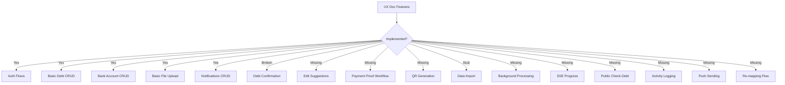

# Audit Verification Report — Backend Deep Scan

**Date:** May 1, 2026
**Scope:** Backend (`apps/api`) primary, Frontend (`apps/web`) secondary
**Reference:** `UX_Flow_Logic_Business.md`, Backend Audit Report, Frontend Audit Report

---

## Executive Summary

After deep-scanning every handler, service, repository, plugin, and route in the backend codebase, **both audit reports are largely accurate**. The backend audit's overall grade of **C (5.8/10)** is justified. The frontend audit's **B+ (8.2/10)** is also fair — the frontend is architecturally superior but has a critical auth bug and is decoupled from the backend's actual capabilities.

**Key Finding:** The backend has solid infrastructure (Redis caching, JWT auth, rate limiting, telemetry) but **critical business logic is either missing, broken, or stubbed out**. The gap between `UX_Flow_Logic_Business.md` and the actual implementation is substantial.

**Architecture Note — VietQR as Single Source of Truth:**
The project uses VietQR as the sole provider for bank list data and QR code generation. This is the correct approach for a Vietnam-focused app:
- **Bank List**: Fetched directly from VietQR API (`https://api.vietqr.io/v2/banks`) — free, unlimited, always up-to-date. No backend storage needed.
- **QR Generation**: VietQR provides embeddable image URLs (`https://img.vietqr.io/image/{bankBin}-{accountNumber}-{template}.jpg?amount={amount}&addInfo={description}`) — just construct the URL and embed as ``. No backend image processing, no S3 storage for QR images.
- **Implication**: QR generation is a simple URL construction task in the bank handler, not a complex feature requiring image processing pipelines.

---

## Audit Accuracy Verification

### ✅ CONFIRMED FINDINGS (Audit is Correct)

| # | Finding | Severity | Evidence |
|---|---------|----------|----------|
| 1 | **Response Envelope Mismatch** | 🔴 CRITICAL | `apiError()` and `apiSuccess()` exist in [`response.ts`](../api/src/commons/http/response.ts) but handlers return raw `{ data }`, `{ success: true }`, or raw `BE_ERRORS` objects. No consistent envelope. |
| 2 | **Broken Debt Confirmation Logic** | 🔴 CRITICAL | [`confirm.handler.ts`](../api/src/modules/debts/handlers/confirm.handler.ts:26) always sets `confirmedByCreditor: true` regardless of actor. Service checks `userId !== debtorId` (only debtor can confirm) but handler marks creditor confirmation. Two-party logic is broken. |
| 3 | **Missing Edit Suggestions & Disputes** | 🔴 CRITICAL | Frontend [`debts.remote.ts`](src/lib/remotes/debts.remote.ts:199) calls `suggest.post()` and `suggestion.respond.post()`. Backend [`routes.ts`](../api/src/modules/debts/routes.ts) has NO such routes. Will return 404. |
| 4 | **Data Import is a Stub** | 🔴 CRITICAL | [`data.handler.ts`](../api/src/modules/data/handlers/data.handler.ts:68) line 77: `// TODO: Implement actual data insertion`. Just counts array length. No background processing, no SSE, no batch logic. |
| 5 | **Missing Public /check-debt API** | 🔴 CRITICAL | No routes exist. [`debt.repo.ts`](../api/src/modules/debts/handlers/../repositories/debt/debt.repo.ts:187) has `countActiveDebtsForPhone()` but no handler uses it. |
| 6 | **HTTP Status Code Inconsistencies** | 🟡 HIGH | [`profile.handler.ts`](../api/src/modules/user/handlers/profile.handler.ts:23) lines 23, 60: Returns `BE_ERRORS.USER_NOT_FOUND` without `set.status` (defaults to 200). |
| 7 | **No Transactions on Multi-Step Operations** | 🟡 HIGH | [`register.handler.ts`](../api/src/modules/auth/handlers/register.handler.ts:67): Creates user, links debts, creates verification, creates session — all without `db.transaction()`. |
| 8 | **TOCTOU Race Conditions** | 🟡 HIGH | All debt status handlers use `findById()` then `update()` without optimistic locking or transactions. |
| 9 | **Permission System Not Enforced** | 🟡 HIGH | [`actor.plugin.ts`](../api/src/modules/auth/plugins/actor.plugin.ts:73) `requireActor` only checks existence. No `requirePermission()` macro. Admin checks are manual `role !== 'admin'`. |
| 10 | **Repository Validation Gaps** | 🟡 HIGH | [`debt.repo.ts`](../api/src/modules/debts/handlers/../repositories/debt/debt.repo.ts:98) `create()` uses raw `insert().values()` without Valibot validation. No defense-in-depth. |
| 11 | **Fire-and-Forget lastActiveAt** | 🟠 MEDIUM | [`session-auth.plugin.ts`](../api/src/modules/auth/plugins/session-auth.plugin.ts:162) uses `Promise.resolve().then(...)` — no retry, no queue. |
| 12 | **Missing Swagger Documentation** | 🟠 MEDIUM | No `@elysiajs/swagger` installed. Routes have `detail` metadata but no UI. |
| 13 | **Missing Sorting Support** | 🟠 MEDIUM | [`DebtFindManyOptions`](../api/src/modules/debts/handlers/../repositories/debt/debt.repo.ts:7) has no `sortBy`/`order`. No `ORDER BY` in queries. |
| 14 | **Frontend Auth Remote Bug** | 🔴 CRITICAL | [`auth.remote.ts`](src/lib/remotes/auth.remote.ts:28) line 28-68: `mustChangePassword` check causes redirect BEFORE cookie-setting code. Normal logins hit `invalid('Unexpected error occurred')`. Dead code on lines 31-65. |
| 15 | **getLocation() is a Stub** | 🟠 MEDIUM | [`auth.service.ts`](../api/src/modules/auth/services/auth.service.ts:92) returns hardcoded `'Remote Location'` for all IPs. No GeoIP integration. |

### ⚠️ PARTIALLY CONFIRMED (Audit Overstated or Nuanced)

| # | Finding | Audit Says | Actual Assessment |
|---|---------|-----------|-------------------|
| 1 | **N+1 Query Risks** | 🔴 CRITICAL | **Overstated.** `getDebtDirection()` is a pure function, not a DB query. The real risk is that listing endpoints return raw entities without joined user details (name, avatar), forcing frontend N+1 requests. Not a backend query N+1. |
| 2 | **Redundant Schema (Phone vs ID)** | 🟡 HIGH | **Valid concern but by design.** Phone fields enable pre-linking debts to unregistered users. The `linkDebtsToUser()` method uses this. Removing phones would break the core UX flow. |
| 3 | **Fat Users Table** | 🟡 HIGH | **Premature optimization.** The table has ~20 columns. Normalizing `failedLoginAttempts`/`isLocked` into a separate table adds JOIN overhead for a table unlikely to exceed millions of rows in the near term. |
| 4 | **Missing Message Queue** | 🔴 CRITICAL | **Correct for production** but acceptable for MVP. The fire-and-forget pattern works for `lastActiveAt`. The real issue is the import stub needing a queue. |

### ❌ AUDIT MISSED THESE ISSUES

| # | Finding | Severity | Evidence |
|---|---------|----------|----------|
| 1 | **Missing Payment Proof Workflow** | 🔴 CRITICAL | UX doc describes full proof upload → approve/reject → debt PAID flow. Storage module only has generic file upload. No proof-specific routes, no approval logic, no debt linking. |
| 2 | **Missing QR Code Generation** | 🟡 HIGH | UX doc describes VietQR integration for debt payment. Bank module has account management but NO QR generation endpoint. |
| 3 | **Frontend Calls Non-Existent Endpoints** | 🔴 CRITICAL | [`debts.remote.ts`](src/lib/remotes/debts.remote.ts:21) calls `batch.delete`, `status.patch`, `all.delete`, `upload.proof.approve.post`, `upload.proof.reject.post`, `upload.payment-proof.post` — NONE exist in backend routes. |
| 4 | **Missing Activity Logging** | 🟡 HIGH | UX doc describes comprehensive audit trail. [`activity.repo.ts`](../api/src/modules/debts/handlers/../repositories/system/activity.repo.ts) exists but NO handler calls it. Zero activity logging in any handler. |
| 5 | **Missing Push Notification Sending** | 🟡 HIGH | UX doc says "Send push notification to counterparty" on debt creation. [`notification.handler.ts`](../api/src/modules/notification/handlers/notification.handler.ts) only has CRUD for notification records. No actual push sending logic. |
| 6 | **Missing Debt Pending Limit Check** | 🟠 MEDIUM | UX doc says "Max 10 unconfirmed debts per user". [`create.handler.ts`](../api/src/modules/debts/handlers/create.handler.ts) has NO pending limit check. `countUnconfirmedByCreditor()` exists in repo but is never called. |
| 7 | **Missing Duplicate Debt Detection** | 🟠 MEDIUM | UX doc says "Check for duplicate debts (amount tolerance ±10%)". [`findPotentialDuplicates()`](../api/src/modules/debts/handlers/../repositories/debt/debt.repo.ts:127) exists in repo but `create.handler.ts` never calls it. |
| 8 | **Missing Debt Edit Permission for Disputed** | 🟠 MEDIUM | [`update.handler.ts`](../api/src/modules/debts/handlers/update.handler.ts:21) only allows editing when `status === 'pending'`. UX doc says "only pending/disputed editable". |

---

## Handler-by-Handler Logic Assessment

### Auth Module — Grade: B

| Handler | Logic Quality | Issues |
|---------|--------------|--------|
| [`login.handler.ts`](../api/src/modules/auth/handlers/login.handler.ts) | ✅ GOOD | Proper lockout, timing-safe comparison, device parsing. Missing: no `set.status` on some error paths. |
| [`register.handler.ts`](../api/src/modules/auth/handlers/register.handler.ts) | ⚠️ FAIR | Works but no transaction wrapping. `linkDebtsToUser()` + user creation should be atomic. |
| [`password.handler.ts`](../api/src/modules/auth/handlers/password.handler.ts) | ✅ GOOD | Proper OTP verification, reset flow, session revocation on password change. |
| [`session-auth.plugin.ts`](../api/src/modules/auth/plugins/session-auth.plugin.ts) | ✅ STRONG | 10-step auth flow, Redis caching, blacklist check, sessionVersion validation. Best code in the codebase. |

### Debts Module — Grade: C-

| Handler | Logic Quality | Issues |
|---------|--------------|--------|
| [`create.handler.ts`](../api/src/modules/debts/handlers/create.handler.ts) | ⚠️ FAIR | Missing: pending limit check, duplicate detection, activity logging, notifications. |
| [`confirm.handler.ts`](../api/src/modules/debts/handlers/confirm.handler.ts) | ❌ BROKEN | Always sets `confirmedByCreditor: true`. No two-party logic. No activity logging. |
| [`complete.handler.ts`](../api/src/modules/debts/handlers/complete.handler.ts) | ⚠️ FAIR | Uses `validateStatusTransition` correctly. Missing: activity logging, notifications. Casts status as `any`. |
| [`cancel.handler.ts`](../api/src/modules/debts/handlers/cancel.handler.ts) | ⚠️ FAIR | Same pattern as complete. Missing: activity logging, notifications. |
| [`update.handler.ts`](../api/src/modules/debts/handlers/update.handler.ts) | ⚠️ FAIR | Only allows `pending` status edits. Should also allow `disputed`. Missing: activity logging. |
| [`list.handler.ts`](../api/src/modules/debts/handlers/list.handler.ts) | ✅ GOOD | Proper pagination, direction filtering. Missing: sorting, summary totals. |
| [`get.handler.ts`](../api/src/modules/debts/handlers/get.handler.ts) | ✅ GOOD | Proper ownership check, direction/overdue computation. |
| [`remove.handler.ts`](../api/src/modules/debts/handlers/remove.handler.ts) | ✅ GOOD | Only allows deletion of cancelled debts. Proper soft-delete. |

### Data Module — Grade: F

| Handler | Logic Quality | Issues |
|---------|--------------|--------|
| [`data.handler.ts`](../api/src/modules/data/handlers/data.handler.ts) | ❌ STUB | Export works for basic cases. Import is a complete stub — counts array length, returns hardcoded result. No actual data processing. |

### Bank Module — Grade: B+

| Handler | Logic Quality | Issues |
|---------|--------------|--------|
| [`bank.handler.ts`](../api/src/modules/bank/handlers/bank.handler.ts) | ✅ GOOD | Proper validation, ownership checks, default account management, account masking. Missing: QR generation. |

### Storage Module — Grade: C

| Handler | Logic Quality | Issues |
|---------|--------------|--------|
| [`storage.handler.ts`](../api/src/modules/storage/handlers/storage.handler.ts) | ⚠️ FAIR | Generic file upload works. Missing: image processing (resize/compress/WebP), payment proof workflow, proof approval/rejection. |

### User Module — Grade: B-

| Handler | Logic Quality | Issues |
|---------|--------------|--------|
| [`profile.handler.ts`](../api/src/modules/user/handlers/profile.handler.ts) | ⚠️ FAIR | Missing `set.status` on error returns (lines 23, 60). Password change logic is solid. |
| [`admin.handler.ts`](../api/src/modules/user/handlers/admin.handler.ts) | ✅ GOOD | Proper admin checks, safe user returns. Uses manual role check instead of permission system. |

### Notification Module — Grade: C

| Handler | Logic Quality | Issues |
|---------|--------------|--------|
| [`notification.handler.ts`](../api/src/modules/notification/handlers/notification.handler.ts) | ⚠️ FAIR | CRUD operations work. Missing: actual push notification sending, subscription management, VAPID integration. |

---

## Performance Assessment

### What's Good
- **Redis caching** with circuit breaker and in-memory fallback ✅
- **Cache-aside pattern** for sessions reduces DB queries ~90% ✅
- **Rate limiting** with multi-factor identification ✅
- **Parallel queries** with `Promise.all()` in repositories ✅
- **Composite indexes** in Drizzle schema ✅
- **ETag support** for HTTP caching ✅

### What Needs Upgrading

| Issue | Impact | Recommendation |
|-------|--------|----------------|
| No `ORDER BY` in list queries | Results returned in insertion order, not user-expected order | Add `sortBy`/`order` to `DebtFindManyOptions` and apply `orderBy()` |
| No eager loading / JOIN queries | Listing debts returns IDs only, frontend must resolve names | Add `findManyWithUsers()` that JOINs user table |
| Fire-and-forget updates | Lost on crash, no retry | Move to background job queue (BullMQ or Bun workers) |
| No connection pooling config | Default SQLite connection handling | Verify Drizzle pool settings for production load |
| Export loads all records into memory | `limit: 10000` in export handler | Implement streaming export for large datasets |
| No pagination cursor support | Offset-based pagination degrades at high page numbers | Add cursor-based pagination option |

---

## Missing Features vs UX_Flow_Logic_Business.md



---

## Recommended Implementation Plan

### Phase 1: Fix Critical Bugs (Immediate)

1. **Fix Response Envelope Consistency**
   - All handlers must use `apiSuccess()` / `apiError()` wrappers
   - Standardize: success → `{ ok: true, data, message }`, error → `{ ok: false, error: { code, message } }`

2. **Fix Debt Confirmation Logic**
   - Implement two-party confirmation with `confirmedByCreditor` + `confirmedByDebtor` flags
   - Only mark the confirming party's flag
   - Auto-confirm debt when both parties have confirmed

3. **Fix Frontend Auth Remote**
   - Remove dead code after redirect in `auth.remote.ts`
   - Fix the `mustChangePassword` conditional to handle normal login flow

4. **Fix HTTP Status Code Inconsistencies**
   - Add `set.status` to all error returns in `profile.handler.ts`
   - Create a handler wrapper that auto-sets status from error codes

### Phase 2: Implement Missing Core Features (Short-term)

5. **Implement Edit Suggestions & Disputes**
   - Add `suggest` and `respond` handlers to debts module
   - Add routes: `POST /debts/:id/suggest`, `POST /debts/:id/suggestion/respond`
   - Store suggestions (consider `debt_suggestions` table or JSON field)

6. **Implement Payment Proof Workflow**
   - Add proof upload, approve, reject handlers to storage module
   - Link proofs to debts
   - Auto-mark debt PAID when all proofs approved

7. **Implement Activity Logging**
   - Call `activityRepo.create()` in all mutation handlers
   - Include user, action, resource, changes, metadata

8. **Implement Missing Validation in Create Handler**
   - Add pending debt limit check (max 10)
   - Add duplicate debt detection using `findPotentialDuplicates()`

### Phase 3: Data Import & Background Processing (Medium-term)

9. **Implement Real Data Import**
   - Parse Excel/CSV to JSON on upload
   - Store parsed JSON in S3 linked to `import_log_id`
   - Process rows in batches with error collection
   - Return import job ID

10. **Implement SSE Progress Tracking**
    - Add `/data/import/:id/progress` SSE endpoint
    - Track progress in Redis
    - Emit events as batches complete

11. **Implement Re-mapping Flow**
    - Add `/data/import/:id/remap` endpoint
    - Read pre-parsed JSON from S3
    - Allow column re-mapping without re-processing binary files

### Phase 4: Infrastructure & Quality (Medium-term)

12. **Add Swagger Documentation**
13. **Wrap Multi-Step Operations in Transactions**
14. **Add Repository-Level Validation (Valibot)**
15. **Implement Permission-Based Guards**
16. **Add Sorting Support to List Endpoints**
17. **Expand Test Coverage**

### Phase 5: QR & Public API (Low Effort — Short-term)

18. **QR Code Generation via VietQR URL Construction**
    - Add `GET /debts/:id/qr` endpoint to bank handler
    - Fetch user's default bank account from DB
    - Construct VietQR embeddable image URL:
      `https://img.vietqr.io/image/{bankBin}-{accountNumber}-qr_only.jpg?amount={amount}&addInfo={description}`
    - Return the URL — frontend embeds as `` (no backend image processing needed)
    - Bank list already fetched client-side from VietQR API (see [`vietqr.ts`](src/lib/services/vietqr.ts))
    - VietQR is the single source of truth for all bank data and QR images

19. **Public Check-Debt API**
    - Add `GET /v1/check-debt?phone={phone}` public endpoint
    - Use existing `countActiveDebtsForPhone()` from [`debt.repo.ts`](../api/src/modules/debts/handlers/../repositories/debt/debt.repo.ts:187)
    - Add captcha verification (Google reCAPTCHA or hCaptcha)
    - Mask phone in response, strict rate limiting

### Phase 6: Advanced Infrastructure (Long-term)

20. **Push Notification Sending (Web Push / VAPID)**
21. **Background Job Queue (BullMQ or Bun workers)**
22. **Event-Driven Architecture (Redis pub/sub)**

---

## Verdict: Are the Audits Correct?

**Backend Audit: 90% Accurate** — All critical and high-severity findings are confirmed. The audit slightly overstates N+1 risks and missed several missing features (payment proofs, QR, activity logging, push sending).

**Frontend Audit: 95% Accurate** — The auth remote bug is confirmed and is indeed critical. The API desync findings are confirmed. The audit correctly identifies the frontend as architecturally superior.

**Both audits are reliable guides for prioritizing work.**

---

## Appendix: VietQR Architecture Decision

**Decision:** Use VietQR as the single source of truth for bank data and QR generation.

**Rationale:**
- VietQR API (`https://api.vietqr.io/v2/banks`) is free, unlimited, and covers virtually all Vietnamese banks
- QR images are generated server-side by VietQR via simple URL construction — no image processing needed in our backend
- Frontend already has a client-first fetch strategy with backend fallback (see [`vietqr.ts`](src/lib/services/vietqr.ts))
- This eliminates the need for: bank data tables, QR image storage, image processing pipelines

**Implementation Pattern:**
```
Frontend: fetchBanks() → VietQR API → display bank list
Backend:  GET /debts/:id/qr → construct VietQR URL → return URL
Frontend:  → display QR code
```
