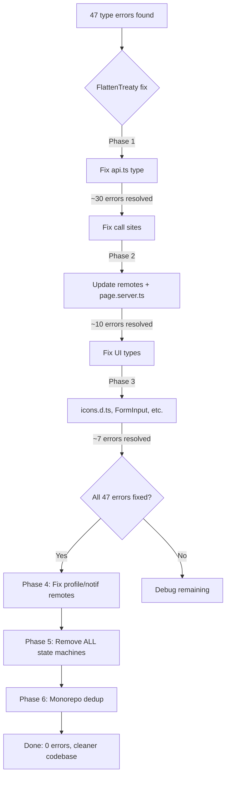
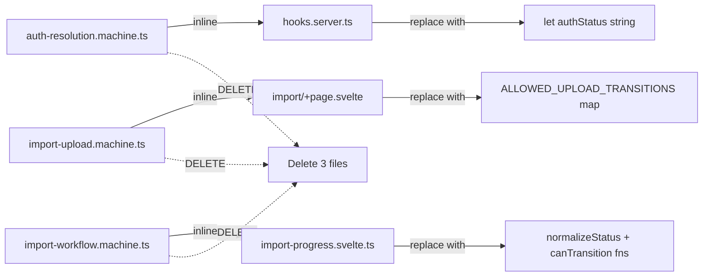

# Buddy Wallet — Codebase Cleanup & Type Fix Plan

**Date:** 2026-05-07  
**Scope:** `apps/web` (frontend) + `apps/api` (backend schema alignment)  
**Goal:** Fix all 47 type-check errors, remove all state machines, clean Eden Treaty typing, align audit mismatches

---

## Root Cause Analysis

### The FlattenTreaty Problem (causes ~30 of 47 errors)

The [`FlattenTreaty<T>`](src/lib/services/api.ts:30) type in `api.ts` has a critical flaw. When a route node is **both callable** (for `:id` params) **AND** has object properties (like `.get`, `.post`, `.batch`), TypeScript's conditional type picks the **function branch first**, dropping all object members.

```typescript
// CURRENT (broken) — function branch wins, object keys lost
type FlattenTreaty<T> = T extends (...args: infer Args) => infer R
    ? (...args: Args) => FlattenTreaty<R>  // ← loses .get, .post, .batch, .all
    : ...
```

**Example:** `api.v1.debts` is typed as:
```
{ (params: {id: string}): { get, patch, delete, confirm, cancel, ... }; get: ...; post: ...; batch: ...; all: ... }
```
`FlattenTreaty` matches the function branch → becomes `(...args) => FlattenTreaty<R>` → `.get`, `.post`, `.batch`, `.all` are gone.

**Fix:** Preserve both callable signature AND object properties using intersection:

```typescript
type FlattenTreaty<T> = T extends (...args: infer Args) => infer R
    ? ((...args: Args) => FlattenTreaty<R>) & {
        [K in keyof T as K extends keyof Function ? never : K]: FlattenTreaty<T[K]>
      }
    : T extends Promise<infer R>
    ? Promise<FlattenTreaty<R>>
    : T extends { data: infer D; error: infer E; status: infer S; response: infer Res }
    ? { data: MapApiResponse<D>; error: E; status: S; response: Res }
    : T extends object
    ? { [K in keyof T]: FlattenTreaty<T[K]> }
    : T;
```

---

## Correct API Call Shape Reference

After fixing `FlattenTreaty`, these are the **correct** call shapes (no parentheses unless passing `:id` params):

### Debts Module
| Operation | Correct Call Shape |
|---|---|
| List debts | `locals.api.v1.debts.get({ query })` |
| Create debt | `locals.api.v1.debts.post(body)` |
| Batch delete | `locals.api.v1.debts.batch.delete({ ids })` |
| Delete all | `locals.api.v1.debts.all.delete({}, { query })` |
| Get one debt | `locals.api.v1.debts({ id }).get()` |
| Update debt | `locals.api.v1.debts({ id }).patch(body)` |
| Delete one | `locals.api.v1.debts({ id }).delete()` |
| Confirm | `locals.api.v1.debts({ id }).confirm.post(body)` |
| Cancel | `locals.api.v1.debts({ id }).cancel.post(body)` |
| Complete | `locals.api.v1.debts({ id }).complete.post(body)` |
| Suggest edit | `locals.api.v1.debts({ id }).suggest.post(body)` |
| Respond suggestion | `locals.api.v1.debts({ id }).suggestion.respond.post(body)` |

### Bank Module
| Operation | Correct Call Shape |
|---|---|
| List accounts | `locals.api.v1.bank.accounts.get()` |
| Create account | `locals.api.v1.bank.accounts.post(body)` |
| Get one | `locals.api.v1.bank.accounts({ id }).get()` |
| Update | `locals.api.v1.bank.accounts({ id }).patch(body)` |
| Delete | `locals.api.v1.bank.accounts({ id }).delete()` |

### User Module
| Operation | Correct Call Shape |
|---|---|
| Get profile | `locals.api.v1.user.profile.get()` |
| Update profile | `locals.api.v1.user.profile.patch(body)` |
| Change password | `locals.api.v1.user.changePassword.post(body)` |
| List users (admin) | `locals.api.v1.user.admin.users.get({ query })` |
| Get user (admin) | `locals.api.v1.user.admin.users({ id }).get()` |
| Update user (admin) | `locals.api.v1.user.admin.users({ id }).patch(body)` |

### Data Module
| Operation | Correct Call Shape |
|---|---|
| Export | `locals.api.v1.data.export.get({ query })` |
| Import preview | `locals.api.v1.data.import.preview.post({ file })` |
| Start from preview | `locals.api.v1.data.import({ id }).start.post(body)` |
| Legacy import | `locals.api.v1.data.import.post(body)` |
| Import logs | `locals.api.v1.data.import.logs.get({ query })` |
| Progress poll | `locals.api.v1.data.import['progress-poll'].post(body)` |
| Get progress | `locals.api.v1.data.import({ id }).progress.get()` |
| Remap | `locals.api.v1.data.import({ id }).remap.post(body)` |

### Storage Module
| Operation | Correct Call Shape |
|---|---|
| Upload file | `locals.api.v1.storage.upload.post({ file })` |
| Upload proof | `locals.api.v1.storage['payment-proof']({ debtId }).post({ file })` |
| Approve proof | `locals.api.v1.storage.proof({ id }).approve.post()` |
| Reject proof | `locals.api.v1.storage.proof({ id }).reject.post(body)` |

### System (public, no /v1 prefix)
| Operation | Correct Call Shape |
|---|---|
| Check debt | `api['check-debt'].get({ query })` |

---

## Implementation Steps

### Phase 1: Fix Eden Treaty Type (fixes ~30 errors)

**Step 1.1** — Fix [`FlattenTreaty`](src/lib/services/api.ts:30) in `api.ts`

Replace the type with the intersection-based version that preserves both callable signatures and object properties on route nodes.

**Step 1.2** — Fix [`progress-poll`](src/lib/stores/import-progress.svelte.ts:105) path in import store

The backend route is `POST /data/import/progress-poll`. In Eden Treaty this becomes `data.import['progress-poll']` (not `data['import/progress-poll']`). After fixing FlattenTreaty, verify this resolves.

**Step 1.3** — Verify `data.import({id}).start.post(...)` resolves correctly

The route `/data/import/:id/start` maps to `data.import({id}).start.post(...)`. After FlattenTreaty fix, verify this works.

### Phase 2: Fix All API Call Sites (fix remaining type errors from wrong shapes)

**Step 2.1** — Fix [`dashboard.remote.ts`](src/lib/remotes/dashboard.remote.ts)

| Line | Current (broken) | Fixed |
|---|---|---|
| 46 | `locals.api.v1.debts().get(...)` | `locals.api.v1.debts.get(...)` |
| 69 | `locals.api.v1.user['admin/users']().get(...)` | `locals.api.v1.user.admin.users.get(...)` |
| 88 | `locals.api.v1.bank.accounts().get()` | `locals.api.v1.bank.accounts.get()` |
| 89 | `locals.api.v1.debts().get(...)` | `locals.api.v1.debts.get(...)` |
| 108 | `locals.api.v1.debts().get(...)` | `locals.api.v1.debts.get(...)` |

**Step 2.2** — Fix [`debts.remote.ts`](src/lib/remotes/debts.remote.ts)

| Line | Current (broken) | Fixed |
|---|---|---|
| 36 | `locals.api.v1.debts.batch().delete(...)` | `locals.api.v1.debts.batch.delete(...)` |
| 63 | `locals.api.v1.debts.all().delete(...)` | `locals.api.v1.debts.all.delete(...)` |
| 82 | `locals.api.v1.debts({ id: debtId }).confirm().post({})` | `locals.api.v1.debts({ id: debtId }).confirm.post({})` |
| 84 | `locals.api.v1.debts({ id: debtId }).cancel().post({})` | `locals.api.v1.debts({ id: debtId }).cancel.post({})` |
| 86 | `locals.api.v1.debts({ id: debtId }).complete().post({})` | `locals.api.v1.debts({ id: debtId }).complete.post({})` |

**Step 2.3** — Fix [`admin/users/+page.server.ts`](src/routes/(admin)/admin/users/+page.server.ts:28)

| Line | Current (broken) | Fixed |
|---|---|---|
| 28 | `locals.api.v1.user['admin/users'].get(...)` | `locals.api.v1.user.admin.users.get(...)` |

**Step 2.4** — Fix [`admin/users/[id]/+page.server.ts`](src/routes/(admin)/admin/users/[id]/+page.server.ts:20)

| Line | Current (broken) | Fixed |
|---|---|---|
| 20 | `locals.api.v1.user.admin.users({ id: params.id }).get()` | Already correct shape, just needs FlattenTreaty fix |
| 30 | `locals.api.v1.debts.get(...)` | Already correct shape, just needs FlattenTreaty fix |
| 48 | `locals.api.v1.user.admin.users({ id: params.id }).patch({})` | Already correct shape |

**Step 2.5** — Fix [`dashboard/import/+page.server.ts`](src/routes/(admin)/dashboard/import/+page.server.ts)

| Line | Current | Issue | Fixed |
|---|---|---|---|
| 48 | `locals.api.v1.data['import/logs'].get(...)` | Bracket path doesn't resolve | `locals.api.v1.data.import.logs.get(...)` |
| 95 | `locals.api.v1.data['import/preview'].post(...)` | Bracket path doesn't resolve | `locals.api.v1.data.import.preview.post(...)` |
| 177 | `locals.api.v1.data[\`import/${previewLogId}/start\`].post(...)` | Template literal path | `locals.api.v1.data.import({ id: previewLogId }).start.post(...)` |
| 204 | `locals.api.v1.data.import.post(body)` | `.import` is callable, `.post` lost | Needs FlattenTreaty fix to work |

**Step 2.6** — Fix [`debts/create/+page.server.ts`](src/routes/(admin)/debts/create/+page.server.ts)

| Line | Current (broken) | Fixed |
|---|---|---|
| 47 | `api.v1.bank.accounts.get()` | Already correct shape, needs FlattenTreaty fix |
| 48 | `api.v1.debts.get(...)` | Already correct shape, needs FlattenTreaty fix |
| 103 | `api.v1.bank.accounts.get()` | Already correct shape |
| 119 | `locals.api.v1.debts.post(...)` | Already correct shape |

**Step 2.7** — Fix [`debts/[id]/confirmation/+page.server.ts`](src/routes/(admin)/debts/[id]/confirmation/+page.server.ts:25)

| Line | Current (broken) | Fixed |
|---|---|---|
| 25 | `locals.api.v1.debts.get(...)` | Already correct shape, needs FlattenTreaty fix |

**Step 2.8** — Fix [`settings/banks/+page.server.ts`](src/routes/(admin)/settings/banks/+page.server.ts:12)

| Line | Current (broken) | Fixed |
|---|---|---|
| 12 | `locals.api.v1.bank.accounts.get()` | Already correct shape, needs FlattenTreaty fix |

**Step 2.9** — Fix [`import-progress.svelte.ts`](src/lib/stores/import-progress.svelte.ts:105)

| Line | Current (broken) | Fixed |
|---|---|---|
| 105 | `api.v1.data['import/progress-poll'].post(...)` | `api.v1.data.import['progress-poll'].post(...)` |

**Step 2.10** — Fix [`dashboard/import/+page.svelte:142`](src/routes/(admin)/dashboard/import/+page.svelte:142)

| Line | Current (broken) | Fixed |
|---|---|---|
| 142 | `api.v1.data['import/logs'].get(...)` | `api.v1.data.import.logs.get(...)` |

### Phase 3: Fix UI Type Errors (non-API errors)

**Step 3.1** — Add `Moon` and `Sun` to [`icons.d.ts`](src/icons.d.ts)

Add after line 90 (before closing `}`):
```typescript
export const Moon: Component<any>;
export const Sun: Component<any>;
```

**Step 3.2** — Fix [`FormInput.svelte`](src/lib/components/forms/FormInput.svelte:95) prop spread

The `restProps` type is `HTMLInputAttributes & { custom props }` which creates a massive union when spread into `Input`. The current cast on line 43 (`const inputProps = restProps as Omit<HTMLInputAttributes, 'type'>`) doesn't help because the spread on line 111 still triggers the union explosion.

Fix: Cast restProps to a simpler type before spreading:
```typescript
const inputProps = restProps as Record<string, unknown>;
```
And spread with `{...inputProps as Record<string, unknown>}` on the Input component.

**Step 3.3** — Fix [`ImportHistoryTable.svelte`](src/lib/components/import/ImportHistoryTable.svelte:11) ImportJob type

Line 11 imports `ImportJob` from `$lib/stores/import-progress.svelte` but it's not exported from there. The type is actually from `@repo/types/infrastructure/jobs`. The import on line 11 already says `import type { ImportJob } from '@repo/types/infrastructure/jobs'` — verify this is correct and the error is from a different import path.

**Step 3.4** — Fix [`PageHeader.svelte`](src/lib/components/layout/PageHeader.svelte:28) Snippet type

The `actions` prop is typed as `Snippet | null` (line 14) which is correct for Svelte 5. The `{@render actions()}` call should work. If the error persists, the issue may be that the `$props()` destructuring loses the type narrowing. Fix: add explicit type guard before rendering:
```svelte
{#if actions}
    {@render actions()}
{/if}
```
(Already done on line 27 — verify the Snippet import is correct.)

**Step 3.5** — Fix [`QuickActions.svelte`](src/lib/components/dashboard/QuickActions.svelte:12) createdAt type

The `RecentDebtItem.createdAt` is typed as `string | Date | null` (line 12) which already accepts both. The error is on the caller side in [`dashboard/+page.svelte:129`](src/routes/(admin)/dashboard/+page.svelte:129) where `Debt[]` is passed as `RecentDebtItem[]`. Verify the actual `Debt` type has `createdAt: string | Date` (not just `string`).

**Step 3.6** — Fix [`debts/[id]/+page.svelte`](src/routes/(admin)/debts/[id]/+page.svelte) type guards

| Line | Error | Fix |
|---|---|---|
| 40 | `CurrentUserLike` not assignable (can be undefined) | The `$derived` on line 42 already guards with `data.currentUser ?` — the error is from the cast on line 46. Remove the explicit cast or add null check. |
| 47 | `{}` in `'error' in value` | Line 55 already has `typeof value !== 'object'` guard — verify TypeScript recognizes this. |
| 70 | `allProofsApproved` not on type | Cast `form` to `FormWithMessage` before accessing: `const successForm = form as FormWithMessage;` (already on line 77, but the check on line 80 uses `successForm.allProofsApproved` which should work if `FormWithMessage` includes it — verify the type definition on line 29-34). |
| 71 | `debtId` not on type | Same — `FormWithMessage` on line 29-34 already includes `debtId?: string`. The error may be that TypeScript doesn't narrow from the `'success' in form` check. Fix: use `(form as FormWithMessage).debtId`. |

**Step 3.7** — Fix [`settings/banks/+page.svelte:152`](src/routes/(admin)/settings/banks/+page.svelte:152) null accountName

Line 152: `accountName = account.accountName` → `accountName = account.accountName ?? ''`

**Step 3.8** — Fix [`(app)/+page.svelte:21`](src/routes/(app)/+page.svelte:21) check-debt payload

The backend returns `{ hasDebts: boolean, phone: string }` but the UI casts to `{ success, phone, found, count }`. Fix: update the cast to match backend:
```typescript
return form.result as { hasDebts: boolean; phone: string };
```
And update the UI template to use `result.hasDebts` instead of `result.found`/`result.count`.

**Step 3.9** — Fix [`admin/traces/+page.server.ts:16`](src/routes/(admin)/admin/traces/+page.server.ts:16) data typing

The `data` is typed as `{}` which makes `'error' in data` fail. Fix: cast to `Record<string, unknown>` before the `in` check. The file already does this on line 7 but the return on line 16-17 still uses the raw `data`. Fix the return to use the already-cast `payload`.

### Phase 4: Fix Profile/Notifications Schema Mismatch (Security-First)

**Problem:** Frontend sends `phoneNumber` and notification flags to `PATCH /user/profile`, but backend `UpdateProfileSchema` only accepts `name/email/avatar`. Expanding the schema would mix sensitive fields with basic profile updates — a security anti-pattern.

**Solution:** Remove the incorrect frontend calls and use dedicated endpoints.

**Step 4.1** — Fix [`profile.remote.ts`](src/lib/remotes/profile.remote.ts)

The remote sends `phoneNumber` to `api.v1.user.profile.patch()`. This is wrong — phone number changes should go through a dedicated verification flow. Fix: remove `phoneNumber` from the profile patch payload. If phone update is needed, create a separate `PATCH /user/phone` endpoint with OTP verification (backlog item).

For now, the profile remote should only update allowed fields:
```typescript
const { error: apiError } = await api.v1.user.profile.patch({
    name: data.name,
    email: data.email
});
```

**Step 4.2** — Fix [`notifications.remote.ts`](src/lib/remotes/notifications.remote.ts)

The remote sends `emailNotificationsEnabled` and `pushNotificationsEnabled` to `api.v1.user.profile.patch()`. These should go to the notification module instead. The backend has `notificationRoutes` at `/notifications` but no update-preferences endpoint yet.

**Option A (minimal):** Create a `PATCH /notifications/preferences` endpoint in the backend notification module with a strict schema (booleans only, reject unknown keys).

**Option B (backlog):** For now, comment out the notification preference update in the frontend and add a TODO. The UI can show the toggles but disable the save button until the backend endpoint exists.

**Recommended:** Option A — it's a small, focused endpoint that follows the existing notification module pattern.

**Step 4.3** — Update [`profile.remote.ts`](src/lib/remotes/profile.remote.ts) to remove phoneNumber

After Step 4.1, the `profileSchema` from `@repo/schema/dto/profile` may include `phoneNumber`. Either:
- Update the schema to remove `phoneNumber` from the profile update schema
- Or bypass the schema validation for the profile remote and send only allowed fields

### Phase 5: Remove ALL State Machines (Complete Removal)

**Philosophy:** State machines add indirection without proportional benefit for these use cases. The transition logic is simple enough to inline as plain variables and conditionals — the Svelte 5 way.

**Step 5.1** — Remove auth resolution machine from [`hooks.server.ts`](src/hooks.server.ts)

**Current:** `createAuthResolutionMachine()` creates an object with `.getState()` and `.send()` methods. Used on lines 238, 246, 259, 263, 271, 276, 290, 294, 304, 308, 312.

**Replace with:** A simple string variable and direct assignments:

```typescript
// Replace: const authResolution = createAuthResolutionMachine();
type AuthStatus = 'idle' | 'resolving' | 'authenticated' | 'unauthenticated'| 'timeout' | 'network-error' | 'offline';
let authStatus: AuthStatus = 'idle';

// Replace: authResolution.send('START');
authStatus = 'resolving';

// Replace: authResolution.send('USER_RESOLVED');
authStatus = 'authenticated';

// Replace: authResolution.send('NO_USER');
authStatus = 'unauthenticated';

// Replace: authResolution.send('TIMEOUT');
authStatus = 'timeout';

// Replace: authResolution.send('NETWORK_ERROR');
authStatus = 'network-error';

// Replace: authResolution.getState() === 'resolving'
authStatus === 'resolving'

// Replace: authResolution.getState() === 'offline'
authStatus === 'offline'
```

Remove the import of `createAuthResolutionMachine` from line 8.

**Step 5.2** — Remove import upload machine from [`import/+page.svelte`](src/routes/(admin)/dashboard/import/+page.svelte)

**Current:** `transitionImportUploadState(from, to)` checks if a status transition is allowed. Used on line 124.

**Replace with:** Inline the transition check as a simple object lookup:

```typescript
// Replace import of transitionImportUploadState
const ALLOWED_UPLOAD_TRANSITIONS: Record<string, string[]> = {
    idle: ['uploading'],
    uploading: ['uploaded', 'preview-loading', 'error'],
    uploaded: ['preview-loading', 'preview-ready', 'error'],
    'preview-loading': ['preview-ready', 'error', 'idle'],
    'preview-ready': ['idle', 'uploading', 'error'],
    error: ['idle', 'uploading']
};

const setUploadStatus = (nextStatus: UploadState['status']) => {
    if (uploadState.status !== nextStatus && !ALLOWED_UPLOAD_TRANSITIONS[uploadState.status]?.includes(nextStatus)) {
        console.warn(`[Import] Invalid upload transition ${uploadState.status} -> ${nextStatus}`);
        return;
    }
    uploadState.status = nextStatus;
};
```

Remove the import of `transitionImportUploadState` from line 12.

**Step 5.3** — Remove import workflow machine from [`import-progress.svelte.ts`](src/lib/stores/import-progress.svelte.ts)

**Current:** Uses `normalizeImportWorkflowState`, `isImportWorkflowTerminal`, `transitionImportWorkflow` from the machine file. Used on lines 37, 164-165, 190.

**Replace with:** Inline helpers at the top of the file:

```typescript
// Inline replacement for import-workflow.machine.ts
const TERMINAL_STATES = new Set(['success', 'failed', 'cancelled']);

function normalizeStatus(state: string | undefined): string {
    if (state === 'preview' || state === 'completed') return 'success';
    if (['queued', 'processing', 'success', 'failed', 'cancelled'].includes(state ?? '')) return state!;
    return 'pending';
}

function isTerminal(state: string): boolean {
    return TERMINAL_STATES.has(normalizeStatus(state));
}

const ALLOWED_WORKFLOW_TRANSITIONS: Record<string, string[]> = {
    pending: ['queued', 'processing', 'failed', 'cancelled'],
    queued: ['processing', 'failed', 'cancelled'],
    processing: ['success', 'failed', 'cancelled'],
    preview: ['success', 'failed', 'cancelled'],
    success: [],
    failed: [],
    cancelled: []
};

function canTransition(from: string, to: string): boolean {
    const normFrom = normalizeStatus(from);
    const normTo = normalizeStatus(to);
    if (normFrom === normTo) return true;
    return ALLOWED_WORKFLOW_TRANSITIONS[normFrom]?.includes(normTo) ?? false;
}
```

Then replace all usages:
- Line 37: `transitionImportWorkflow('pending', 'pending')` → just use `'pending'` directly
- Line 164: `normalizeImportWorkflowState(...)` → `normalizeStatus(...)`
- Line 165: `isImportWorkflowTerminal(status)` → `isTerminal(status)`
- Line 190: `transitionImportWorkflow(job.status, result.status)` → inline check with `canTransition()`

Remove the import block on lines 5-9.

**Step 5.4** — Delete state machine files

After all references are removed:
- Delete [`src/lib/state-machines/auth-resolution.machine.ts`](src/lib/state-machines/auth-resolution.machine.ts)
- Delete [`src/lib/state-machines/import-upload.machine.ts`](src/lib/state-machines/import-upload.machine.ts)
- Delete [`src/lib/state-machines/import-workflow.machine.ts`](src/lib/state-machines/import-workflow.machine.ts)
- Delete the `src/lib/state-machines/` directory if empty

### Phase 6: Monorepo Deduplication

**Step 6.1** — Add `bun-types` to root [`package.json`](../../package.json) overrides

Currently two versions of `bun-types` (1.2.11 and 1.2.12) are installed. Add to overrides:
```json
"overrides": {
    "bun-types": "1.3.10"
}
```

**Step 6.2** — Audit duplicate packages

Run `bun pm ls` or check `node_modules` for other duplicated packages. Common candidates: `@sinclair/typebox`, `svelte`, `tailwindcss` (already in overrides). Check if `@elysiajs/eden` has version conflicts.

**Step 6.3** — Consider `node_modules` hoisting optimization

Bun workspaces already hoist by default. Verify with `bun install --verbose` that common packages are hoisted to root `node_modules`.

---

## Error-to-Fix Mapping (all 47 errors)

| # | File | Error | Phase | Step |
|---|---|---|---|---|
| 1 | banks.remote.ts:22 | `.accounts.post()` — Expected 1 args, got 0 | 1 | 1.1 |
| 2 | banks.remote.ts:22 | `.post` does not exist | 1 | 1.1 |
| 3 | dashboard.remote.ts:46 | `.debts().get()` — Expected 1 args | 2 | 2.1 |
| 4 | dashboard.remote.ts:69 | `user['admin/users']` doesn't exist | 2 | 2.1 |
| 5 | dashboard.remote.ts:88 | `.bank.accounts().get()` — Expected 1 args | 2 | 2.1 |
| 6 | dashboard.remote.ts:89 | `.debts().get()` — Expected 1 args | 2 | 2.1 |
| 7 | dashboard.remote.ts:108 | `.debts().get()` — Expected 1 args | 2 | 2.1 |
| 8 | debts.remote.ts:36 | `.batch` does not exist on callable | 2 | 2.2 |
| 9 | debts.remote.ts:63 | `.all` does not exist on callable | 2 | 2.2 |
| 10 | debts.remote.ts:82 | `.confirm().post()` not callable | 2 | 2.2 |
| 11 | debts.remote.ts:84 | `.cancel().post()` not callable | 2 | 2.2 |
| 12 | debts.remote.ts:86 | `.complete().post()` not callable | 2 | 2.2 |
| 13 | notifications.remote.ts:15 | `emailNotificationsEnabled` not in schema | 4 | 4.2 |
| 14 | profile.remote.ts:14 | `phoneNumber` not in schema | 4 | 4.1 |
| 15 | import-progress.svelte.ts:105 | `import/progress-poll` doesn't exist | 2 | 2.9 |
| 16 | admin/traces/+page.server.ts:16 | `{}` in `'error' in data` | 3 | 3.9 |
| 17 | admin/traces/+page.server.ts:16 | `.traces` not on `{}` | 3 | 3.9 |
| 18 | admin/users/+page.server.ts:28 | `user['admin/users']` doesn't exist | 2 | 2.3 |
| 19 | admin/users/[id]/+page.server.ts:20 | `user['admin/users']` doesn't exist | 2 | 2.4 |
| 20 | admin/users/[id]/+page.server.ts:30 | `.debts.get` not on callable | 1 | 1.1 |
| 21 | admin/users/[id]/+page.server.ts:48 | `user['admin/users']` doesn't exist | 2 | 2.4 |
| 22 | dashboard/import/+page.server.ts:48 | `import/logs` doesn't exist | 2 | 2.5 |
| 23 | dashboard/import/+page.server.ts:95 | `import/preview` doesn't exist | 2 | 2.5 |
| 24 | dashboard/import/+page.server.ts:177 | template literal path | 2 | 2.5 |
| 25 | dashboard/import/+page.server.ts:204 | `.import.post` not on callable | 1 | 1.1 |
| 26 | dashboard/preview/[id]/+page.server.ts:119 | `.import.post` not on callable | 1 | 1.1 |
| 27 | debts/[id]/confirmation/+page.server.ts:25 | `.debts.get` not on callable | 1 | 1.1 |
| 28 | debts/create/+page.server.ts:47 | `.bank.accounts.get` not on callable | 1 | 1.1 |
| 29 | debts/create/+page.server.ts:48 | `.debts.get` not on callable | 1 | 1.1 |
| 30 | debts/create/+page.server.ts:103 | `.bank.accounts.get` not on callable | 1 | 1.1 |
| 31 | debts/create/+page.server.ts:119 | `.debts.post` not on callable | 1 | 1.1 |
| 32 | settings/banks/+page.server.ts:12 | `.bank.accounts.get` not on callable | 1 | 1.1 |
| 33 | ThemeToggle.svelte:2 | `Moon` not exported | 3 | 3.1 |
| 34 | ThemeToggle.svelte:2 | `Sun` not exported | 3 | 3.1 |
| 35 | FormInput.svelte:95 | union type too complex | 3 | 3.2 |
| 36 | FormInput.svelte:95 | type not assignable to Props | 3 | 3.2 |
| 37 | ImportHistoryTable.svelte:11 | `ImportJob` not exported | 3 | 3.3 |
| 38 | PageHeader.svelte:28 | `unknown` not assignable to Snippet | 3 | 3.4 |
| 39 | dashboard/+page.svelte:129 | `Debt[]` not assignable to `RecentDebtItem[]` | 3 | 3.5 |
| 40 | dashboard/import/+page.svelte:142 | `import/logs` doesn't exist | 2 | 2.10 |
| 41 | debts/[id]/+page.svelte:40 | `CurrentUserLike` not assignable | 3 | 3.6 |
| 42 | debts/[id]/+page.svelte:47 | `{}` in `'error' in value` | 3 | 3.6 |
| 43 | debts/[id]/+page.svelte:70 | `allProofsApproved` not on type | 3 | 3.6 |
| 44 | debts/[id]/+page.svelte:70 | `debtId` not on type | 3 | 3.6 |
| 45 | debts/[id]/+page.svelte:71 | `debtId` not on type | 3 | 3.6 |
| 46 | settings/banks/+page.svelte:152 | `null` not assignable to `string` | 3 | 3.7 |
| 47 | (app)/+page.svelte:21 | `CheckDebtPayload` not assignable | 3 | 3.8 |

---

## Execution Order

```
Phase 1 (FlattenTreaty fix)     → unlocks Phase 2
Phase 2 (API call site fixes)   → depends on Phase 1
Phase 3 (UI type fixes)         → independent, can parallel with Phase 2
Phase 4 (Profile/Notif fix)     → independent
Phase 5 (State machine removal) → independent
Phase 6 (Monorepo dedup)        → independent, do last
```

Recommended order: **1 → 2 → 3 → 4 → 5 → 6**

After each phase, run `bun run check-types` in `apps/web` to verify error count decreases.

---

## Mermaid: Error Resolution Flow



---

## Mermaid: State Machine Removal Map


