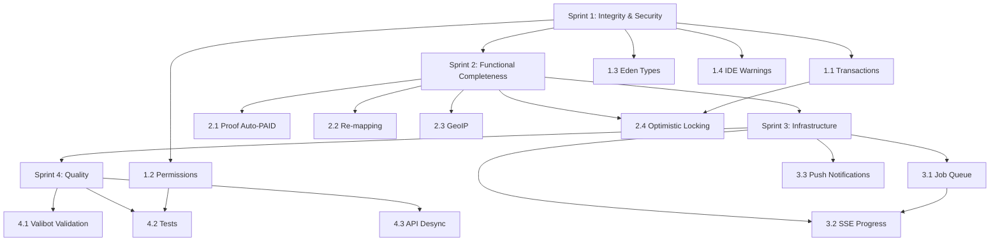

# Comprehensive Implementation Plan — Remaining Gaps

**Date:** May 2, 2026  
**Current Grade:** B (7.2/10)  
**Target Grade:** A- (8.5/10)  
**Reference:** `audit-verification-report.md`, `POST_IMPLEMENTATION_AUDIT.md`

---

## Architecture Context

| Component | Technology | Key Detail |
|-----------|-----------|------------|
| Runtime | Bun | SQLite native, fast startup |
| Framework | ElysiaJS | Eden Treaty for type-safe client |
| ORM | Drizzle ORM | `db.transaction()` available, used once in `bank-account.repo.ts:76` |
| Database | SQLite (bun:sqlite) | Single-file, no connection pooling needed |
| Frontend | SvelteKit 5 | Server-side remotes via `$app/server` `form()` |
| Validation | Valibot | Used in frontend, NOT in backend repos |
| Auth | JWT + Session | Redis cache, 10-step auth flow in `session-auth.plugin.ts` |

---

## Sprint 1 — Integrity & Security

### 1.1 Add `db.transaction()` to Multi-Write Handlers

**Problem:** `register.handler.ts` performs 4+ writes (user create → debt linking → email verification → session create) without atomicity. `confirm.handler.ts` does read-then-write (TOCTOU). `proof.handler.ts` does file save + debt update non-atomically.

**Solution:** Wrap critical multi-step operations in `db.transaction()`.

**Files to modify:**

| File | Change |
|------|--------|
| [`register.handler.ts`](../api/src/modules/auth/handlers/register.handler.ts) | Wrap lines 68-131 in `db.transaction(async (tx) => { ... })`. Pass `tx` to `userRepo.create()`, `debtRepo.linkDebtsToUser()`, `emailVerificationRepo.create()`, `sessionRepo.create()`. |
| [`confirm.handler.ts`](../api/src/modules/debts/handlers/confirm.handler.ts) | Wrap lines 9-49 in transaction. Use `SELECT ... FOR UPDATE` equivalent (SQLite exclusive transaction) to prevent TOCTOU on `findById` + `update`. |
| [`proof.handler.ts`](../api/src/modules/storage/handlers/proof.handler.ts) | Wrap lines 33-77 (file upload + debt update) in transaction. If debt update fails, roll back file metadata. |
| [`register.handler.ts`](../api/src/modules/auth/handlers/register.handler.ts) | Also wrap `password.handler.ts` password change flow (session revocation + password update). |

**Implementation pattern:**
```typescript
// In handler
import { db } from '@/providers/database';

const result = await db.transaction(async (tx) => {
  const user = await userRepo.createWithTx(tx, { ... });
  await debtRepo.linkDebtsToUserWithTx(tx, user.id, phone);
  await sessionRepo.createWithTx(tx, { ... });
  return user;
});
```

**Repository changes needed:**
- Add `*WithTx(tx)` variants to `UserRepository`, `DebtRepository`, `SessionRepository`, `EmailVerificationRepository`
- These accept a `tx` parameter and use `tx.insert()` / `tx.update()` instead of `this.database.insert()`
- Alternatively, refactor repos to accept `db | tx` in constructor (cleaner long-term)

**Estimated scope:** 4 handlers + 4 repositories (add tx variants)

---

### 1.2 Implement `requirePermission()` Macro

**Problem:** [`permissions.ts`](../api/src/commons/security/permissions.ts) defines 11 permissions and `hasPermission()`, but [`actor.plugin.ts`](../api/src/modules/auth/plugins/actor.plugin.ts:73) only has `requireActor` macro. No handler calls `hasPermission()`. Admin checks are manual `role !== 'admin'`.

**Solution:** Add `requirePermission()` macro to actor plugin, then apply to routes.

**Files to modify:**

| File | Change |
|------|--------|
| [`actor.plugin.ts`](../api/src/modules/auth/plugins/actor.plugin.ts) | Add `requirePermission` macro alongside existing `requireActor`. Accepts `Permission` or `Permission[]`. Returns 403 if missing. |
| [`require-user.ts`](../api/src/commons/http/require-user.ts) | Add `requirePermission(permission)` variant that checks `hasPermission(ctx.permissions, permission)`. |
| [`admin.handler.ts`](../api/src/modules/user/handlers/admin.handler.ts) | Replace manual `role !== 'admin'` with `requirePermission('admin:view')`. |
| [`data.routes.ts`](../api/src/modules/data/routes.ts) | Add `requirePermission('admin:import')` to import route. |
| [`debt.routes.ts`](../api/src/modules/debts/routes.ts) | Add `requirePermission('debt:create')` to create route, `debt:view-own` to list/get, etc. |

**Implementation:**
```typescript
// In actor.plugin.ts — add to macro
requirePermission(this: void, permission: Permission | Permission[]) {
  const required = Array.isArray(permission) ? permission : [permission];
  
  onBeforeHandle((ctx: ActorContext & { permissions: string[] }) => {
    if (!ctx.actor) {
      ctx.set.status = 401;
      return apiError(BE_ERRORS.AUTH_NO_SESSION);
    }
    if (!hasAnyPermission(ctx.permissions, required)) {
      ctx.set.status = 403;
      return apiError(BE_ERRORS.PERMISSION_DENIED);
    }
  });
}
```

**Route mapping:**

| Route | Permission |
|-------|-----------|
| `POST /debts` | `debt:create` |
| `GET /debts` | `debt:view-own` |
| `GET /debts/:id` | `debt:view-own` |
| `PATCH /debts/:id` | `debt:update-own` |
| `DELETE /debts/:id` | `debt:delete-own` |
| `GET /admin/*` | `admin:view` |
| `POST /data/import` | `admin:import` |
| `GET /data/export?type=users` | `admin:view` |

**Estimated scope:** 1 plugin + 1 utility + 3 route files

---

### 1.3 Fix Eden Treaty Type Inference

**Problem:** [`auth.remote.ts`](src/lib/remotes/auth.remote.ts:13) line 13 has `Property 'v1' does not exist` error. The `App` type from `@repo/api/types` is stale/mismatched.

**Solution:** Regenerate the `@repo/api/types` package.

**Files to modify:**

| File | Change |
|------|--------|
| `packages/api/types` (or wherever `@repo/api/types` is generated) | Regenerate by running the Elysia type export. Typically `bun run build` in the API package or a dedicated `generate-types` script. |
| [`api.ts`](src/lib/services/api.ts) | Verify `App` type import resolves correctly after regeneration. |
| [`debts.remote.ts`](src/lib/remotes/debts.remote.ts) | Remove `as any` casts on lines 21, 67, 169 once types are correct. |

**Steps:**
1. Find the type generation script in `apps/api/package.json`
2. Run it to regenerate `@repo/api/types`
3. Verify `api.v1` resolves correctly
4. Remove all `as any` casts in frontend remotes

**Estimated scope:** 1 build script + cleanup in 3-4 remote files

---

### 1.4 Fix IDE Warnings

**Problem:** Multiple `any` types, unused imports, restricted imports.

**Files to modify:**

| File | Line | Fix |
|------|------|-----|
| [`activity-logger.ts`](../api/src/commons/activity-logger.ts:12) | 12 | Remove unused `randomUUIDv7` import |
| [`activity-logger.ts`](../api/src/commons/activity-logger.ts:62) | 62 | Type the `activityRepo.create()` param properly instead of `as any` |
| [`import.handler.ts`](../api/src/modules/data/handlers/import.handler.ts:214) | 214 | Prefix unused `body` with `_body` |
| [`bootstrap.ts`](../api/src/bootstrap.ts:42) | 42 | Type `appInstance` as `Elysia \| null` instead of `any` |
| [`debt.repo.ts`](../api/src/repositories/debt/debt.repo.ts:1-2) | 1-2 | Verify `@repo/db` import is acceptable (repos are the correct layer for DB access) |
| [`file.repo.ts`](../api/src/repositories/storage/file.repo.ts:36,65) | 36,65 | Add proper types to raw DB operations |

**Estimated scope:** 6 files, targeted fixes

---

## Sprint 2 — Functional Completeness

### 2.1 Implement Proof Approval → Auto-PAID Flow

**Problem:** [`proof.handler.ts`](../api/src/modules/storage/handlers/proof.handler.ts:99) `approve` doesn't link proof to debt or auto-mark PAID. Comment says "simplified approach". No `payment_proofs` table.

**Solution:** Create a `payment_proofs` table and implement full approval workflow.

**New files:**

| File | Purpose |
|------|---------|
| `packages/db/src/schema/payment-proof.schema.ts` | New table: `id`, `debtId`, `fileId`, `uploadedById`, `status` (pending/approved/rejected), `rejectedReason`, `approvedById`, `approvedAt`, `createdAt` |
| `packages/db/drizzle/0010_payment_proofs.sql` | Migration for new table |
| `../api/src/repositories/storage/payment-proof.repo.ts` | CRUD operations for payment proofs |

**Files to modify:**

| File | Change |
|------|--------|
| [`proof.handler.ts`](../api/src/modules/storage/handlers/proof.handler.ts) | `upload`: Create `payment_proofs` record linking file to debt. `approve`: Update proof status, check if all proofs for debt are approved → auto-mark debt as `paid`. `reject`: Update proof status with reason. |
| [`debt.schema.ts`](../../packages/db/src/schema/debt.schema.ts) | Add `version` field for optimistic locking (see 2.4). |
| [`proof.handler.ts`](../api/src/modules/storage/handlers/proof.handler.ts) | Wrap approve flow in transaction (proof update + potential debt status change). |

**Approval logic:**
```typescript
// In approve handler
const allProofs = await proofRepo.findByDebtId(proof.debtId);
const allApproved = allProofs.every(p => p.status === 'approved' || p.id === id);

if (allApproved) {
  await debtRepo.update(proof.debtId, { status: 'paid', updatedAt: new Date() });
}
```

**Estimated scope:** 1 new schema + 1 migration + 1 new repo + 1 handler rewrite

---

### 2.2 Implement Re-mapping Flow

**Problem:** [`import.handler.ts`](../api/src/modules/data/handlers/import.handler.ts:213) remap is a stub. Returns message only.

**Solution:** Store raw import JSON in a `raw_data` column on `import_logs` table, then re-process with new column mapping.

**Files to modify:**

| File | Change |
|------|---------|
| [`import-log.schema.ts`](../../packages/db/src/schema/import-log.schema.ts) | Add `rawData` text column (JSON string of original import data). |
| `packages/db/drizzle/0011_import_raw_data.sql` | Migration to add column. |
| [`import.handler.ts`](../api/src/modules/data/handlers/import.handler.ts) | `importData`: Store `JSON.stringify(importData)` in `rawData` column. `remap`: Read `rawData`, apply new column mapping, re-process through `processBatch()`. |
| [`import.repo.ts`](../api/src/repositories/data/import.repo.ts) | Add `getRawData(id)` method. |

**Remap implementation:**
```typescript
remap: async ({ params, body, user, set }) => {
  const log = await importRepo.getLogById(params.id, user.id);
  if (!log?.rawData) {
    set.status = 400;
    return apiError(BE_ERRORS.IMPORT_NO_RAW_DATA);
  }

  const rawData = JSON.parse(log.rawData);
  const remapped = rawData.map((row: Record<string, unknown>) => ({
    debtorPhone: row[body.columnMap.debtorPhone] || row.debtorPhone,
    creditorPhone: row[body.columnMap.creditorPhone] || row.creditorPhone,
    amount: Number(row[body.columnMap.amount] || row.amount),
    // ... etc
  }));

  // Re-process with new mapping
  const newLogId = randomUUIDv7();
  // ... create new import log and process
}
```

**Estimated scope:** 1 schema change + 1 migration + 1 handler rewrite + 1 repo update

---

### 2.3 Integrate GeoIP for `getLocation()`

**Problem:** [`auth.service.ts`](../api/src/modules/auth/services/auth.service.ts:92) returns hardcoded `'Remote Location'`.

**Solution:** Use a free GeoIP service (ip-api.com or similar).

**Files to modify:**

| File | Change |
|------|--------|
| [`auth.service.ts`](../api/src/modules/auth/services/auth.service.ts) | Replace `getLocation()` stub with actual HTTP call to GeoIP API. Cache results in Redis with 24h TTL. |

**Implementation:**
```typescript
export async function getLocation(ip: string): Promise<string> {
  if (ip === '127.0.0.1' || ip === '::1') return 'Localhost';

  // Check Redis cache first
  const cached = await geoCache.get(`geo:${ip}`);
  if (cached) return cached;

  try {
    const res = await fetch(`http://ip-api.com/json/${ip}?fields=city,country`);
    const data = await res.json();
    const location = [data.city, data.country].filter(Boolean).join(', ') || 'Unknown';
    await geoCache.set(`geo:${ip}`, location, { ex: 86400 }); // 24h
    return location;
  } catch {
    return 'Unknown';
  }
}
```

**Estimated scope:** 1 file, ~20 lines

---

### 2.4 Add Optimistic Locking

**Problem:** TOCTOU race conditions on debt updates. `findById()` then `update()` without locking.

**Solution:** Add `version` field to debts table.

**Files to modify:**

| File | Change |
|------|---------|
| [`debt.schema.ts`](../../packages/db/src/schema/debt.schema.ts) | Add `version: integer('version').notNull().default(1)` |
| `packages/db/drizzle/0012_debt_version.sql` | Migration |
| [`debt.repo.ts`](../api/src/repositories/debt/debt.repo.ts) | `update()`: Add `WHERE version = ?` condition. Increment version. Return null if no rows affected (version mismatch). |
| All debt handlers | Handle `update()` returning `null` as conflict (409 status). |

**Implementation:**
```typescript
async update(id: string, data: Partial<Debt> & { updatedAt: Date }): Promise<Debt | null> {
  const current = await this.findById(id);
  if (!current) return null;

  const [updated] = await this.database
    .update(debts)
    .set({ ...data, version: (current.version || 0) + 1 })
    .where(and(eq(debts.id, id), eq(debts.version, current.version || 0)))
    .returning();
  return updated || null;
}
```

**Estimated scope:** 1 schema + 1 migration + 1 repo + handler updates (add 409 handling)

---

## Sprint 3 — Infrastructure

### 3.1 Add Background Job Queue

**Problem:** Import processing blocks HTTP request. `lastActiveAt` is fire-and-forget with no retry.

**Solution:** Use Bun's built-in `Worker` threads or a lightweight in-process queue (no external dependency like BullMQ for SQLite-based app).

**New files:**

| File | Purpose |
|------|---------|
| `../api/src/commons/queue/job-queue.ts` | Simple in-process job queue with retry, dead-letter support |
| `../api/src/commons/queue/workers/import-worker.ts` | Worker for import batch processing |
| `../api/src/commons/queue/workers/session-worker.ts` | Worker for `lastActiveAt` updates |

**Implementation approach:**
```typescript
// job-queue.ts — Simple in-process queue
class JobQueue {
  private queue: Job[] = [];
  private processing = false;

  async add(job: Job): Promise<string> {
    const id = randomUUIDv7();
    this.queue.push({ ...job, id, status: 'pending', attempts: 0 });
    this.processNext();
    return id;
  }

  private async processNext() {
    if (this.processing || this.queue.length === 0) return;
    this.processing = true;
    const job = this.queue.shift()!;
    try {
      await job.handler(job.data);
    } catch (err) {
      if (job.attempts < job.maxRetries) {
        job.attempts++;
        this.queue.push(job); // Re-queue
      }
    } finally {
      this.processing = false;
      this.processNext();
    }
  }
}
```

**Files to modify:**

| File | Change |
|------|--------|
| [`import.handler.ts`](../api/src/modules/data/handlers/import.handler.ts) | `importData`: Create import log, enqueue job, return immediately with `importId`. Add SSE endpoint for progress. |
| [`session-auth.plugin.ts`](../api/src/modules/auth/plugins/session-auth.plugin.ts:162) | Replace `Promise.resolve().then(...)` with `jobQueue.add({ type: 'updateLastActive', ... })`. |
| [`activity-logger.ts`](../api/src/commons/activity-logger.ts:50) | Replace `Promise.resolve().then(...)` with `jobQueue.add({ type: 'logActivity', ... })`. |

**Estimated scope:** 3 new files + 3 handler modifications

---

### 3.2 Add SSE Progress Streaming

**Problem:** Large imports have no real-time feedback. Current progress is poll-based.

**Solution:** Add SSE endpoint that streams import progress from Redis/in-memory store.

**Files to modify:**

| File | Change |
|------|--------|
| [`import.handler.ts`](../api/src/modules/data/handlers/import.handler.ts) | Add `GET /data/import/:id/progress/stream` SSE endpoint. |
| [`data.routes.ts`](../api/src/modules/data/routes.ts) | Register SSE route. |
| Job queue (from 3.1) | Emit progress events as batches complete. |

**Implementation:**
```typescript
// SSE endpoint
progressStream: async ({ params, user, set }: ImportProgressContext) => {
  const log = await importRepo.getLogById(params.id, user.id);
  if (!log) { set.status = 404; return apiError(GEN_ERRORS.NOT_FOUND); }

  set.headers['Content-Type'] = 'text/event-stream';
  set.headers['Cache-Control'] = 'no-cache';
  set.headers['Connection'] = 'keep-alive';

  return new Response(
    new ReadableStream({
      start(controller) {
        const interval = setInterval(async () => {
          const progress = await importRepo.getLogById(params.id, user.id);
          const data = JSON.stringify({
            status: progress.status,
            imported: progress.importedCount,
            errors: progress.errorCount,
            total: progress.totalRows
          });
          controller.enqueue(`data: ${data}\n\n`);

          if (progress.status === 'success' || progress.status === 'failed') {
            controller.close();
            clearInterval(interval);
          }
        }, 1000);
      }
    })
  );
}
```

**Estimated scope:** 1 handler addition + 1 route registration

---

### 3.3 Implement Push Notification Sending

**Problem:** [`notification.handler.ts`](../api/src/modules/notification/handlers/notification.handler.ts) only has CRUD. No actual push sending. Types exist in [`push.ts`](../api/src/modules/notification/types/push.ts). Schema exists in [`push-subscription.schema.ts`](../../packages/db/src/schema/push-subscription.schema.ts).

**Solution:** Install `web-push` library, implement VAPID key management, add `sendPush()` service.

**New files:**

| File | Purpose |
|------|---------|
| `../api/src/modules/notification/services/push.service.ts` | `sendPush()`, `sendPushToUser()`, `sendPushToAll()` |
| `../api/src/modules/notification/handlers/subscription.handler.ts` | Subscribe/unsubscribe endpoints |

**Files to modify:**

| File | Change |
|------|--------|
| `apps/api/package.json` | Add `web-push` dependency |
| [`notification.handler.ts`](../api/src/modules/notification/handlers/notification.handler.ts) | Add `subscribe`, `unsubscribe` handlers. |
| [`notification.routes.ts`](../api/src/modules/notification/routes.ts) | Add subscription routes. |
| [`create.handler.ts`](../api/src/modules/debts/handlers/create.handler.ts) | After debt creation, call `sendPushToUser(debtorId, { title: 'New Debt', body: `...` })`. |
| [`confirm.handler.ts`](../api/src/modules/debts/handlers/confirm.handler.ts) | After confirmation, notify counterparty. |
| `.env` | Add `VAPID_PUBLIC_KEY`, `VAPID_PRIVATE_KEY`, `VAPID_EMAIL` |

**Push service implementation:**
```typescript
import webPush from 'web-push';

webPush.setVapidDetails(
  process.env.VAPID_EMAIL!,
  process.env.VAPID_PUBLIC_KEY!,
  process.env.VAPID_PRIVATE_KEY!
);

export async function sendPushToUser(userId: string, payload: PushPayload): Promise<SendResult> {
  const subscriptions = await pushSubRepo.findActiveByUserId(userId);
  const results = await Promise.allSettled(
    subscriptions.map(sub => webPush.sendNotification(
      { endpoint: sub.endpoint, keys: { p256dh: sub.p256dhKey, auth: sub.authKey } },
      JSON.stringify(payload)
    ))
  );
  // Handle failures, deactivate dead subscriptions
}
```

**Estimated scope:** 1 new dependency + 2 new files + 4 handler modifications

---

## Sprint 4 — Quality

### 4.1 Add Repository-Level Valibot Validation

**Problem:** All repos use raw `insert().values()` without defense-in-depth. If API validation is bypassed, bad data enters DB.

**Solution:** Add Valibot schemas for repo write operations.

**Files to modify:**

| File | Change |
|------|--------|
| [`debt.repo.ts`](../api/src/repositories/debt/debt.repo.ts) | Add `createDebtSchema` using Valibot. Validate in `create()` before `insert().values()`. |
| [`user.repo.ts`](../api/src/repositories/user/user.repo.ts) | Add validation for `create()` and `update()`. |
| [`session.repo.ts`](../api/src/repositories/auth/session.repo.ts) | Add validation for `create()`. |
| [`file.repo.ts`](../api/src/repositories/storage/file.repo.ts) | Add validation for `createUpload()`. |

**Implementation pattern:**
```typescript
import * as v from 'valibot';

const createDebtSchema = v.object({
  debtorPhone: v.string(),
  creditorPhone: v.string(),
  amount: v.number([v.minValue(1)]),
  currency: v.string([v.length(3)]),
  // ...
});

async create(data: Omit<NewDebt, 'id' | 'createdAt' | 'updatedAt'>): Promise<Debt> {
  const validated = v.parse(createDebtSchema, data);
  const now = new Date();
  const [created] = await this.database.insert(debts).values({
    ...validated,
    id: crypto.randomUUID(),
    createdAt: now,
    updatedAt: now
  }).returning();
  return created;
}
```

**Estimated scope:** 4 repo files + Valibot schema definitions

---

### 4.2 Expand Test Coverage

**Problem:** Estimated <10% coverage. All new handlers lack tests.

**Solution:** Add integration tests for all critical handlers.

**New test files:**

| File | Tests |
|------|-------|
| `apps/api/tests/handlers/auth.test.ts` | Register, login, password change, session management |
| `apps/api/tests/handlers/debts.test.ts` | Create, confirm (two-party), complete, cancel, suggest, respond |
| `apps/api/tests/handlers/proof.test.ts` | Upload, approve, reject, auto-PAID |
| `apps/api/tests/handlers/import.test.ts` | Import, progress, remap |
| `apps/api/tests/handlers/permissions.test.ts` | Permission enforcement on all routes |
| `apps/api/tests/services/push.test.ts` | Push notification sending |

**Test approach:**
- Use Bun's built-in test runner (`bun test`)
- Create test database (in-memory SQLite)
- Seed test data before each test
- Test both happy path and error cases
- Test permission enforcement (401/403)

**Estimated scope:** 6 test files, ~200-300 test cases

---

### 4.3 Fix Frontend-Backend API Desync

**Problem:** [`debts.remote.ts`](src/lib/remotes/debts.remote.ts) calls endpoints that don't exist in backend:
- `batch.delete` → No route
- `status.patch` → No route (should use `confirm.post`, `complete.post`, `cancel.post`)
- `all.delete` → No route
- `upload.proof.approve.post` → Route exists at `/storage/proof/:id/approve`
- `upload.proof.reject.post` → Route exists at `/storage/proof/:id/reject`

**Solution:** Align frontend remotes with actual backend routes.

**Files to modify:**

| File | Change |
|------|--------|
| [`debts.remote.ts`](src/lib/remotes/debts.remote.ts) | `batchDeleteDebts`: Either add backend route `POST /debts/batch-delete` or loop individual deletes. `updateDebtStatus`: Replace with specific action calls (`confirm`, `complete`, `cancel`). `deleteAllDebts`: Either add backend route or remove feature. `approveProof`/`rejectProof`: Fix path to match `/storage/proof/:id/approve`. |

**Decision needed:** Add batch endpoints to backend OR simplify frontend to use individual calls.

**Recommended:** Add batch endpoints (better UX for bulk operations).

**New backend routes:**
```
POST /debts/batch-delete  → batch delete handler
DELETE /debts/all          → delete all handler (admin only)
PATCH /debts/:id/status   → generic status update handler
```

**Estimated scope:** 3 new backend handlers + frontend remote updates

---

## Implementation Order & Dependencies



---

## Risk Assessment

| Risk | Impact | Mitigation |
|------|--------|------------|
| SQLite `transaction()` with concurrent writes | Medium — SQLite has single-writer lock | Use WAL mode, keep transactions short |
| `web-push` library compatibility with Bun | Medium — native bindings may not work | Test early, fallback to HTTP-based push API |
| Eden Treaty type regeneration breaks existing types | High — cascading type errors | Regenerate in isolated branch, fix incrementally |
| Adding `version` field requires migration on existing data | Low — default value handles it | Migration sets `version = 1` for all existing rows |
| In-process job queue lost on server restart | Medium — pending jobs lost | Persist job state to SQLite, replay on startup |

---

## Success Criteria

| Metric | Current | Target |
|--------|---------|--------|
| Overall Grade | B (7.2/10) | A- (8.5/10) |
| Database Transactions | 0 handlers | 4+ critical handlers |
| Permission Enforcement | 0 routes | All protected routes |
| Test Coverage | <10% | 50%+ |
| Background Processing | Synchronous | Queue-based |
| Push Notifications | Types only | Fully functional |
| Repository Validation | None | Valibot on all writes |
| API Desync | 6+ broken calls | 0 broken calls |
