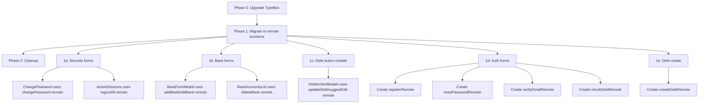

# Form & UI Audit Fix Plan — `apps/web` (Revised)

> **Scope**: All 7 categories. Revised to align with the existing `form()` remote function pattern already used in `auth.remote.ts`, `banks.remote.ts`, `debts.remote.ts`, and `security.remote.ts`.

---

## Guiding Principles

1. **No hidden inputs** — use `form()` remote functions with direct data passing (like [`loginRemote`](src/lib/remotes/auth.remote.ts:8))
2. **No `<form method="POST" action="?/..." use:enhance>`** — replace with `remoteFunction.enhance()` pattern
3. **Upgrade `@sinclair/typebox`** to `typebox` v1.0+ monorepo-wide to eliminate all casts
4. **Use `toStandardSchema()`** from [`@repo/schema/adapters`](../../packages/schema/src/adapters/standard-schema.ts:31) for remote function validation

---

## Phase 0: Upgrade TypeBox Monorepo-wide

### Problem

`@sinclair/typebox` v0.34 is used across the monorepo, but `sveltekit-superforms`' `typebox()` adapter expects the `typebox` v1.0+ package format. This forces the ugly cast:

```ts
typebox(schema as unknown as TSchema & { '~kind': string })
```

### Solution

Replace `@sinclair/typebox` with `typebox` v1.0+ in all packages.

#### Step 0.1: Update root `package.json` override

```jsonc
// ../../package.json — overrides section
{
  "overrides": {
    "@sinclair/typebox": "typebox@^1.0.0",  // redirect old package to new
    // ... other overrides
  }
}
```

#### Step 0.2: Update `packages/schema/package.json`

```jsonc
{
  "dependencies": {
    "typebox": "^1.0.0"  // was "@sinclair/typebox": "^0.34.8"
  }
}
```

#### Step 0.3: Update `packages/api/package.json`

```jsonc
{
  "dependencies": {
    "typebox": "^1.0.0"  // was "@sinclair/typebox": "^0.34.8"
  }
}
```

#### Step 0.4: Update `apps/web/package.json`

```jsonc
{
  "dependencies": {
    "typebox": "^1.0.0"  // was "@sinclair/typebox": "^0.34.8"
  }
}
```

#### Step 0.5: Find-and-replace all imports

Across the entire monorepo, replace:

```ts
// BEFORE
import { Type, TSchema, Static } from '@sinclair/typebox';
import { TypeCompiler } from '@sinclair/typebox/compiler';

// AFTER
import { Type, TSchema, Static } from 'typebox';
import { TypeCompiler } from 'typebox/compiler';
```

#### Step 0.6: Remove the cast from `toStandardSchema()`

After upgrade, [`toStandardSchema()`](../../packages/schema/src/adapters/standard-schema.ts:31) no longer needs special handling — the `typebox()` adapter from superforms will accept the schema directly.

#### Step 0.7: Remove `typeboxAdapter()` wrapper concept

With the upgrade, every call site can use `typebox(schema)` directly — no cast needed:

```ts
// AFTER — clean, no cast
import { typebox } from 'sveltekit-superforms/adapters';
import { registerRequestSchema } from '@repo/schema/dto/auth';
const adapter = typebox(registerRequestSchema);
```

#### Files affected

| Package | Files |
|---------|-------|
| `packages/schema` | All `.ts` files importing from `@sinclair/typebox` |
| `packages/api` | All `.ts` files importing from `@sinclair/typebox` |
| `apps/web` | [`signup/+page.server.ts`](src/routes/(auth)/signup/+page.server.ts:7), [`security/+page.server.ts`](src/routes/(admin)/settings/security/+page.server.ts:8), [`banks/+page.server.ts`](src/routes/(admin)/settings/banks/+page.server.ts:9), [`debts/[id]/+page.server.ts`](src/routes/(admin)/debts/[id]/+page.server.ts:8), [`BankFormModal.svelte`](src/routes/(admin)/settings/banks/components/BankFormModal.svelte:11), [`ChangePassword.svelte`](src/routes/(admin)/settings/security/components/ChangePassword.svelte:9), [`DebtActionModals.svelte`](src/routes/(admin)/debts/[id]/components/DebtActionModals.svelte:13), [`security.remote.ts`](src/lib/remotes/security.remote.ts:3) |

---

## Phase 1: Migrate Forms to `form()` Remote Functions

### Pattern Reference

The login page already demonstrates the target pattern:

```svelte
<!-- src/routes/(auth)/login/+page.svelte -->
<script>
  import { loginRemote } from '$lib/remotes/auth.remote';
</script>

<form {...loginRemote.enhance(async ({ submit }) => {
  isSubmitting = true;
  try { await submit(); }
  finally { isSubmitting = false; }
})}>
  <FormInput bind:value={email} ... />
  <Button type="submit">Sign in</Button>
</form>
```

No `method="POST"`, no `action="?/..."`, no `use:enhance`, no `formData.set()`. The remote function handles everything.

---

### 1a. Migrate `ChangePassword.svelte` + `ActiveSessions.svelte`

**Remote functions already exist**: [`changePassword`](src/lib/remotes/security.remote.ts:37) and [`logoutAll`](src/lib/remotes/security.remote.ts:22) in [`security.remote.ts`](src/lib/remotes/security.remote.ts).

#### [`ChangePassword.svelte`](src/routes/(admin)/settings/security/components/ChangePassword.svelte)

**Current**: Uses `superForm` with `typebox()` adapter, `<form method="POST" action="?/changePassword" use:enhance>`.

**Fix**: Replace with `changePassword` remote function:

```svelte
<script>
  import { changePassword } from '$lib/remotes/security.remote';
  import { changePasswordSchema } from '@repo/schema/dto/auth';
  import { validateField } from '@repo/schema/adapters';

  let currentPassword = $state('');
  let newPassword = $state('');
  let confirmPassword = $state('');
  let isSubmitting = $state(false);

  // Client-side validation using shared schemas
  const passwordValidation = $derived(validateField(changePasswordSchema.properties.newPassword, newPassword));
  // ... other derived validations
</script>

<form {...changePassword.enhance(async ({ submit }) => {
  isSubmitting = true;
  try { await submit(); }
  finally { isSubmitting = false; }
})}>
  <FormInput name="currentPassword" bind:value={currentPassword} ... />
  <FormInput name="newPassword" bind:value={newPassword} ... />
  <FormInput name="confirmPassword" bind:value={confirmPassword} ... />
  <Button type="submit" disabled={isSubmitting}>Update Password</Button>
</form>
```

**Also removes**: `superForm` import, `typebox()` adapter, `typeboxAdapter` cast, `any` prop type for `initialData`.

#### [`ActiveSessions.svelte`](src/routes/(admin)/settings/security/components/ActiveSessions.svelte)

**Current**: `<form method="POST" action="?/logoutAll" use:enhance>` inside `<AlertDialog.Footer>`.

**Fix**: Use `logoutAll` remote function:

```svelte
<script>
  import { logoutAll } from '$lib/remotes/security.remote';
</script>

<AlertDialog.Content>
  <AlertDialog.Header>...</AlertDialog.Header>
  <AlertDialog.Footer>
    <AlertDialog.Cancel>Cancel</AlertDialog.Cancel>
    <form {...logoutAll.enhance(async ({ submit }) => {
      isLoggingOutAll = true;
      try { await submit(); }
      finally { isLoggingOutAll = false; }
    })}>
      <Button type="submit" variant="destructive" disabled={isLoggingOutAll}>
        Yes, logout all
      </Button>
    </form>
  </AlertDialog.Footer>
</AlertDialog.Content>
```

**Also removes**: `enhance` import from `$app/forms`, `formData.set()` pattern.

#### [`security/+page.server.ts`](src/routes/(admin)/settings/security/+page.server.ts)

**Current**: Has `actions.changePassword` with `superValidate` + `typebox()` adapter.

**Fix**: Remove the `changePassword` action entirely — the remote function handles it. Keep only the `load` function (but remove the `superValidate` call for the password form since it's no longer needed).

---

### 1b. Migrate `BankFormModal.svelte` + `BankAccountsList.svelte`

**Remote functions already exist**: [`addBank`](src/lib/remotes/banks.remote.ts:5), [`editBank`](src/lib/remotes/banks.remote.ts:32), [`deleteBank`](src/lib/remotes/banks.remote.ts:58) in [`banks.remote.ts`](src/lib/remotes/banks.remote.ts).

#### [`BankFormModal.svelte`](src/routes/(admin)/settings/banks/components/BankFormModal.svelte)

**Current**: Uses `superForm` with `typebox()` adapter, `<form method="POST" action="?/upsert" use:enhance>`.

**Fix**: Use `addBank` or `editBank` remote function based on `isEditing`:

```svelte
<script>
  import { addBank, editBank } from '$lib/remotes/banks.remote';

  let bankCode = $state('');
  let accountNumber = $state('');
  let accountName = $state('');
  let isDefault = $state(false);
  let isSubmitting = $state(false);

  // When bank is selected, derive bankName and bankBin
  let selectedBank = $derived(banks.find(b => b.code === bankCode));

  const activeRemote = $derived(isEditing ? editBank : addBank);
</script>

<form {...activeRemote.enhance(async ({ submit, data }) => {
  // Set derived fields before submit
  data.set('bankCode', bankCode);
  data.set('bankName', selectedBank?.shortName ?? '');
  data.set('bankBin', selectedBank?.bin ?? '');
  data.set('accountNumber', accountNumber);
  data.set('accountName', accountName);
  data.set('isDefault', isDefault ? 'on' : '');
  if (isEditing && initialData.data?.id) {
    data.set('id', initialData.data.id);
  }
  isSubmitting = true;
  try { await submit(); }
  finally { isSubmitting = false; }
})}>
  <!-- Bank select, account number, account name, isDefault checkbox -->
  <Button type="submit" disabled={isSubmitting}>Add Account</Button>
</form>
```

**Also removes**: `superForm` import, `typebox()` adapter, `any` prop type, `$effect()` for bankName/bankBin, `$errors` manual wiring.

**Note**: The `enhance` callback's `data` parameter is the FormData object — setting fields here is the proper SvelteKit pattern (not hidden inputs). This is how the framework intends form data to be augmented.

#### [`BankAccountsList.svelte`](src/routes/(admin)/settings/banks/components/BankAccountsList.svelte)

**Current**: `<form method="POST" action="?/delete" use:enhance>` with `formData.append('id', account.id)`.

**Fix**: Use `deleteBank` remote function:

```svelte
<script>
  import { deleteBank } from '$lib/remotes/banks.remote';
</script>

<AlertDialog.Content>
  <AlertDialog.Header>...</AlertDialog.Header>
  <AlertDialog.Footer>
    <AlertDialog.Cancel>Cancel</AlertDialog.Cancel>
    <form {...deleteBank.enhance(async ({ submit, data }) => {
      data.set('id', account.id);
      isDeleting = true;
      try { await submit(); }
      finally { isDeleting = false; }
    })}>
      <Button type="submit" variant="destructive" disabled={isDeleting}>Delete</Button>
    </form>
  </AlertDialog.Footer>
</AlertDialog.Content>
```

**Also removes**: `enhance` import from `$app/forms`.

#### [`banks/+page.server.ts`](src/routes/(admin)/settings/banks/+page.server.ts)

**Current**: Has `actions.upsert` and `actions.delete` with `superValidate` + `typebox()` adapter.

**Fix**: Remove both actions — the remote functions handle them. Simplify `load` to only fetch data.

---

### 1c. Migrate `DebtActionModals.svelte`

**Remote functions already exist**: [`updateDebt`](src/lib/remotes/debts.remote.ts:99), [`suggestEdit`](src/lib/remotes/debts.remote.ts:161) in [`debts.remote.ts`](src/lib/remotes/debts.remote.ts).

#### [`DebtActionModals.svelte`](src/routes/(admin)/debts/[id]/components/DebtActionModals.svelte)

**Current**: Uses two `superForm` instances with `typebox()` adapters.

**Fix**: Use `updateDebt` and `suggestEdit` remote functions:

```svelte
<script>
  import { updateDebt, suggestEdit } from '$lib/remotes/debts.remote';

  let description = $state(debt.description ?? '');
  let amount = $state(debt.amount?.toString() ?? '');
  let note = $state('');
  let isSubmitting = $state(false);
</script>

<!-- Edit Debt Dialog -->
<form {...updateDebt.enhance(async ({ submit, data }) => {
  data.set('description', description);
  data.set('amount', amount);
  isSubmitting = true;
  try { await submit(); }
  finally { isSubmitting = false; }
})}>
  <FormInput name="description" bind:value={description} ... />
  <FormInput name="amount" bind:value={amount} ... />
  <Button type="submit">Save Changes</Button>
</form>

<!-- Suggest Edit Dialog -->
<form {...suggestEdit.enhance(async ({ submit, data }) => {
  data.set('amount', amount);
  data.set('description', description);
  data.set('note', note);
  isSubmitting = true;
  try { await submit(); }
  finally { isSubmitting = false; }
})}>
  <!-- fields -->
</form>
```

**Also removes**: Two `superForm` instances, `typebox()` adapters, `any`/`Record<string, unknown>` prop types.

#### [`debts/[id]/+page.server.ts`](src/routes/(admin)/debts/[id]/+page.server.ts)

**Current**: Has `actions.updateDebt` and `actions.suggestEdit` with `superValidate`.

**Fix**: Remove both actions. Keep only `load` (remove `superValidate` calls).

---

### 1d. Migrate Auth Forms

#### [`signup/+page.server.ts`](src/routes/(auth)/signup/+page.server.ts) + [`signup/+page.svelte`](src/routes/(auth)/signup/+page.svelte)

**Current**: Uses `superForm` + `typebox()` adapter with `actions.default`.

**Fix**: Create `registerRemote` in [`auth.remote.ts`](src/lib/remotes/auth.remote.ts):

```ts
// Add to src/lib/remotes/auth.remote.ts
export const registerRemote = form(
  toStandardSchema(registerRequestSchema),
  async ({ name, phoneNumber, email, password }) => {
    const event = getRequestEvent();
    const { fetch, cookies } = event;

    try {
      const api = createTreatyClient(fetch);
      const { error } = await api.v1.auth.register.post({
        fullName: name,
        phone: phoneNumber,
        email: email || undefined,
        password
      });

      if (error) {
        const msg = extractApiErrorMessage(error.value, 'Registration failed');
        invalid(msg.includes('already exists')
          ? 'An account with this phone number or email already exists.'
          : msg);
      }

      // If email provided, set cookie and redirect to verify
      if (email) {
        cookies.set('pending_verification_email', email, {
          path: '/', httpOnly: true, maxAge: 600
        });
        throw redirect(303, '/verify-email');
      }

      throw redirect(303, '/login?registered=true');
    } catch (err) {
      if (err && typeof err === 'object' && 'status' in err) throw err;
      invalid('Unable to connect to server. Please try again later.');
    }
  }
);
```

Then update `signup/+page.svelte` to use `registerRemote.enhance()`.

Remove `signup/+page.server.ts` actions (keep only `load`).

#### [`reset-password/+page.server.ts`](src/routes/(auth)/reset-password/+page.server.ts) + [`reset-password/+page.svelte`](src/routes/(auth)/reset-password/+page.svelte)

**Current**: `formData.set('token', ...)` and `formData.set('email', ...)` in enhance callback.

**Fix**: Create `resetPasswordRemote` in `auth.remote.ts`:

```ts
export const resetPasswordRemote = form(
  'unchecked' as const,
  async (data) => {
    const token = data.token as string;
    const newPassword = data.newPassword as string;

    if (!token || !newPassword) {
      invalid('Missing required reset fields');
    }

    try {
      const { fetch } = getRequestEvent();
      const api = createTreatyClient(fetch);
      const { error } = await api.v1.auth['reset-password'].post({ token, newPassword });

      if (error) {
        invalid(extractApiErrorMessage(error.value, 'Invalid or expired reset link'));
      }

      throw redirect(303, '/login?reset=success');
    } catch (err) {
      if (err && typeof err === 'object' && 'status' in err) throw err;
      invalid('Unable to connect to server. Please try again later.');
    }
  }
);
```

Then update `reset-password/+page.svelte`:

```svelte
<form {...resetPasswordRemote.enhance(async ({ submit, data }) => {
  data.set('token', pageData.token);
  data.set('email', pageData.email);
  isSubmitting = true;
  try { await submit(); }
  finally { isSubmitting = false; }
})}>
  <FormInput name="newPassword" bind:value={newPassword} ... />
  <FormInput name="confirmPassword" bind:value={confirmPassword} ... />
  <Button type="submit">Reset Password</Button>
</form>
```

Remove `reset-password/+page.server.ts` actions.

#### [`verify-email/+page.server.ts`](src/routes/(auth)/verify-email/+page.server.ts) + [`verify-email/+page.svelte`](src/routes/(auth)/verify-email/+page.svelte)

**Current**: `formData.set('otp', otp)` in enhance callback.

**Fix**: Create `verifyEmailRemote` and `skipVerificationRemote` in `auth.remote.ts`:

```ts
export const verifyEmailRemote = form(
  'unchecked' as const,
  async (data) => {
    const otp = data.otp as string;
    const { cookies, fetch } = getRequestEvent();
    const email = cookies.get('pending_verification_email');

    if (!email) invalid('No pending verification. Please sign up again.');
    if (!otp || otp.length !== 6) invalid('Please enter a valid 6-digit code');

    try {
      const api = createTreatyClient(fetch);
      const { error } = await api.v1.auth['verify-email'].post({ token: otp });

      if (error) {
        invalid(extractApiErrorMessage(error.value, 'Verification failed'));
      }

      cookies.delete('pending_verification_email', { path: '/' });
      throw redirect(303, '/login?verified=true');
    } catch (err) {
      if (err && typeof err === 'object' && 'status' in err) throw err;
      invalid('Unable to connect to server. Please try again.');
    }
  }
);

export const skipVerificationRemote = form(async () => {
  const { cookies } = getRequestEvent();
  cookies.delete('pending_verification_email', { path: '/' });
  throw redirect(303, '/login');
});
```

Then update `verify-email/+page.svelte`:

```svelte
<form {...verifyEmailRemote.enhance(async ({ submit, data }) => {
  data.set('otp', otp);
  isSubmitting = true;
  try { await submit(); }
  finally { isSubmitting = false; }
})}>
  <!-- OTP inputs -->
  <Button type="submit">Verify Email</Button>
</form>

<!-- Skip button -->
<form {...skipVerificationRemote.enhance(async ({ submit }) => {
  await submit();
})}>
  <Button variant="ghost" type="submit">Skip for now</Button>
</form>
```

Remove `verify-email/+page.server.ts` actions.

#### [`(app)/+page.svelte`](src/routes/(app)/+page.svelte)

**Current**: Raw `use:enhance` with no validation.

**Fix**: Create `checkDebtRemote` in a new `public.remote.ts`:

```ts
// src/lib/remotes/public.remote.ts
import { form } from '$app/server';
import { invalid } from '@sveltejs/kit';
import { createTreatyClient } from '$lib/services/api';
import { extractApiData, extractApiErrorMessage } from '$lib/services/api-envelope';

export const checkDebtRemote = form(
  'unchecked' as const,
  async (data) => {
    const phoneNumber = data.phoneNumber as string;
    if (!phoneNumber || phoneNumber.length < 9) {
      invalid('Please enter a valid phone number');
    }

    try {
      const { fetch } = getRequestEvent();
      const api = createTreatyClient(fetch);
      const { data: result, error } = await api.v1.debts.lookup.get({
        query: { phone: phoneNumber }
      });

      if (error) {
        invalid(extractApiErrorMessage(error.value, 'Failed to check debts'));
      }

      const parsed = extractApiData<{ hasDebts: boolean }>(result);
      return { success: true, result: { hasDebts: parsed.data?.hasDebts ?? false, phone: phoneNumber } };
    } catch {
      invalid('Unable to connect to server. Please try again later.');
    }
  }
);
```

Then update `(app)/+page.svelte` to use `checkDebtRemote.enhance()`.

Remove `(app)/+page.server.ts` `actions.checkDebt` if it exists.

---

### 1e. Migrate `CreateDebtModal.svelte` + `debts/create/+page.svelte`

**Remote functions needed**: Create `createDebtRemote` in [`debts.remote.ts`](src/lib/remotes/debts.remote.ts).

#### New remote function in `debts.remote.ts`

```ts
export const createDebtRemote = form(
  'unchecked' as const,
  async (data) => {
    const locals = ensureAuthenticated();

    const amount = Number(data.amount);
    const description = data.description as string;
    const counterpartyPhone = data.counterpartyPhone as string;
    const direction = data.direction as 'LEND' | 'BORROW';
    const expiryOption = (data.expiryOption as string) || 'never';
    const confirmDuplicate = data.confirmDuplicate === 'true';

    if (!amount || !description || !counterpartyPhone || !direction) {
      invalid('All fields are required');
    }

    // ... existing create debt logic from +page.server.ts
    // ... duplicate check, bank account check, etc.

    const { error } = await locals.api.v1.debts.post({
      amount, description, counterpartyPhone, direction,
      expiryOption, confirmDuplicate
    });

    if (error) {
      const msg = extractApiErrorMessage(error.value, 'Failed to create debt');
      // Handle DUPLICATE_WARNING specially
      invalid(msg);
    }

    return { success: true };
  }
);
```

#### [`CreateDebtModal.svelte`](src/lib/components/dashboard/CreateDebtModal.svelte)

**Current**: `formData.set()` for `direction`, `counterpartyPhone`, `expiryOption`, `confirmDuplicate`.

**Fix**: Use `createDebtRemote.enhance()`:

```svelte
<form {...createDebtRemote.enhance(async ({ submit, data }) => {
  data.set('direction', direction);
  data.set('counterpartyPhone', form.phoneNumber);
  data.set('expiryOption', 'never');
  data.set('confirmDuplicate', 'false');
  ui.isSubmitting = true;
  try { await submit(); }
  finally { ui.isSubmitting = false; }
})}>
  <!-- Step 1: phone + direction -->
  <!-- Step 2: amount + description -->
</form>
```

#### [`debts/create/+page.svelte`](src/routes/(admin)/debts/create/+page.svelte)

**Current**: `formData.set('confirmDuplicate', ...)` in enhance callback.

**Fix**: Use same `createDebtRemote.enhance()`:

```svelte
<form {...createDebtRemote.enhance(async ({ submit, data }) => {
  data.set('confirmDuplicate', confirmDuplicate.toString());
  isSubmitting = true;
  try { await submit(); }
  finally { isSubmitting = false; }
})}>
  <!-- form fields -->
</form>
```

Remove `debts/create/+page.server.ts` actions.

---

## Phase 2: Fix Remaining Issues

### 2a. Fix `any` Types on Props

After Phase 1, most `any` types are eliminated because the components no longer receive `superForm` data as props. For any remaining cases:

| File | Current | Fix |
|------|---------|-----|
| [`BankFormModal.svelte`](src/routes/(admin)/settings/banks/components/BankFormModal.svelte:22) | `initialData: any` | Type as `{ data: Partial<BankAccountRequest> }` |
| [`ChangePassword.svelte`](src/routes/(admin)/settings/security/components/ChangePassword.svelte:11) | `initialData: any` | Remove — no longer needed with remote functions |
| [`DebtActionModals.svelte`](src/routes/(admin)/debts/[id]/components/DebtActionModals.svelte:28) | `initialFormData: Record<string, unknown>` | Remove — no longer needed with remote functions |

### 2b. Category 6: BankFormModal Hidden Fields

**Resolved by Phase 1**: With `form()` remote functions, `bankName` and `bankBin` are set via `data.set()` in the enhance callback — no hidden inputs needed.

### 2c. Category 7: Raw `fetch()` Calls

| File | Verdict |
|------|---------|
| [`dashboard/+page.server.ts`](src/routes/(admin)/dashboard/+page.server.ts:44) | **Keep** — CSV binary export, Treaty can't handle |
| [`vietqr.ts`](src/lib/services/vietqr.ts:17) | **Keep** — External third-party API |
| [`ImportResultsDialog.svelte`](src/lib/components/import/ImportResultsDialog.svelte:24) | **Convert** — Create `query()` remote function |
| [`ImportActionsDialog.svelte`](src/lib/components/import/ImportActionsDialog.svelte:21) | **Convert** — Create `query()` remote function |

#### New file: `src/lib/remotes/import.remote.ts`

```ts
import { query, getRequestEvent } from '$app/server';

export const getImportResults = query(
  'unchecked' as const,
  async (logId: string) => {
    const { fetch } = getRequestEvent();
    const response = await fetch(`/dashboard/import/results/${logId}`);
    if (!response.ok) throw new Error('Failed to load import results');
    return response.json();
  }
);

export const getImportExport = query(
  'unchecked' as const,
  async (logId: string) => {
    const { fetch } = getRequestEvent();
    const response = await fetch(`/dashboard/import/export/${logId}`);
    if (!response.ok) throw new Error('Failed to download export');
    return response.blob();
  }
);
```

Then update the dialog components to call these instead of raw `fetch()`.

---

## Phase 3: Formsnap Integration (Deferred)

Category 2 — replacing `FormInput` with `Form.Field/Form.Control/Form.Label/Form.FieldErrors` — is a large refactor deferred to a separate plan. The current `FormInput` works correctly.

---

## Implementation Order

```
Phase 0 — TypeBox upgrade (monorepo-wide)
├── Update package.json in packages/schema, packages/api, apps/web, root
├── Find-and-replace @sinclair/typebox → typebox imports
├── Run bun install
├── Verify typecheck passes
└── Remove cast from toStandardSchema if needed

Phase 1 — Migrate forms to remote functions
├── 1a: security (ChangePassword + ActiveSessions) — remote functions exist
├── 1b: banks (BankFormModal + BankAccountsList) — remote functions exist
├── 1c: debt detail (DebtActionModals) — remote functions exist
├── 1d: auth (signup, reset-password, verify-email, checkDebt) — create new remotes
└── 1e: debt create (CreateDebtModal + create page) — create new remote

Phase 2 — Cleanup
├── 2a: Fix remaining any types
├── 2b: Category 6 resolved by Phase 1
└── 2c: Import dialog raw fetch → remote functions
```

---

## Dependency Graph



---

## Files Summary

### New files

| # | File | Purpose |
|---|------|---------|
| 1 | `src/lib/remotes/public.remote.ts` | `checkDebtRemote` for public debt lookup |
| 2 | `src/lib/remotes/import.remote.ts` | `getImportResults`, `getImportExport` query functions |

### Modified files

| # | File | Changes |
|---|------|---------|
| 1 | `../../package.json` | Update typebox override |
| 2 | `../../packages/schema/package.json` | `@sinclair/typebox` → `typebox` |
| 3 | `../../packages/api/package.json` | `@sinclair/typebox` → `typebox` |
| 4 | `apps/web/package.json` | `@sinclair/typebox` → `typebox` |
| 5 | All `@sinclair/typebox` imports across monorepo | Update import paths |
| 6 | `src/lib/remotes/auth.remote.ts` | Add `registerRemote`, `resetPasswordRemote`, `verifyEmailRemote`, `skipVerificationRemote` |
| 7 | `src/lib/remotes/debts.remote.ts` | Add `createDebtRemote` |
| 8 | `src/routes/(auth)/signup/+page.svelte` | Use `registerRemote.enhance()` |
| 9 | `src/routes/(auth)/signup/+page.server.ts` | Remove actions, simplify load |
| 10 | `src/routes/(auth)/reset-password/+page.svelte` | Use `resetPasswordRemote.enhance()` |
| 11 | `src/routes/(auth)/reset-password/+page.server.ts` | Remove actions |
| 12 | `src/routes/(auth)/verify-email/+page.svelte` | Use `verifyEmailRemote.enhance()` |
| 13 | `src/routes/(auth)/verify-email/+page.server.ts` | Remove actions |
| 14 | `src/routes/(app)/+page.svelte` | Use `checkDebtRemote.enhance()` |
| 15 | `src/routes/(admin)/settings/security/+page.server.ts` | Remove `changePassword` action |
| 16 | `src/routes/(admin)/settings/security/components/ChangePassword.svelte` | Use `changePassword` remote |
| 17 | `src/routes/(admin)/settings/security/components/ActiveSessions.svelte` | Use `logoutAll` remote |
| 18 | `src/routes/(admin)/settings/banks/+page.server.ts` | Remove `upsert`/`delete` actions |
| 19 | `src/routes/(admin)/settings/banks/components/BankFormModal.svelte` | Use `addBank`/`editBank` remote |
| 20 | `src/routes/(admin)/settings/banks/components/BankAccountsList.svelte` | Use `deleteBank` remote |
| 21 | `src/routes/(admin)/debts/[id]/+page.server.ts` | Remove `updateDebt`/`suggestEdit` actions |
| 22 | `src/routes/(admin)/debts/[id]/components/DebtActionModals.svelte` | Use `updateDebt`/`suggestEdit` remote |
| 23 | `src/routes/(admin)/debts/create/+page.server.ts` | Remove actions |
| 24 | `src/routes/(admin)/debts/create/+page.svelte` | Use `createDebtRemote.enhance()` |
| 25 | `src/lib/components/dashboard/CreateDebtModal.svelte` | Use `createDebtRemote.enhance()` |
| 26 | `src/lib/components/import/ImportResultsDialog.svelte` | Use `getImportResults` remote |
| 27 | `src/lib/components/import/ImportActionsDialog.svelte` | Use `getImportExport` remote |

**Total**: 2 new files, 27 modified files

---

## Risk Assessment

| Phase | Risk | Reason |
|-------|------|--------|
| 0 — TypeBox upgrade | Medium | Monorepo-wide dependency change, needs full typecheck |
| 1a — Security forms | Low | Remote functions already exist and tested |
| 1b — Bank forms | Low | Remote functions already exist and tested |
| 1c — Debt modals | Low | Remote functions already exist and tested |
| 1d — Auth forms | Medium | Creating new remote functions, need to handle redirects/cookies |
| 1e — Debt create | Medium | Complex flow with duplicate detection |
| 2c — Import dialogs | Low | Simple query wrappers |
