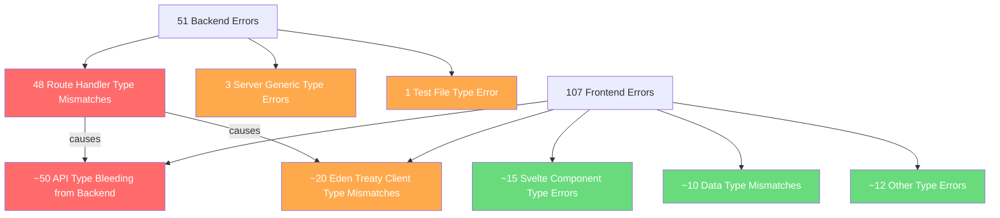
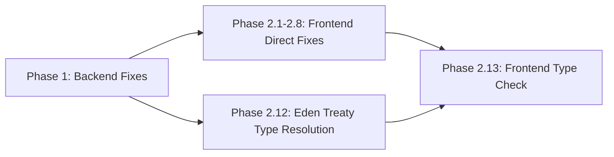

# Buddy Wallet Type Errors Fix Plan

## Overview

The `buddy-wallet` monorepo has **51 backend errors** (in `apps/api`) and **107 frontend errors** (in `apps/web`). The errors fall into distinct categories that must be fixed in a specific order — backend first, then frontend — because the frontend's Eden Treaty client types are derived from the backend's Elysia route definitions.

## Error Categories



## Root Cause Analysis

### Backend Root Cause: `requireUser` / `requirePermission` Return Type

The core issue is in [`require-user.ts`](../api/src/commons/http/require-user.ts). Both [`requireUser()`](../api/src/commons/http/require-user.ts:18) and [`requirePermission()`](../api/src/commons/http/require-user.ts:37) wrap route handlers with auth checks. The wrapper functions return `(ctx: Context) => ...` but Elysia's type system expects the handler to carry the typed `body`, `query`, `params` from the schema definition (via `InlineHandlerNonMacro`).

**Current state**: The file has already been partially fixed to use `any` types, which should resolve the 48 route handler errors. This needs verification.

### Frontend Root Cause: API Type Bleeding

The frontend's [`svelte.config.js`](svelte.config.js:43) has an alias `'@/*': '../../apps/api/src/*'` and imports `App` type from [`@repo/api/types`](../api/src/index.d.ts). When `svelte-check` runs, it follows these paths and type-checks the API source files, surfacing all API route errors in the frontend too.

---

## Execution Plan

### Phase 1: Verify Backend Fixes (apps/api)

The following files have already been partially modified. We need to verify they resolve all 51 errors:

#### 1.1 Verify [`require-user.ts`](../api/src/commons/http/require-user.ts)
- **Status**: Already modified to use `any` types for both `requireUser` and `requirePermission`
- **Expected**: Resolves 48 route handler type mismatch errors across all route files
- **Action**: Run `bun run check-types` in `apps/api` to confirm

#### 1.2 Verify [`rate-limit.middleware.ts`](../api/src/commons/http/rate-limit.middleware.ts)
- **Status**: Already uses `Server<any>` on line 12
- **Expected**: Resolves 2 of 3 `Server` generic errors
- **Action**: Verify line 112 also uses `Server<any>` (it does: `server: (ctx as { server?: Server<any> }).server`)

#### 1.3 Verify [`extract.ts`](../api/src/commons/security/ip/extract.ts)
- **Status**: Already uses `Server<any>` on line 7
- **Expected**: Resolves 1 `Server` generic error
- **Action**: Confirm no changes needed

#### 1.4 Verify [`storage.service.test.ts`](../api/tests/storage.service.test.ts)
- **Status**: Already modified to use `'code' in result` guard on line 24
- **Expected**: Resolves 1 test type error
- **Action**: Confirm the fix is correct

#### 1.5 Run Backend Type Check
- Run `bun run check-types` in `apps/api`
- **Expected**: 0 errors

---

### Phase 2: Fix Frontend Type Errors (apps/web)

#### 2.1 Fix [`api-envelope.ts`](src/lib/services/api-envelope.ts) — Unsafe Type Assertions
- **Lines 34, 45**: Cast through `unknown` first
- **Fix**:
  ```typescript
  // Line 34
  const envelope = payload as unknown as ApiEnvelopeSuccess<T>;
  // Line 45
  const envelope = value as unknown as ApiEnvelopeError;
  ```

#### 2.2 Fix [`FormInput.svelte`](src/lib/components/forms/FormInput.svelte) — Icon Type
- **Line 33**: `icon?: Component<unknown>` → `icon?: Component<any>`
- **Impact**: Resolves icon type errors in 8+ Svelte files that pass `icon={Phone}`, `icon={Lock}`, etc.

#### 2.3 Fix [`PageHeader.svelte`](src/lib/components/layout/PageHeader.svelte) — Snippet Type
- **Line 13**: `actions?: (() => unknown) | null` → use Svelte's `Snippet` type
- **Fix**:
  ```typescript
  import type { Snippet } from 'svelte';
  // ...
  actions?: Snippet | null;
  ```

#### 2.4 Fix [`ImportHistoryTable.svelte`](src/lib/components/import/ImportHistoryTable.svelte) — ImportJob
- **Line 11**: `ImportJob` is imported from `$lib/stores/import-progress.svelte` but it's actually defined in `@repo/types/infrastructure/jobs`
- **Fix**: Change import to `import type { ImportJob } from '@repo/types/infrastructure/jobs';`

#### 2.5 Fix [`dashboard/+page.svelte`](src/routes/(admin)/dashboard/+page.svelte) — Debt Type
- **Line 129**: `Debt[]` not assignable to `RecentDebtItem[]` because `createdAt` is `string | Date` vs `string`
- **Fix**: Normalize `createdAt` to string before passing, or widen `RecentDebtItem.createdAt` type

#### 2.6 Fix [`debts/[id]/+page.svelte`](src/routes/(admin)/debts/[id]/+page.svelte) — Multiple Issues
- **Line 40**: `CurrentUserLike` can be `undefined` — add null check
- **Line 47**: `'error' in value` on `{}` — use proper type narrowing
- **Lines 70-71**: `allProofsApproved` and `debtId` missing from `ActionData` — define proper type

#### 2.7 Fix [`settings/banks/+page.svelte`](src/routes/(admin)/settings/banks/+page.svelte) — Null Type
- **Line 152**: `accountNumber` is `string | null` but expected `string`
- **Fix**: Add null coalescing: `accountNumber = account.accountNumber ?? ''`

#### 2.8 Fix [`(app)/+page.svelte`](src/routes/(app)/+page.svelte) — Unsafe Cast
- **Line 21**: `CheckDebtPayload` cast to `{ success; phone; found; count }`
- **Fix**: Cast through `unknown`: `as unknown as { success: boolean; phone: string; found: boolean; count: number }`

#### 2.9 Fix [`notifications.remote.ts`](src/lib/remotes/notifications.remote.ts) — Schema Mismatch
- **Line 14-16**: `emailNotificationsEnabled` and `pushNotificationsEnabled` not in `UpdateProfileSchema`
- **Fix**: Either add these fields to the API's `UpdateProfileSchema`, or use a separate endpoint/schema for notification preferences

#### 2.10 Fix [`profile.remote.ts`](src/lib/remotes/profile.remote.ts) — Schema Mismatch
- **Line 14**: `phoneNumber` not in `UpdateProfileSchema`
- **Fix**: Either add `phoneNumber` to the API's `UpdateProfileSchema`, or handle it separately

#### 2.11 Fix [`debts.remote.ts`](src/lib/remotes/debts.remote.ts) — Type Issues
- **Lines 82, 84, 86**: `ApiErrorResult | null` not assignable to `ApiErrorResult | undefined`
- **Fix**: Change `ApiErrorResult | null` to `ApiErrorResult | undefined` or add null coalescing

#### 2.12 Fix Eden Treaty Type Issues (After Backend Fixes)
- After Phase 1 backend fixes, the Eden Treaty client types should regenerate correctly
- Verify these access patterns work:
  - `locals.api.v1.bank.accounts.post(payload)` — `banks.remote.ts:22`
  - `locals.api.v1.debts.get(...)` — `dashboard.remote.ts:46,88,89,108`
  - `locals.api.v1.user['admin/users'].get(...)` — `dashboard.remote.ts:69`
  - `locals.api.v1.debts.batch.delete(...)` — `debts.remote.ts:36`
  - `locals.api.v1.debts.all.delete(...)` — `debts.remote.ts:63`
  - `api.v1.data['import/progress-poll'].post(...)` — `import-progress.svelte.ts:105`
  - `api.v1.data['import/logs'].get(...)` — multiple files
  - `api.v1.data['import/preview'].post(...)` — import page
  - `api.v1.data.import.post(...)` — import page
- If any still fail after backend fixes, the route definitions may need adjustment

#### 2.13 Run Frontend Type Check
- Run `bun run check-types` in `apps/web`
- **Expected**: 0 errors

---

## Dependency Order



Backend fixes MUST come first because:
1. The frontend imports `App` type from the backend via `@repo/api/types`
2. Eden Treaty generates client types from the backend's Elysia route tree
3. If backend routes have type errors, the generated client types are broken

## Files to Modify

### Backend (apps/api) — Verify Only
| File | Status | Errors Fixed |
|------|--------|-------------|
| `src/commons/http/require-user.ts` | Already modified | 48 |
| `src/commons/http/rate-limit.middleware.ts` | Already modified | 2 |
| `src/commons/security/ip/extract.ts` | Already correct | 1 |
| `tests/storage.service.test.ts` | Already modified | 1 |

### Frontend (apps/web) — Needs Modification
| File | Fix Type | Errors Fixed |
|------|----------|-------------|
| `src/lib/services/api-envelope.ts` | Cast through `unknown` | 2 |
| `src/lib/components/forms/FormInput.svelte` | Icon type | 1 direct + ~8 downstream |
| `src/lib/components/layout/PageHeader.svelte` | Snippet type | 1 |
| `src/lib/components/import/ImportHistoryTable.svelte` | Import path | 1 |
| `src/routes/(admin)/dashboard/+page.svelte` | Date type | 1 |
| `src/routes/(admin)/debts/[id]/+page.svelte` | Multiple types | 4 |
| `src/routes/(admin)/settings/banks/+page.svelte` | Null coalescing | 1 |
| `src/routes/(app)/+page.svelte` | Unsafe cast | 1 |
| `src/lib/remotes/notifications.remote.ts` | Schema mismatch | 1 |
| `src/lib/remotes/profile.remote.ts` | Schema mismatch | 1 |
| `src/lib/remotes/debts.remote.ts` | Null vs undefined | 3 |
| Multiple Eden Treaty access files | After backend fix | ~20 |
