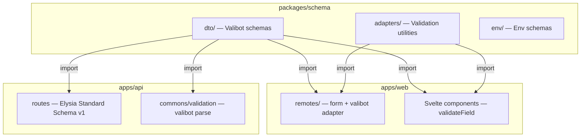
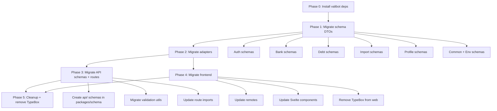

# Valibot Migration Architectural Plan

> Migrate buddy-wallet monorepo from `@sinclair/typebox` to `valibot` for unified schema validation.

---

## 1. Current State Analysis

### 1.1 Schema Inventory

#### `packages/schema` — Shared Package (TypeBox)

| Domain | File | Schemas | Used By |
|--------|------|---------|---------|
| Auth | `dto/auth/auth-primitives.schema.ts` | `passwordSchema`, `emailSchema`, `nameSchema`, `phoneSchema` | Frontend `validateField()` |
| Auth | `dto/auth/login.schema.ts` | `loginRequestSchema` — `{ email, password }` | Frontend `auth.remote.ts` |
| Auth | `dto/auth/register.schema.ts` | `registerRequestSchema` — `{ name, phoneNumber, email?, password }` | Frontend `auth.remote.ts` |
| Auth | `dto/auth/change-password.schema.ts` | `changePasswordSchema`, `forgotPasswordSchema`, `resetPasswordSchema` | Frontend `security.remote.ts` |
| Bank | `dto/bank/bank.schema.ts` | `bankAccountSchema` — `{ bankCode, bankName, bankBin, accountNumber, accountName, isDefault? }` | Frontend types only |
| Debt | `dto/debt/create-debt.schema.ts` | `createDebtRequestSchema` — `{ amount, description, counterpartyPhone, direction, expiryOption?, confirmDuplicate? }` | Not directly used |
| Debt | `dto/debt/update-debt.schema.ts` | `updateDebtRequestSchema`, `suggestEditRequestSchema` | Not directly used |
| Debt | `dto/debt/debt-primitives.schema.ts` | `amountSchema`, `amountClientSchema`, `descriptionSchema`, `directionSchema`, `CreateDebtInputSchema`, `CreateDebtClientSchema`, `debtStatusSchema`, `debtDirectionSchema`, `debtQuerySchema`, `updateDebtStatusSchema` | Frontend `validateField()` |
| Import | `dto/import/preview.schema.ts` | `previewImportRequestSchema` | Not directly used |
| Import | `dto/import/start-import.schema.ts` | `importConfigSchema`, `startImportRequestSchema` | Not directly used |
| Import | `dto/import/progress.schema.ts` | `progressSSEQuerySchema`, `progressBatchBodySchema`, `logsQuerySchema` | Not directly used |
| Profile | `dto/profile/profile.schema.ts` | `profileSchema` — `{ phoneNumber }`, `updateProfileSchema` | Frontend `profile.remote.ts` |
| Common | `dto/common.schema.ts` | 18 response/query schemas | Not directly used in frontend |
| Env | `env/api-env.schema.ts` | `apiEnvSchema` | API env validation |
| Env | `env/worker-env.schema.ts` | `workerEnvSchema` | Worker env validation |
| Adapters | `adapters/standard-schema.ts` | `toStandardSchema()` — wraps TypeBox for Standard Schema v1 | Frontend remotes |
| Adapters | `adapters/parse.ts` | `parseSchema()` — TypeCompiler validation | Not found in use |
| Adapters | `adapters/validate-field.ts` | `validateField()` — single-field UI validation | 6 Svelte components |

#### `packages/api` — Elysia Backend (Elysia `t` = TypeBox wrapper)

| Module | File | Schemas | Purpose |
|--------|------|---------|---------|
| Auth | `modules/auth/schema.ts` | `LoginSchema` — `{ identifier, password }`, `RegisterSchema` — `{ email?, phone, password, fullName }`, `RefreshTokenSchema`, `LogoutSchema`, `VerifyEmailSchema`, `RequestPasswordResetSchema`, `ResetPasswordSchema`, `MFASetupSchema`, `MFAVerifySchema`, `AuthResponseSchema`, `SessionListSchema` | Route body/query validation |
| Bank | `modules/bank/schema.ts` | `CreateBankAccountSchema` — `{ bankName, accountNumber, accountName, isDefault? }`, `UpdateBankAccountSchema`, `ListBankAccountsQuerySchema`, response schemas | Route body/query validation |
| Debts | `modules/debts/schema.ts` | `CreateDebtSchema` — `{ debtorId, amount, currency, description?, dueDate? }`, `UpdateDebtSchema`, `DebtStatusSchema`, `CancelDebtSchema`, `ConfirmDebtSchema`, `BatchDeleteSchema`, `DeleteAllQuerySchema`, `ListDebtsQuerySchema`, `SuggestEditSchema`, `RespondSuggestionSchema`, response schemas | Route body/query validation |
| Data | `modules/data/schema.ts` | `ExportDataQuerySchema`, `ImportDataSchema`, response schemas | Route body/query validation |
| Notification | `modules/notification/schema.ts` | `ListNotificationsQuerySchema`, `MarkAsReadSchema`, response schemas | Route body/query validation |
| Storage | `modules/storage/schema.ts` | `UploadFileSchema` (uses `t.File`), `DeleteFileSchema`, `ListFilesQuerySchema`, response schemas | Route body/query validation |
| System | `modules/system/schema.ts` | `HealthResponseSchema`, `SystemInfoResponseSchema` | Response typing |
| User | `modules/user/schema.ts` | `UpdateProfileSchema` — `{ name?, email?, avatar? }`, `ChangePasswordSchema` — `{ currentPassword, newPassword }`, `ListUsersQuerySchema`, response schemas | Route body/query validation |

#### API Validation Utilities (`commons/validation/`)

| File | Functions | Library |
|------|-----------|---------|
| `debt.ts` | `validateAmount()`, `validateCreateDebtInput()`, `validatePhones()` | TypeBox + TypeCompiler |
| `phone.ts` | `PhoneSchema`, `validatePhone()`, `validatePhonePair()` | TypeBox + TypeCompiler |
| `import.ts` | `validateImportUploadFile()` | Manual (no TypeBox) |

### 1.2 Key Schema Divergences

The schemas in `packages/schema` and `packages/api` are **NOT identical** — they serve different purposes:

| Concept | `packages/schema` (Frontend) | `packages/api` (Backend) |
|---------|------------------------------|--------------------------|
| **Login** | `{ email, password }` | `{ identifier, password }` — identifier = email OR phone |
| **Register** | `{ name, phoneNumber, email?, password }` | `{ email?, phone, password, fullName }` — different field names |
| **Debt Create** | `{ amount, description, counterpartyPhone, direction, expiryOption?, confirmDuplicate? }` | `{ debtorId, amount, currency, description?, dueDate? }` — completely different shape |
| **Bank** | `{ bankCode, bankName, bankBin, accountNumber, accountName, isDefault? }` | `{ bankName, accountNumber, accountName, isDefault? }` — no bankCode/bankBin |
| **Profile** | `{ name?, email?, pushNotificationsEnabled?, emailNotificationsEnabled? }` | `{ name?, email?, avatar? }` — different optional fields |
| **Change Password** | `{ currentPassword, newPassword, confirmPassword }` | `{ currentPassword, newPassword }` — no confirmPassword |
| **Debt Status** | Includes `disputed` status | Includes `disputed` in ListDebtsQuery but not in DebtStatusSchema |

### 1.3 Frontend Consumption Patterns

1. **`form()` remotes** — Use `toStandardSchema(typeboxSchema)` to wrap schemas for SvelteKit's `form()` function
2. **`validateField()`** — Used in 6 Svelte components for real-time field validation (login, signup, forgot-password, reset-password, change-password, create-debt)
3. **Type imports** — `BankAccountRequest` type imported in bank components
4. **No superforms `typebox()` adapter** — The project uses a custom `toStandardSchema()` adapter instead

### 1.4 Current Dependencies

| Package | TypeBox Dependency | Valibot Dependency |
|---------|-------------------|-------------------|
| `@repo/schema` | `@sinclair/typebox ^0.34.8` | None |
| `@repo/api` | `@sinclair/typebox ^0.34.8` + `elysia ^1.4.28` | None |
| `@repo/web` | `@sinclair/typebox ^0.34.8` | None |

---

## 2. Target Architecture

### 2.1 Single Source of Truth: `@repo/schema`



### 2.2 Schema Layer Design

```
packages/schema/src/
├── dto/
│   ├── auth/
│   │   ├── primitives.ts        # v.pipe(v.string(), v.minLength(...)) — shared building blocks
│   │   ├── login.schema.ts      # Frontend form schema
│   │   ├── register.schema.ts   # Frontend form schema
│   │   ├── change-password.schema.ts
│   │   └── index.ts
│   ├── bank/
│   │   ├── bank.schema.ts       # Frontend form schema
│   │   └── index.ts
│   ├── debt/
│   │   ├── primitives.ts        # amount, direction, status building blocks
│   │   ├── create-debt.schema.ts
│   │   ├── update-debt.schema.ts
│   │   └── index.ts
│   ├── import/
│   │   ├── preview.schema.ts
│   │   ├── start-import.schema.ts
│   │   ├── progress.schema.ts
│   │   └── index.ts
│   ├── profile/
│   │   ├── profile.schema.ts
│   │   └── index.ts
│   ├── api/                     # NEW: API-specific schemas (moved from packages/api)
│   │   ├── auth.schema.ts       # LoginSchema, RegisterSchema, etc. for Elysia routes
│   │   ├── bank.schema.ts
│   │   ├── debt.schema.ts
│   │   ├── data.schema.ts
│   │   ├── notification.schema.ts
│   │   ├── storage.schema.ts
│   │   ├── system.schema.ts
│   │   ├── user.schema.ts
│   │   └── index.ts
│   ├── responses/               # NEW: Response schemas (extracted from common.schema.ts + API modules)
│   │   ├── auth.response.ts
│   │   ├── bank.response.ts
│   │   ├── debt.response.ts
│   │   ├── notification.response.ts
│   │   ├── user.response.ts
│   │   └── index.ts
│   ├── common.schema.ts         # Slimmed down — only shared query/pagination schemas
│   └── index.ts
├── adapters/
│   ├── standard-schema.ts       # Rewritten: valibot → Standard Schema v1 (native support)
│   ├── parse.ts                 # Rewritten: v.parse() / v.safeParse()
│   ├── validate-field.ts        # Rewritten: v.safeParse() per field
│   └── index.ts
├── env/
│   ├── api-env.schema.ts        # Migrated to valibot
│   ├── worker-env.schema.ts     # Migrated to valibot
│   └── index.ts
└── index.ts
```

### 2.3 Key Design Decisions

1. **Valibot natively implements Standard Schema v1** — No custom adapter needed for Elysia or superforms
2. **`sveltekit-superforms` has native `valibot()` adapter** — Replace `toStandardSchema()` with direct `valibot(schema)` usage
3. **Elysia supports Standard Schema v1** — Valibot schemas can be passed directly as `body`/`query` in route definitions
4. **Frontend schemas and API schemas remain separate** — They have different shapes by design (form input vs API validation)
5. **`validateField()` rewritten with `v.safeParse()`** — Simpler, no TypeCompiler needed
6. **Tree-shaking** — Valibot's functional API means only used validators are bundled (~2KB vs ~50KB)

### 2.4 Valibot Schema Examples

**Before (TypeBox):**
```typescript
import { Type, type Static } from '@sinclair/typebox';

export const loginRequestSchema = Type.Object({
  email: Type.String(),
  password: Type.String({ minLength: 1 })
});

export type LoginRequest = Static<typeof loginRequestSchema>;
```

**After (Valibot):**
```typescript
import * as v from 'valibot';

export const loginRequestSchema = v.object({
  email: v.pipe(v.string(), v.nonEmpty()),
  password: v.pipe(v.string(), v.nonEmpty())
});

export type LoginRequest = v.InferOutput<typeof loginRequestSchema>;
```

**Before (API route with Elysia `t`):**
```typescript
import { t } from 'elysia';

export const LoginSchema = t.Object({
  identifier: t.String({ minLength: 1, error: 'Email or phone number is required' }),
  password: t.String({ minLength: 8, error: 'Password must be at least 8 characters' })
});
```

**After (API route with Valibot):**
```typescript
import * as v from 'valibot';

export const LoginSchema = v.object({
  identifier: v.pipe(v.string(), v.nonEmpty('Email or phone number is required')),
  password: v.pipe(v.string(), v.minLength(8, 'Password must be at least 8 characters'))
});
```

**Before (adapter):**
```typescript
import { toStandardSchema } from '@repo/schema/adapters/standard-schema';
// ...
form(toStandardSchema(loginSchema), async (data) => { ... })
```

**After (native valibot support):**
```typescript
import { valibot } from 'sveltekit-superforms/adapters';
import { loginRequestSchema } from '@repo/schema/dto/auth';
// ...
form(valibot(loginRequestSchema), async (data) => { ... })
```

---

## 3. Migration Strategy

### Phase 0: Preparation

- [ ] Install `valibot` in `packages/schema` (`bun add valibot`)
- [ ] Install `valibot` in `packages/api` (`bun add valibot`)
- [ ] Install `valibot` in `apps/web` (`bun add valibot`)
- [ ] Verify Elysia version supports Standard Schema v1 (v1.4.28 — confirmed)
- [ ] Verify sveltekit-superforms version supports `valibot()` adapter (v2.30.0 — confirmed)
- [ ] Create a feature branch `feat/valibot-migration`

### Phase 1: Migrate `packages/schema` DTO Schemas

Migrate each domain module from TypeBox to Valibot, one at a time. Each sub-step is independently testable.

#### Step 1.1: Auth Primitives + Login + Register
- [ ] Migrate `dto/auth/auth-primitives.schema.ts` to valibot
- [ ] Migrate `dto/auth/login.schema.ts` to valibot
- [ ] Migrate `dto/auth/register.schema.ts` to valibot
- [ ] Migrate `dto/auth/change-password.schema.ts` to valibot
- [ ] Update `dto/auth/index.ts` exports
- [ ] Run `bun run check-types` in `packages/schema`

#### Step 1.2: Bank
- [ ] Migrate `dto/bank/bank.schema.ts` to valibot
- [ ] Update `dto/bank/index.ts` exports
- [ ] Run type check

#### Step 1.3: Debt
- [ ] Migrate `dto/debt/debt-primitives.schema.ts` to valibot
- [ ] Migrate `dto/debt/create-debt.schema.ts` to valibot
- [ ] Migrate `dto/debt/update-debt.schema.ts` to valibot
- [ ] Update `dto/debt/index.ts` exports
- [ ] Run type check

#### Step 1.4: Import
- [ ] Migrate `dto/import/preview.schema.ts` to valibot
- [ ] Migrate `dto/import/start-import.schema.ts` to valibot
- [ ] Migrate `dto/import/progress.schema.ts` to valibot
- [ ] Update `dto/import/index.ts` exports
- [ ] Run type check

#### Step 1.5: Profile
- [ ] Migrate `dto/profile/profile.schema.ts` to valibot
- [ ] Update `dto/profile/index.ts` exports
- [ ] Run type check

#### Step 1.6: Common + Response Schemas
- [ ] Migrate `dto/common.schema.ts` to valibot
- [ ] Run type check

#### Step 1.7: Env Schemas
- [ ] Migrate `env/api-env.schema.ts` to valibot
- [ ] Migrate `env/worker-env.schema.ts` to valibot
- [ ] Run type check

### Phase 2: Migrate Adapters

- [ ] Rewrite `adapters/validate-field.ts` — use `v.safeParse()` instead of TypeCompiler
- [ ] Rewrite `adapters/parse.ts` — use `v.parse()` / `v.safeParse()`
- [ ] Rewrite `adapters/standard-schema.ts` — valibot natively supports Standard Schema v1, so this becomes a thin wrapper or is removed entirely
- [ ] Update `adapters/index.ts` exports
- [ ] Run type check

### Phase 3: Migrate `packages/api` Schemas

#### Step 3.1: Move API schemas to `packages/schema/dto/api/`
- [ ] Create `dto/api/auth.schema.ts` — migrate from Elysia `t` to valibot
- [ ] Create `dto/api/bank.schema.ts` — migrate from Elysia `t` to valibot
- [ ] Create `dto/api/debt.schema.ts` — migrate from Elysia `t` to valibot
- [ ] Create `dto/api/data.schema.ts` — migrate from Elysia `t` to valibot
- [ ] Create `dto/api/notification.schema.ts` — migrate from Elysia `t` to valibot
- [ ] Create `dto/api/storage.schema.ts` — migrate from Elysia `t` to valibot (note: `t.File` needs special handling)
- [ ] Create `dto/api/system.schema.ts` — migrate from Elysia `t` to valibot
- [ ] Create `dto/api/user.schema.ts` — migrate from Elysia `t` to valibot
- [ ] Create `dto/api/index.ts` barrel export
- [ ] Update `dto/index.ts` to include `api/`

#### Step 3.2: Migrate API Validation Utilities
- [ ] Migrate `commons/validation/phone.ts` — use `v.parse()` instead of TypeCompiler
- [ ] Migrate `commons/validation/debt.ts` — use `v.parse()` instead of TypeCompiler
- [ ] Keep `commons/validation/import.ts` as-is (manual validation, no TypeBox)

#### Step 3.3: Update API Route Definitions
- [ ] Update `modules/auth/routes.ts` — import from `@repo/schema/dto/api` instead of local `./schema`
- [ ] Update `modules/bank/routes.ts`
- [ ] Update `modules/debts/routes.ts`
- [ ] Update `modules/data/routes.ts`
- [ ] Update `modules/notification/routes.ts`
- [ ] Update `modules/storage/routes.ts`
- [ ] Update `modules/user/routes.ts`
- [ ] Delete local `schema.ts` files from each module (or keep as re-exports temporarily)
- [ ] Run `bun run check-types` in `packages/api`

### Phase 4: Migrate `apps/web` Frontend

#### Step 4.1: Update Remote Files
- [ ] Update `lib/remotes/auth.remote.ts` — replace `toStandardSchema()` with valibot adapter
- [ ] Update `lib/remotes/security.remote.ts` — replace `toStandardSchema()` + inline TypeBox with valibot
- [ ] Update `lib/remotes/profile.remote.ts` — replace `toStandardSchema()` with valibot adapter
- [ ] Remove `import { Type } from '@sinclair/typebox'` from all remote files

#### Step 4.2: Update Svelte Components
- [ ] Update `routes/(auth)/login/+page.svelte` — `validateField()` now takes valibot schema
- [ ] Update `routes/(auth)/signup/+page.svelte`
- [ ] Update `routes/(auth)/forgot-password/+page.svelte`
- [ ] Update `routes/(auth)/reset-password/+page.svelte`
- [ ] Update `routes/(admin)/settings/security/components/ChangePassword.svelte`
- [ ] Update `routes/(admin)/debts/create/+page.svelte`
- [ ] Update `lib/components/dashboard/CreateDebtModal.svelte`
- [ ] Update `routes/(admin)/settings/banks/+page.svelte` — type import
- [ ] Update `routes/(admin)/settings/banks/components/BankFormModal.svelte` — type import

#### Step 4.3: Remove TypeBox Dependencies
- [ ] Remove `@sinclair/typebox` from `apps/web/package.json`
- [ ] Run `bun install` to update lockfile
- [ ] Run `bun run check-types` in `apps/web`

### Phase 5: Cleanup

- [ ] Remove `@sinclair/typebox` from `packages/schema/package.json`
- [ ] Remove `@sinclair/typebox` from `packages/api/package.json`
- [ ] Delete `packages/api/src/modules/*/schema.ts` files (replaced by `@repo/schema/dto/api/`)
- [ ] Run full monorepo type check: `bun run check-types` across all packages
- [ ] Run full test suite: `bun run test` in `packages/api`
- [ ] Verify PWA bundle size reduction

---

## 4. Breaking Changes

### 4.1 API Contract Changes

**No breaking changes to external API contracts.** The migration is internal — the Elysia route definitions will use the same validation rules, just expressed in valibot instead of TypeBox. The HTTP request/response shapes remain identical.

### 4.2 Internal Breaking Changes

| Change | Impact | Mitigation |
|--------|--------|------------|
| `Static<typeof schema>` → `v.InferOutput<typeof schema>` | All type exports change | Update all type imports across monorepo |
| `toStandardSchema()` removed/replaced | Frontend remotes break | Replace with `valibot()` adapter from superforms |
| `validateField()` signature changes | Svelte components break | New function accepts valibot schema (same call signature) |
| `parseSchema()` signature changes | Any consumers break | New function uses `v.safeParse()` (same return shape) |
| `t.Object` / `t.String` → `v.object` / `v.string` | API route definitions break | Migrate all route `body`/`query` options |
| `t.File` (Elysia-specific) | Storage upload schema | Use custom valibot pipe with file validation |
| `loginRequestSchema.properties.email` access | Login page Svelte component | Use `v.entries` or restructure schema access |

### 4.3 Type Export Changes

```typescript
// Before
import type { LoginRequest } from '@repo/schema/dto/auth';
// LoginRequest = Static<typeof loginRequestSchema> = { email: string; password: string }

// After
import type { LoginRequest } from '@repo/schema/dto/auth';
// LoginRequest = v.InferOutput<typeof loginRequestSchema> = { email: string; password: string }
// Same shape, different derivation
```

### 4.4 Elysia `t.File` Handling

The storage module uses `t.File({ type: 'image/*', maxSize: '10m' })` which is Elysia-specific. Options:

1. **Keep `t.File` for storage only** — Elysia can still use its own `t` for file uploads alongside valibot for everything else
2. **Custom valibot pipe** — Create a `v.pipe(v.unknown(), v.check(...))` that validates File instances
3. **Recommended: Option 1** — File upload validation is framework-specific and doesn't benefit from sharing

---

## 5. Testing Strategy

### 5.1 Unit Tests

- [ ] Test each migrated schema with `v.safeParse()` for valid and invalid inputs
- [ ] Verify type inference produces correct TypeScript types
- [ ] Test `validateField()` with valibot schemas returns correct `{ state, message }` shapes
- [ ] Test `parseSchema()` with valibot schemas returns correct `{ success, output/errors }` shapes

### 5.2 Integration Tests

- [ ] Test Elysia routes accept valid requests and reject invalid ones (existing API tests)
- [ ] Test frontend `form()` remotes validate correctly with valibot schemas
- [ ] Test `validateField()` in Svelte components shows correct validation states

### 5.3 E2E Verification

- [ ] Login flow — form validation + API call
- [ ] Registration flow — form validation + API call
- [ ] Debt creation — form validation + API call
- [ ] Profile update — form validation + API call
- [ ] Password change — form validation + API call
- [ ] Bank account management — form validation + API call

### 5.4 Bundle Size Verification

- [ ] Measure `apps/web` bundle size before migration
- [ ] Measure `apps/web` bundle size after migration
- [ ] Verify tree-shaking removes unused valibot functions
- [ ] Target: ~48KB reduction (TypeBox ~50KB removed, Valibot ~2KB added)

---

## 6. Rollback Plan

### 6.1 Branch Strategy

- All work happens on `feat/valibot-migration` branch
- Each phase is a separate commit for granular rollback
- Merge to main only after full test suite passes

### 6.2 Rollback Per Phase

| Phase | Rollback Action |
|-------|----------------|
| Phase 0 | Delete branch, remove valibot deps |
| Phase 1 | `git revert` schema commits, TypeBox schemas still work |
| Phase 2 | `git revert` adapter commits |
| Phase 3 | `git revert` API commits, restore local `schema.ts` files |
| Phase 4 | `git revert` frontend commits |
| Phase 5 | `git revert` cleanup commits |

### 6.3 Coexistence Period

During migration, both TypeBox and Valibot can coexist:
- `packages/schema` can export both TypeBox and Valibot versions temporarily
- API routes can be migrated module-by-module while others still use Elysia `t`
- Frontend remotes can be migrated one at a time

### 6.4 Feature Flag (Optional)

If a gradual rollout is preferred:
- Add a `USE_VALIBOT` env flag
- Adapter layer checks flag and delegates to TypeBox or Valibot
- Remove flag once migration is complete

---

## 7. Dependency Changes Summary

### Add
```json
// packages/schema/package.json
{ "dependencies": { "valibot": "^1.0.0" } }

// packages/api/package.json
{ "dependencies": { "valibot": "^1.0.0" } }

// apps/web/package.json
{ "dependencies": { "valibot": "^1.0.0" } }
```

### Remove (after Phase 5)
```json
// packages/schema/package.json
// Remove: "@sinclair/typebox": "^0.34.8"

// packages/api/package.json
// Remove: "@sinclair/typebox": "^0.34.8"

// apps/web/package.json
// Remove: "@sinclair/typebox": "^0.34.8"
```

---

## 8. Execution Order Diagram



---

## 9. Risk Assessment

| Risk | Likelihood | Impact | Mitigation |
|------|-----------|--------|------------|
| Elysia Standard Schema v1 incompatibility | Low | High | Test early in Phase 3; fallback to custom adapter |
| `t.File` has no valibot equivalent | Certain | Low | Keep `t.File` for storage module only |
| `loginSchema.properties.email` access pattern breaks | Certain | Low | Restructure to export individual field schemas |
| Bundle size not reduced as expected | Low | Low | Verify with `vite-bundle-analyzer` after Phase 4 |
| Type inference differences | Medium | Medium | Comprehensive type tests in Phase 1 |
| API response time regression | Very Low | Medium | Valibot is faster than TypeBox for runtime validation |
