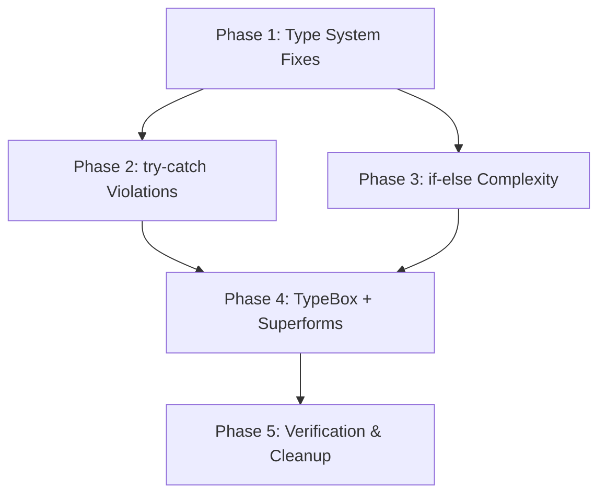

# Audit Implementation Plan

**Created:** 2026-05-04  
**Source Audits:** 6 files (POST_MIGRATION_GAP, QUICK_FIXES, MIGRATION_STATUS_TRACKER, TRY_CATCH_VIOLATIONS, IF_ELSE_COMPLEXITY, factory-closures pattern)  
**Total Items:** ~45 discrete changes across 25+ files

---

## Execution Order & Dependencies



---

## Phase 1: Type System Fixes (No Runtime Risk)

**Audit Sources:** POST_MIGRATION_GAP_AUDIT, QUICK_FIXES, MIGRATION_STATUS_TRACKER  
**Risk:** 🟢 Zero — type-only changes, no runtime behavior affected  
**Verification:** `bun run check-types` after each sub-phase

### 1A. SafeUser → UserResponse Migration (10 files)

#### Micro-phase 1A-1: Service Type Declarations (4 files)

| # | File | Change | Lines |
|---|------|--------|-------|
| 1 | [`packages/types/src/services/debt.service.d.ts`](packages/types/src/services/debt.service.d.ts:2) | `import type { SafeUser }` → `import type { UserResponse }` | 2 |
| 2 | [`packages/types/src/services/debt.service.d.ts`](packages/types/src/services/debt.service.d.ts:9) | `currentUser: SafeUser` → `currentUser: UserResponse` in `createDebt` | 9 |
| 3 | [`packages/types/src/services/debt.service.d.ts`](packages/types/src/services/debt.service.d.ts:10) | `currentUser: SafeUser` → `currentUser: UserResponse` in `updateDebtStatus` | 10 |
| 4 | [`packages/types/src/services/auth.service.d.ts`](packages/types/src/services/auth.service.d.ts:2) | `import type { SafeUser }` → `import type { UserResponse }` | 2 |
| 5 | [`packages/types/src/services/auth.service.d.ts`](packages/types/src/services/auth.service.d.ts:28) | `user?: SafeUser` → `user?: UserResponse` in `AuthResultData` | 28 |
| 6 | [`packages/types/src/services/user.service.d.ts`](packages/types/src/services/user.service.d.ts:2) | `import type { SafeUser, UserResult }` → `import type { UserResponse, UserResult }` | 2 |
| 7 | [`packages/types/src/services/user.service.d.ts`](packages/types/src/services/user.service.d.ts:8) | `PaginatedResult<SafeUser>` → `PaginatedResult<UserResponse>` | 8 |
| 8 | [`packages/types/src/services/session.service.d.ts`](packages/types/src/services/session.service.d.ts:2) | `import type { SafeUser }` → `import type { UserResponse }` | 2 |
| 9 | [`packages/types/src/services/session.service.d.ts`](packages/types/src/services/session.service.d.ts:7) | `user: SafeUser` → `user: UserResponse` in `RefreshSessionData` | 7 |

**Checkpoint:** Run `bun run check-types` — all 4 service `.d.ts` files should pass.

#### Micro-phase 1A-2: API Handler Files (4 files)

| # | File | Change |
|---|------|--------|
| 10 | [`apps/api/src/modules/auth/plugins/actor.plugin.ts`](apps/api/src/modules/auth/plugins/actor.plugin.ts:41) | `import type { SafeUser }` → `import type { UserResponse }` from `@repo/types` |
| 11 | [`apps/api/src/modules/auth/plugins/actor.plugin.ts`](apps/api/src/modules/auth/plugins/actor.plugin.ts:47) | `actor: SafeUser \| null` → `actor: UserResponse \| null` in `ActorContext` |
| 12 | [`apps/api/src/modules/auth/plugins/actor.plugin.ts`](apps/api/src/modules/auth/plugins/actor.plugin.ts:65) | `actor: SafeUser \| null` → `actor: UserResponse \| null` in derive return type |
| 13 | [`apps/api/src/modules/auth/plugins/actor.plugin.ts`](apps/api/src/modules/auth/plugins/actor.plugin.ts:71) | `as SafeUser` → `as UserResponse` cast |
| 14 | [`apps/api/src/modules/auth/handlers/login.handler.ts`](apps/api/src/modules/auth/handlers/login.handler.ts:148) | `toSafeUser(user)` — no type change needed (function returns `Record<string, unknown>`) |
| 15 | [`apps/api/src/modules/auth/handlers/register.handler.ts`](apps/api/src/modules/auth/handlers/register.handler.ts:157) | `toSafeUser(result.newUser)` — no type change needed |
| 16 | [`apps/api/src/modules/user/handlers/admin.handler.ts`](apps/api/src/modules/user/handlers/admin.handler.ts:29) | `toSafeUser(targetUser)` — no type change needed |

**Note:** `login.handler.ts`, `register.handler.ts`, and `admin.handler.ts` use `toSafeUser()` which returns `Record<string, unknown>`. These don't import `SafeUser` type directly — the function name is cosmetic. No type changes needed in these files, but consider renaming `toSafeUser` → `toUserResponse` for consistency (optional, Phase 5).

#### Micro-phase 1A-3: Web Frontend (1 file)

| # | File | Change |
|---|------|--------|
| 17 | [`apps/web/src/routes/(admin)/admin/users/+page.server.ts`](apps/web/src/routes/(admin)/admin/users/+page.server.ts:3) | `import type { SafeUser }` → `import type { UserResponse }` from `@repo/types/core/user` |
| 18 | [`apps/web/src/routes/(admin)/admin/users/+page.server.ts`](apps/web/src/routes/(admin)/admin/users/+page.server.ts:14) | `SafeUser[]` → `UserResponse[]` in return type |
| 19 | [`apps/web/src/routes/(admin)/admin/users/+page.server.ts`](apps/web/src/routes/(admin)/admin/users/+page.server.ts:38) | `SafeUser[]` → `UserResponse[]` in error fallback |

#### Micro-phase 1A-4: Remove SafeUser Alias (final step)

| # | File | Change |
|---|------|--------|
| 20 | [`packages/types/src/core/user.d.ts`](packages/types/src/core/user.d.ts:60-65) | Remove `SafeUser` type alias entirely |
| 21 | [`packages/types/src/core/user.d.ts`](packages/types/src/core/user.d.ts:68) | Change `UserResponse = SafeUser` → inline the actual type definition |
| 22 | [`packages/types/src/core/user.d.ts`](packages/types/src/core/user.d.ts:81) | `UserResult = Result<SafeUser>` → `Result<UserResponse>` |
| 23 | [`packages/types/src/core/user.d.ts`](packages/types/src/core/user.d.ts:86) | `UserListResult = Result<SafeUser[]>` → `Result<UserResponse[]>` |

**Checkpoint:** `grep -r "SafeUser" packages/ apps/ --include="*.ts" --include="*.d.ts"` should return zero results (excluding `.svelte-kit`).

### 1B. ActivityAction Missing 'import_preview' (1 file)

| # | File | Change |
|---|------|--------|
| 24 | [`packages/types/src/core/activity.d.ts`](packages/types/src/core/activity.d.ts:9) | Add `\| 'import_preview'` after `\| 'import'` on line 9 |

**Checkpoint:** `grep -r "action:.*import_preview" apps/api/src --include="*.ts"` should match [`preview.handler.ts:117`](apps/api/src/modules/data/handlers/preview.handler.ts:117) without type errors.

### 1C. Lint/Type Cosmetic Fixes (1 file)

| # | File | Change |
|---|------|--------|
| 25 | [`packages/errors/src/hierarchy.ts`](packages/errors/src/hierarchy.ts:25) | `field?: string` → `_field?: string` |

**Note:** TS server cache issue for `packages/errors/tsconfig.json` — restart TS server after this change.

### Phase 1 Verification

```bash
bun run check-types
grep -r "SafeUser" packages/types/src/services apps/api/src apps/web/src --include="*.ts" --include="*.d.ts" | grep -v ".svelte-kit"
grep -r "action:.*import_preview" apps/api/src --include="*.ts"
```

---

## Phase 2: try-catch Violations

**Audit Source:** TRY_CATCH_VIOLATIONS_AUDIT  
**Risk:** 🟡 Medium — changes error handling flow, must test each handler  
**Principle:** try-catch ONLY for exceptional unrecoverable errors. Validation uses Result types.

### 2A. Critical: Result Type for parseSpreadsheetFile (2 files)

#### Micro-phase 2A-1: Define ParseResult type & refactor parseSpreadsheetFile

| # | File | Change |
|---|------|--------|
| 26 | [`apps/api/src/modules/data/services/import-preview.service.ts`](apps/api/src/modules/data/services/import-preview.service.ts:116) | Add `ParseResult` type: `{ kind: 'success'; data: ParsedSpreadsheet } \| { kind: 'error'; code: string; message: string }` |
| 27 | [`apps/api/src/modules/data/services/import-preview.service.ts`](apps/api/src/modules/data/services/import-preview.service.ts:116-184) | Wrap entire `parseSpreadsheetFile` body in internal try-catch that returns `ParseResult` instead of throwing |
| 28 | [`apps/api/src/modules/data/services/import-preview.service.ts`](apps/api/src/modules/data/services/import-preview.service.ts:119) | Change return type from `Promise<ParsedSpreadsheet>` → `Promise<ParseResult>` |

#### Micro-phase 2A-2: Update caller in preview.handler.ts

| # | File | Change |
|---|------|--------|
| 29 | [`apps/api/src/modules/data/handlers/preview.handler.ts`](apps/api/src/modules/data/handlers/preview.handler.ts:52-58) | Remove try-catch block, replace with Result check: `if (result.kind === 'error') { return apiError(...) }` |

**Checkpoint:** Test upload preview with valid file, invalid file, empty file.

### 2B. Critical: Worker parser.ts Result Type (1 file)

| # | File | Change |
|---|------|--------|
| 30 | [`apps/worker/src/parser.ts`](apps/worker/src/parser.ts:9) | Add `FileParseResult` type: `{ kind: 'success'; rows: string[][] } \| { kind: 'error'; code: string; message: string }` |
| 31 | [`apps/worker/src/parser.ts`](apps/worker/src/parser.ts:9-44) | Refactor `parseFile` to return `FileParseResult` instead of throwing |
| 32 | [`apps/worker/src/parser.ts`](apps/worker/src/parser.ts:49-69) | Refactor `validateRowCount` to return `Result<number>` instead of throwing |

**Note:** Worker `processImportJob` at [`import.worker.ts:148-154`](apps/api/src/workers/import.worker.ts:148) catches errors from S3 read — this is legitimate I/O error handling. Keep try-catch but add error context (see 2D-3).

### 2C. High: Silent/Empty Error Swallowing — Add Context (5 files, 8 locations)

#### Micro-phase 2C-1: system.service.ts — Health checks (3 locations)

| # | File | Lines | Change |
|---|------|-------|--------|
| 33 | [`apps/api/src/modules/system/services/system.service.ts`](apps/api/src/modules/system/services/system.service.ts:26) | `catch {` → `catch (_err) {` + add `logger.debug(...)` |
| 34 | [`apps/api/src/modules/system/services/system.service.ts`](apps/api/src/modules/system/services/system.service.ts:43) | Same pattern for Redis health check |
| 35 | [`apps/api/src/modules/system/services/system.service.ts`](apps/api/src/modules/system/services/system.service.ts:60) | Same pattern for Storage health check |

**Note:** Need to import `logger` from `@repo/logger` in this file.

#### Micro-phase 2C-2: import.handler.ts — JSON.parse + S3 read (2 locations)

| # | File | Lines | Change |
|---|------|-------|--------|
| 36 | [`apps/api/src/modules/data/handlers/import.handler.ts`](apps/api/src/modules/data/handlers/import.handler.ts:131) | `catch {` → `catch (_parseErr) {` + add `logger.warn(...)` |
| 37 | [`apps/api/src/modules/data/handlers/import.handler.ts`](apps/api/src/modules/data/handlers/import.handler.ts:176) | `catch {` → `catch (err) {` + add `logger.error(...)` + use `BE_ERRORS.STORAGE_ERROR` |

#### Micro-phase 2C-3: proof.handler.ts — Transaction + nested catch (1 location)

| # | File | Lines | Change |
|---|------|-------|--------|
| 38 | [`apps/api/src/modules/storage/handlers/proof.handler.ts`](apps/api/src/modules/storage/handlers/proof.handler.ts:95-100) | `catch {` → `catch (txErr) {` + add `logger.error(...)` + fix nested `.catch(() => {})` → `.catch((deleteErr) => { logger.warn(...) })` |

**Note:** Need to import `logger` from `@repo/logger` in this file.

#### Micro-phase 2C-4: progress-poll.handler.ts — JSON.parse (1 location)

| # | File | Lines | Change |
|---|------|-------|--------|
| 39 | [`apps/api/src/modules/data/handlers/progress-poll.handler.ts`](apps/api/src/modules/data/handlers/progress-poll.handler.ts:60) | `catch {` → `catch (_parseErr) {` + add `logger.warn(...)` |

**Note:** Need to import `logger` from `@repo/logger` in this file.

### 2D. Medium: Generic Catch Without Context (2 locations)

| # | File | Lines | Change |
|---|------|-------|--------|
| 40 | [`apps/api/src/modules/data/handlers/preview.handler.ts`](apps/api/src/modules/data/handlers/preview.handler.ts:88-91) | Add `logger.error(...)` before returning error, use `BE_ERRORS.STORAGE_ERROR` instead of `GEN_ERRORS.UNKNOWN` |
| 41 | [`apps/api/src/workers/import.worker.ts`](apps/api/src/workers/import.worker.ts:151-153) | Already has `log.error(...)` — ✅ OK, no change needed |

### Phase 2 Verification

```bash
bun run check-types
# Manual test: upload invalid file → should get proper error message
# Manual test: trigger S3 failure → should see logged error context
grep -rn "catch {" apps/api/src --include="*.ts" | grep -v node_modules
# Should return zero results after all fixes
```

---

## Phase 3: if-else Complexity Optimization

**Audit Source:** IF_ELSE_COMPLEXITY_AUDIT  
**Risk:** 🟡 Medium — refactors control flow, must test each handler  
**Principle:** Lookup tables for 3+ conditions, early returns, single-pass algorithms.

### 3A. High: Export Type Dispatch → Lookup Table (1 file)

| # | File | Lines | Change |
|---|------|-------|--------|
| 42 | [`apps/api/src/modules/data/handlers/data.handler.ts`](apps/api/src/modules/data/handlers/data.handler.ts:37-52) | Replace 4-branch if-else with `exportRegistry` lookup table pattern |
| 43 | [`apps/api/src/modules/data/handlers/data.handler.ts`](apps/api/src/modules/data/handlers/data.handler.ts:28-33) | Replace one-liner validation ifs with loop-based validation pattern |

**Implementation:**
```typescript
// Define export handlers as a map — O(1) lookup
const exportRegistry: Record<string, {
  requiresAdmin: boolean;
  fetch: (user: User) => Promise<ExportItem[]>;
}> = {
  debts: { requiresAdmin: false, fetch: async (user) => { ... } },
  users: { requiresAdmin: true, fetch: async () => { ... } },
  'bank-accounts': { requiresAdmin: false, fetch: async (user) => { ... } }
};
```

**Checkpoint:** Test export for debts, users (admin), bank-accounts, invalid type.

### 3B. High: UserAgent Detection → Pattern Table (2 files)

#### Micro-phase 3B-1: Extract shared utility

| # | File | Change |
|---|------|--------|
| 44 | [`apps/api/src/commons/security/password.ts`](apps/api/src/commons/security/password.ts:149-165) | Refactor `parseUserAgent` to use pattern table with single-pass regex matching |
| 45 | [`apps/api/src/modules/auth/services/auth.service.ts`](apps/api/src/modules/auth/services/auth.service.ts:74-90) | Refactor `parseDeviceInfo` to use same pattern table (or import shared utility) |

**Implementation:**
```typescript
const DEVICE_PATTERNS = [
  { regex: /ipad/i, type: 'tablet', name: 'iPad' },
  { regex: /iphone/i, type: 'mobile', name: 'iPhone' },
  { regex: /android/i, type: 'mobile', name: 'Android Device' },
  { regex: /tablet/i, type: 'tablet', name: 'Generic Tablet' },
  { regex: /mobile|phone/i, type: 'mobile', name: 'Mobile Device' }
];
```

**Decision:** Either (a) have `auth.service.ts` import `parseUserAgent` from `password.ts`, or (b) extract to a shared `device.ts` utility. Option (a) is simpler.

### 3C. Medium: Permission Matrix for Debt Status (1 file)

| # | File | Lines | Change |
|---|------|-------|--------|
| 46 | [`apps/api/src/modules/debts/services/debt.service.ts`](apps/api/src/modules/debts/services/debt.service.ts:51-60) | Replace 3 if-statements with `statusPermissions` lookup map |

**Implementation:**
```typescript
const statusPermissions: Record<string, (uid: string, cid: string, did: string) => boolean> = {
  cancelled: (uid, cid) => uid === cid,
  confirmed: (uid, _cid, did) => uid === did,
  paid: (uid, _cid, did) => uid === did
};
```

### Phase 3 Verification

```bash
bun run check-types
# Manual test: export debts/users/bank-accounts
# Manual test: login from mobile/desktop → check deviceName/deviceType
# Manual test: debt status transitions with correct/wrong users
```

---

## Phase 4: TypeBox + Superforms Standard Schema Adapter

**Audit Source:** POST_MIGRATION_GAP_AUDIT (Section 3), QUICK_FIXES (Section 4)  
**Risk:** 🟡 Medium — affects form validation at runtime  
**Principle:** SvelteKit Superforms 2.x requires Standard Schema interface.

### 4A. Verify Current State

The adapter [`packages/schema/src/adapters/standard-schema.ts`](packages/schema/src/adapters/standard-schema.ts:1) already exists with `toStandardSchema()`. Need to verify if forms work without it first.

### 4B. If Forms Fail: Wrap All Schema Usages (6 files)

| # | File | Change |
|---|------|--------|
| 47 | [`apps/web/src/routes/(auth)/signup/+page.server.ts`](apps/web/src/routes/(auth)/signup/+page.server.ts:8) | `superValidate(registerRequestSchema)` → `superValidate(toStandardSchema(registerRequestSchema))` |
| 48 | [`apps/web/src/routes/(auth)/signup/+page.server.ts`](apps/web/src/routes/(auth)/signup/+page.server.ts:17) | Same for action handler |
| 49 | [`apps/web/src/lib/remotes/profile.remote.ts`](apps/web/src/lib/remotes/profile.remote.ts:5) | `form(profileSchema, ...)` → `form(toStandardSchema(profileSchema), ...)` |
| 50 | [`apps/web/src/lib/remotes/auth.remote.ts`](apps/web/src/lib/remotes/auth.remote.ts:6) | `form(loginSchema, ...)` → `form(toStandardSchema(loginSchema), ...)` |
| 51 | [`apps/web/src/lib/remotes/security.remote.ts`](apps/web/src/lib/remotes/security.remote.ts:6-9) | `form(Type.Object({sessionId: ...}), ...)` → `form(toStandardSchema(Type.Object({...})), ...)` |
| 52 | [`apps/web/src/lib/remotes/security.remote.ts`](apps/web/src/lib/remotes/security.remote.ts:25-26) | Same for `logoutAll` |
| 53 | [`apps/web/src/lib/remotes/security.remote.ts`](apps/web/src/lib/remotes/security.remote.ts:45-46) | `form(changePasswordSchema, ...)` → `form(toStandardSchema(changePasswordSchema), ...)` |
| 54 | [`apps/web/src/lib/remotes/banks.remote.ts`](apps/web/src/lib/remotes/banks.remote.ts:6-14) | `form(Type.Object({...}), ...)` → `form(toStandardSchema(Type.Object({...})), ...)` for `addBank` |
| 55 | [`apps/web/src/lib/remotes/banks.remote.ts`](apps/web/src/lib/remotes/banks.remote.ts:41-50) | Same for `editBank` |
| 56 | [`apps/web/src/lib/remotes/banks.remote.ts`](apps/web/src/lib/remotes/banks.remote.ts:76-79) | Same for `deleteBank` |

**Alternative (Option B from audit):** Re-export wrapped schemas from schema package:
```typescript
// packages/schema/src/dto/auth/register.schema.ts
export const registerStandardSchema = toStandardSchema(registerRequestSchema);
```
This is cleaner but requires more files to change. Recommend Option B for new code, Option A for quick fix.

### Phase 4 Verification

```bash
bun run check-types
# Manual test: signup form with empty submission → validation errors
# Manual test: login form with wrong credentials
# Manual test: profile update form
# Manual test: bank account add/edit/delete forms
```

---

## Phase 5: Verification & Cleanup

### 5A. Full Type Check

```bash
bun run check-types
```

### 5B. SafeUser Elimination Verification

```bash
grep -r "SafeUser" packages/ apps/ --include="*.ts" --include="*.d.ts" | grep -v ".svelte-kit" | grep -v "node_modules"
# Expected: zero results
```

### 5C. try-catch Cleanup Verification

```bash
grep -rn "catch {" apps/api/src --include="*.ts" | grep -v node_modules
# Expected: zero results (all catches should have error parameter)
```

### 5D. Build Verification

```bash
bun run build
```

### 5E. Optional: Rename toSafeUser → toUserResponse

| # | File | Change |
|---|------|--------|
| 57 | [`apps/api/src/commons/security/password.ts`](apps/api/src/commons/security/password.ts:96) | Rename `toSafeUser` → `toUserResponse` |
| 58 | [`apps/api/src/modules/auth/plugins/actor.plugin.ts`](apps/api/src/modules/auth/plugins/actor.plugin.ts:38) | Update import |
| 59 | [`apps/api/src/modules/auth/handlers/login.handler.ts`](apps/api/src/modules/auth/handlers/login.handler.ts:12) | Update import |
| 60 | [`apps/api/src/modules/auth/handlers/register.handler.ts`](apps/api/src/modules/auth/handlers/register.handler.ts:15) | Update import |
| 61 | [`apps/api/src/modules/user/handlers/admin.handler.ts`](apps/api/src/modules/user/handlers/admin.handler.ts:11) | Update import |

### 5F. Update MIGRATION_STATUS_TRACKER.md

Mark all items as complete in [`.audit/MIGRATION_STATUS_TRACKER.md`](.audit/MIGRATION_STATUS_TRACKER.md).

---

## Phase 6: Error System Architecture ✅

**Source:** ERROR_SYSTEM_AUDIT, NEW_ERROR_SYSTEM_PLAN
**Risk:** 🟡 Medium — new error infrastructure, must verify all imports
**Principle:** Centralized error definitions with `defineErrors` factory pattern

### 6A. defineErrors Factory Implementation

| # | File | Change |
|---|------|--------|
| 1 | [`packages/errors/src/factory.ts`](packages/errors/src/factory.ts) | `defineErrors()` factory — creates error map with `createError()` method per entry |
| 2 | [`packages/errors/src/gen.errors.ts`](packages/errors/src/gen.errors.ts) | Generic errors: `GEN_001`–`GEN_008` (UNKNOWN, NETWORK, TIMEOUT, INVALID_INPUT, NOT_FOUND, UNAUTHORIZED, FORBIDDEN, VALIDATION) |
| 3 | [`packages/errors/src/be.errors.ts`](packages/errors/src/be.errors.ts) | Backend errors: `BE_001`–`BE_100+` (DB, Auth, Import, User, Debt, Rate Limit, File, Push, Session, Bank, Queue, Password) |
| 4 | [`packages/errors/src/fe.errors.ts`](packages/errors/src/fe.errors.ts) | Frontend errors: `FE_001`–`FE_005` |
| 5 | [`packages/errors/src/types.ts`](packages/errors/src/types.ts) | Shared error types (`ErrorDefinition`, `ErrorMap`) |
| 6 | [`packages/errors/src/index.ts`](packages/errors/src/index.ts) | Barrel exports for all error modules |

### 6B. Exception Hierarchy

| # | File | Change |
|---|------|--------|
| 7 | [`packages/errors/src/hierarchy.ts`](packages/errors/src/hierarchy.ts) | `AppError` base class + typed subclasses: `AuthError`, `ValidationError`, `NotFoundError`, `DatabaseError`, `RateLimitError` |
| 8 | [`apps/api/src/bootstrap.ts`](apps/api/src/bootstrap.ts) | Global error handler maps `AppError` codes to HTTP responses via `errorByCode` lookup |

**Checkpoint:** `bun run check-types` — `@repo/errors` package passes.

---

## Phase 7: apiError/apiSuccess Native Response Rewrite ✅

**Source:** API response pattern standardization
**Risk:** 🟡 Medium — changes all handler return types
**Principle:** Handlers return native `Response` objects instead of relying on `set.status`

### 7A. Response Utility Rewrite

| # | File | Change |
|---|------|--------|
| 1 | [`apps/api/src/commons/http/response.ts`](apps/api/src/commons/http/response.ts) | Rewrite `apiError()`, `apiSuccess()`, `apiAccepted()` to return `new Response(...)` with correct status codes |

### 7B. Handler Migration

All handlers updated to use `return apiError(...)` / `return apiSuccess(...)` instead of `set.status = ...`:

| # | File | Status |
|---|------|--------|
| 1 | [`apps/api/src/modules/auth/handlers/login.handler.ts`](apps/api/src/modules/auth/handlers/login.handler.ts) | ✅ |
| 2 | [`apps/api/src/modules/auth/handlers/register.handler.ts`](apps/api/src/modules/auth/handlers/register.handler.ts) | ✅ |
| 3 | [`apps/api/src/modules/auth/handlers/password.handler.ts`](apps/api/src/modules/auth/handlers/password.handler.ts) | ✅ |
| 4 | [`apps/api/src/modules/user/handlers/profile.handler.ts`](apps/api/src/modules/user/handlers/profile.handler.ts) | ✅ |
| 5 | [`apps/api/src/modules/bank/handlers/bank.handler.ts`](apps/api/src/modules/bank/handlers/bank.handler.ts) | ✅ |
| 6 | [`apps/api/src/modules/data/handlers/preview.handler.ts`](apps/api/src/modules/data/handlers/preview.handler.ts) | ✅ |
| 7 | [`apps/api/src/modules/data/handlers/import.handler.ts`](apps/api/src/modules/data/handlers/import.handler.ts) | ✅ |
| 8 | [`apps/api/src/modules/data/handlers/data.handler.ts`](apps/api/src/modules/data/handlers/data.handler.ts) | ✅ |
| 9 | [`apps/api/src/modules/data/handlers/progress-poll.handler.ts`](apps/api/src/modules/data/handlers/progress-poll.handler.ts) | ✅ |
| 10 | [`apps/api/src/modules/debts/handlers/create.handler.ts`](apps/api/src/modules/debts/handlers/create.handler.ts) | ✅ |

**Checkpoint:** All handlers return native `Response`. No `set.status` in handler return paths.

---

## Phase 8: Service-Specific Error Codes ✅

**Source:** Replacing generic `GEN_ERRORS.UNKNOWN` with domain-specific codes
**Risk:** 🟢 Zero — error code changes only, no behavior change
**Principle:** Every error should have a specific, traceable code

### 8A. GEN_ERRORS.UNKNOWN Elimination

| # | File | Old Code | New Code |
|---|------|----------|----------|
| 1 | [`apps/api/src/modules/auth/handlers/login.handler.ts`](apps/api/src/modules/auth/handlers/login.handler.ts:96) | `GEN_ERRORS.UNKNOWN` | `BE_ERRORS.AUTH_TOKEN_INVALID` |
| 2 | [`apps/api/src/modules/auth/handlers/login.handler.ts`](apps/api/src/modules/auth/handlers/login.handler.ts:171) | `GEN_ERRORS.UNKNOWN` | `BE_ERRORS.AUTH_TOKEN_INVALID` |
| 3 | [`apps/api/src/modules/data/handlers/preview.handler.ts`](apps/api/src/modules/data/handlers/preview.handler.ts:155) | `GEN_ERRORS.UNKNOWN` | `BE_ERRORS.FILE_STORAGE_ERROR` |
| 4 | [`apps/api/src/modules/data/handlers/preview.handler.ts`](apps/api/src/modules/data/handlers/preview.handler.ts:162) | `GEN_ERRORS.UNKNOWN` | `BE_ERRORS.FILE_STORAGE_ERROR` |

**Remaining legitimate `GEN_ERRORS.UNKNOWN`:**
- [`apps/api/src/bootstrap.ts`](apps/api/src/bootstrap.ts:108) — Global error handler fallback for unmapped error codes (intentional catch-all)

**Checkpoint:** `grep -rn "GEN_ERRORS.UNKNOWN" apps/api/src` returns only `bootstrap.ts`.

---

## Phase 9: Final SafeUser Cleanup ✅

**Source:** Phase 10 verification discovered remaining SafeUser in `debt.d.ts`
**Risk:** 🟢 Zero — type-only change

| # | File | Change |
|---|------|--------|
| 1 | [`packages/types/src/core/debt.d.ts`](packages/types/src/core/debt.d.ts:2) | `import type { SafeUser }` → `import type { UserResponse }` |
| 2 | [`packages/types/src/core/debt.d.ts`](packages/types/src/core/debt.d.ts:43-45) | `SafeUser` → `UserResponse` in `DebtDetails` interface |

**Checkpoint:** `grep -r "SafeUser" packages/types/src apps/api/src apps/web/src` returns zero results.

---

## Phase 10: Final Verification ✅

### 10A. Full Type Check

```
bun run check-types
```

| Package | Result | Notes |
|---------|--------|-------|
| @repo/config | ✅ pass | |
| @repo/utils | ✅ pass | |
| @repo/logger | ✅ pass | |
| @repo/schema | ✅ pass | |
| @repo/db | ✅ pass | |
| @repo/errors | ✅ pass | |
| @repo/types | ✅ pass | |
| @repo/worker | ✅ pass | |
| @repo/api | ✅ pass | |
| @repo/web | ❌ 54 errors | **Pre-existing** Svelte/svelte-check issues — NOT introduced by audit changes |

### 10B. SafeUser Elimination

```bash
grep -r "SafeUser" packages/types/src apps/api/src apps/web/src --include="*.ts" --include="*.d.ts"
```
**Result:** Zero results ✅

### 10C. try-catch Cleanup

```bash
grep -rn "catch {" apps/api/src --include="*.ts"
```
**Result:** 4 remaining — all in out-of-scope infrastructure files:
- `rate-limit.middleware.ts` (Redis rate limit fallback)
- `cache.ts` (Redis cache fallback)
- `queue.ts` (JSON.parse fallback)
- `session.cache.ts` (Session cache fallback)

### 10D. GEN_ERRORS.UNKNOWN Elimination

```bash
grep -rn "GEN_ERRORS.UNKNOWN" apps/api/src --include="*.ts"
```
**Result:** 1 remaining in `bootstrap.ts` — legitimate global fallback ✅

### 10E. set.status Removal

```bash
grep -rn "set\.status" apps/api/src/modules --include="*.ts"
```
**Result:** 5 remaining — all legitimate:
- `actor.plugin.ts` (3) — Plugin context, not handler returns
- `system.handler.ts` (2) — Health check 503 responses

---

## Summary by Audit Source

| Audit File | Items | Phase | Status |
|------------|-------|-------|--------|
| POST_MIGRATION_GAP_AUDIT.md | 5 gaps | 1A, 1B, 1C, 4 | ✅ |
| QUICK_FIXES.md | 4 fix groups | 1A, 1B, 1C, 4 | ✅ |
| MIGRATION_STATUS_TRACKER.md | 18 tracked items | 1A, 1B, 1C, 4 | ✅ |
| TRY_CATCH_VIOLATIONS_AUDIT.md | 14 locations | 2A, 2B, 2C, 2D | ✅ |
| IF_ELSE_COMPLEXITY_AUDIT.md | 6 patterns | 3A, 3B, 3C | ✅ |
| factory-closures.md | Pattern reference | N/A (guideline) | ✅ |
| ERROR_SYSTEM_AUDIT.md | Error architecture | 6A, 6B | ✅ |
| NEW_ERROR_SYSTEM_PLAN.md | Error implementation | 6A, 6B, 7, 8 | ✅ |

## File Change Count by Phase

| Phase | Files Modified | Risk |
|-------|---------------|------|
| Phase 1: Type System | 9 files | 🟢 Zero |
| Phase 2: try-catch | 7 files | 🟡 Medium |
| Phase 3: if-else | 4 files | 🟡 Medium |
| Phase 4: Superforms | 6 files | 🟡 Medium |
| Phase 5: Cleanup | 5 files + 1 audit | 🟢 Zero |
| Phase 6: Error Architecture | 8 files | 🟡 Medium |
| Phase 7: Response Rewrite | 11 files | 🟡 Medium |
| Phase 8: Error Codes | 2 files | 🟢 Zero |
| Phase 9: SafeUser Cleanup | 1 file | 🟢 Zero |
| Phase 10: Verification | 0 files | 🟢 Zero |
| **Total** | **~35 unique files** | |

## Out of Scope — Future Work

The following items from the audits are noted as future improvements and are **not included** in this plan:

| Item | Source | Reason |
|------|--------|--------|
| Add error telemetry/metrics | TRY_CATCH_VIOLATIONS Phase 3 | Requires observability infrastructure setup |
| Factory closure migration for existing class-based services | factory-closures.md | Guideline for NEW services only — existing services migrate during refactoring |
| General one-liner if formatting cleanup | IF_ELSE_COMPLEXITY Low Priority | Cosmetic — no functional impact |
| Fix pre-existing @repo/web svelte-check errors (54) | Phase 10 verification | Pre-existing issues unrelated to audit work |

## Execution Notes

1. **Phase 1 is fully safe** — type-only changes, can be done in one commit
2. **Phase 2 requires testing** — each handler change should be verified individually
3. **Phase 3 is pure refactoring** — behavior must remain identical
4. **Phase 4 needs runtime testing** — forms must be tested in browser
5. **Phase 5 is verification** — no new code, just checks and optional rename
6. **Phase 6 introduces error infrastructure** — all packages must pass type check
7. **Phase 7 changes handler contracts** — all handlers must return native Response
8. **Phase 8 is error code hygiene** — zero runtime behavior change
9. **Phase 9 is final cleanup** — type-only, zero risk
10. **Phase 10 is comprehensive verification** — all checks must pass before merge
11. **Each micro-phase has a checkpoint** — run type check before proceeding
12. **Never skip checkpoints** — the audit explicitly warns about skipping
